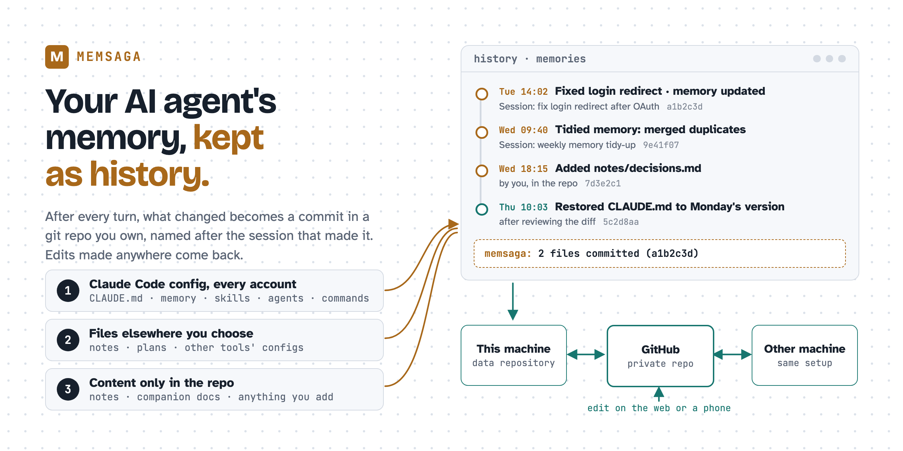
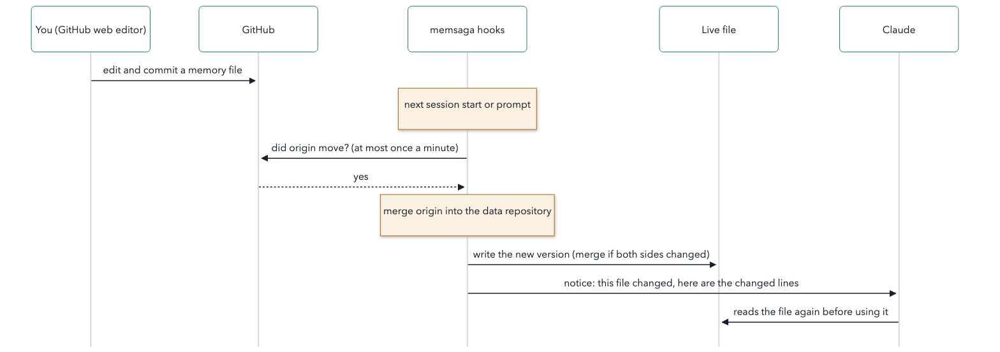

# memsaga

Version control and two-way sync for your AI coding agent's files, starting
with Claude Code: what it remembers, how you configure it, and anything else
you choose.

**Website:** [memsaga.grimmer.io](https://memsaga.grimmer.io) ·
[Try it first](#try-it-first) · Install ([with Claude Code](#install-with-claude-code) or
[by hand](#install-by-hand)) · [Do you need it?](#do-you-need-memsaga) ·
[FAQ](docs/faq.md) ·
[Discussions](https://github.com/grimmerk/memsaga/discussions)

<picture>
  <source media="(prefers-color-scheme: dark)" srcset="docs/assets/hero-dark.png">
  
</picture>

Claude Code writes what it learns about you and your projects into Markdown
files on your machine (its auto memory), next to your `CLAUDE.md`
instructions and your skills. These files have no history, and they live only
on the machine that wrote them. A later session can rewrite a memory, two
sessions that edit the same file on one day leave no trace of the earlier
version, and a clean-up that merges ten memories into three cannot be undone.
(A `CLAUDE.md` inside a repository is versioned with that repository; your
global `~/.claude/CLAUDE.md` and the memory files are not.)

memsaga keeps them as history:

```text
① Claude writes or changes a memory, CLAUDE.md or a skill
        │
② when Claude's reply ends (a turn), a memsaga hook copies what changed into a git
  repository you own (the data repository) and commits it, named after the
  conversation
        │
③ with an `origin` remote (on GitHub, for example), the commit is pushed
  there on its own; your other machines pull it, and an edit made on another
  machine or on GitHub reaches the live file (the one Claude Code reads)
```

When each step runs, and how to change it: [Timing](#timing).

Status: early, in daily use by its author on macOS; Linux is tested in CI and
in a container. Claude Code is the only source today; other agents and
sources are on the [roadmap](#roadmap).

<details>
<summary><b>New to Claude Code's memory?</b> The two kinds, and how a memory gets written</summary>

Claude Code keeps two kinds of memory, both plain Markdown files on your
machine ([Anthropic's docs](https://code.claude.com/docs/en/memory)):

| | `CLAUDE.md` | Auto memory (Claude Code's own name for it) |
|---|---|---|
| Who writes it | You, or Claude when you ask ("add this to CLAUDE.md") | Claude: when you ask it to remember something, and on its own from your corrections and preferences |
| Where | `~/.claude/CLAUDE.md` for every project, and `CLAUDE.md` in a repository | `~/.claude/projects/<project>/memory/`: a `MEMORY.md` index and one file per memory |
| Loaded | The whole file, every session | The first 200 lines (or 25 KB) of `MEMORY.md` every session; each memory file when Claude needs it |

Two ways a memory gets written:

```text
you:          Remember that the API tests need a local Redis.
Claude:       writes memory/api_tests.md, and adds a line for it to MEMORY.md
Claude Code:  Saved 1 memory

you:          No, we only deploy on Fridays, from a git tag.
Claude:       decides this is worth keeping, writes memory/deploy_rules.md
Claude Code:  Saved 1 memory
```

Claude decides what is worth keeping, so not every session saves something.
A session next week loads `MEMORY.md`, sees the line for `deploy_rules.md`,
and reads that file before it answers how to deploy. Claude also reads your
skills from `~/.claude/`, and Claude Code runs the hooks `settings.json` points
at.

</details>

## Contents

- [What goes into the data repository](#what-goes-into-the-data-repository)
- [Do you need memsaga?](#do-you-need-memsaga)
- [Quick start](#quick-start): [try it first](#try-it-first), [with Claude Code](#install-with-claude-code) or [by hand](#install-by-hand)
- [What you can do with it](#what-you-can-do-with-it)
  - Claude Code's config directory
    1. [See what Claude remembered, and when it changed](#1-see-what-claude-remembered-and-when-it-changed)
    2. [Undo a bad edit or a memory clean-up](#2-undo-a-bad-edit-or-a-memory-clean-up)
    3. [Ask Claude about the history](#3-ask-claude-about-the-history)
    4. [Start with the history you already have](#4-start-with-the-history-you-already-have)
  - Files elsewhere, and content only in the repository
    5. [Version any file Claude edits for you](#5-version-any-file-claude-edits-for-you)
    6. [Add your own files to the repository](#6-add-your-own-files-to-the-repository)
    7. [Companion docs: notes beside a repository, never committed to it](#7-companion-docs-notes-beside-a-repository-never-committed-to-it)
  - Everywhere you work
    8. [Two Claude Code accounts](#8-two-claude-code-accounts)
    9. [Two machines](#9-two-machines)
    10. [Edit from anywhere](#10-edit-from-anywhere)
  - Going further
    11. [Let Claude reorganise its memory, safely](#11-let-claude-reorganise-its-memory-safely)
- [What memsaga does not cover, and what to use instead](#what-memsaga-does-not-cover-and-what-to-use-instead)
- [How it works](#how-it-works), and [timing](#timing): when it commits, pushes and checks for edits
- [When something looks wrong](#when-something-looks-wrong)
- [Reference](#reference): [commands](#commands), [what is mirrored](#what-is-mirrored), [memory directory names](#memory-directory-names), [configuration](#configuration), [two-way sync](#two-way-sync), [commit messages](#commit-messages), [updating](#updating), [uninstalling](#uninstalling), [setting up another machine](#setting-up-another-machine)
- [Tests](#tests) · [Roadmap](#roadmap) · [The name](#the-name)

More documents: [FAQ](docs/faq.md) (other ways to keep this history,
compared) · [`docs/architecture.md`](docs/architecture.md) (for contributors) ·
[`docs/two-way-sync.md`](docs/two-way-sync.md) (design and measurements of
two-way sync) · [`docs/design.md`](docs/design.md) (the design record).

Pictures: the image at the top; a recording in
[use case 1](#1-see-what-claude-remembered-and-when-it-changed); a sequence
diagram and a recording in [use case 10](#10-edit-from-anywhere).

## What goes into the data repository

memsaga keeps one git repository you own, the data repository, and fills it
from three places, told apart by where a file lives:

1. **Claude Code's config directory** (`~/.claude`). What Claude Code reads
   and writes there: memory, `CLAUDE.md`, skills, hooks, scripts and (if you
   want) `settings.json`, plus folders of your own such as drafts or
   hand-written mods, once you list them in `dirs`. They are mirrored without changing where they live or how
   Claude Code writes them.
2. **Files elsewhere that you choose.** A notes file, a plan in your home
   directory, a dotfile: whoever edits it, you or Claude, the change is
   committed.
3. **Content that lives only in the repository.** It is a normal git
   repository: add notes, companion documents (your notes, translations or
   drafts about other repositories), anything else; edit and push from
   anywhere. memsaga commits what you add and never deletes it.

One repository can hold every Claude Code account and machine you use, and
each commit names the conversation that made it.

## Do you need memsaga?

**Maybe not.** If you use Claude Code with one account on one computer, a
do-it-yourself setup gets you most of the history:

1. Turn `~/.claude` into a git repository, a folder whose history git keeps
   (`git init`).
2. Add a `.gitignore` that lets in only what you want kept (memory,
   `CLAUDE.md`, skills) and keeps out conversations and credentials.
3. Add a hook that commits at the end of every reply (a `Stop` hook).

memsaga does this for you, with nothing to write yourself, and also handles
what that setup cannot easily handle:

| | Do it yourself | memsaga |
|---|---|---|
| Which files are kept | A list you write and keep up to date | The files Claude Code reads or runs (`CLAUDE.md`, memory, skills, subagents, commands, rules, hooks), from Claude Code's own directory reference. Credentials, conversations and caches stay out |
| Where the history lives | In `~/.claude` itself, so one `git checkout` or `git clean` there, or a merge conflict, changes the files Claude is reading | In a normal folder you choose, away from the files Claude is using (by default `memories` in the folder where you keep code). Its `index.md` lists every project by its real folder, so it is easy to browse in Finder, an editor or Obsidian |
| Files outside `~/.claude` | Not covered | Any file you name, such as a plan in your home directory or another tool's config file, whoever edits it; folders of your own inside `~/.claude` too ([use case 5](#5-version-any-file-claude-edits-for-you)). Whole folders outside `~/.claude` are not supported yet ([#20](https://github.com/grimmerk/memsaga/issues/20)) |
| An edit made on GitHub, a phone or another computer | Comes back through a `git pull` that writes straight into the files in use; a conflict leaves git's markers in a file Claude reads | Brought to the live file for you, keeping the edits of both sides. If both changed the same line, memsaga stops and tells you. Claude is told what changed ([use case 10](#10-edit-from-anywhere)) |
| More than one account or computer | A second account needs a second repository | Every account in one repository; another computer picks up changes the next time you use Claude there ([use cases 8](#8-two-claude-code-accounts) and [9](#9-two-machines)) |
| Which conversation made a change | Not recorded, unless your hook adds it | Every commit names it, and `claude --resume` reopens it while Claude Code still keeps the conversation ([use case 1](#1-see-what-claude-remembered-and-when-it-changed)) |
| History from before you started | None | Rebuilt from the edits recorded in Claude Code's saved conversations ([use case 4](#4-start-with-the-history-you-already-have)) |
| Your own documents about other projects | No place for them | A note, translation or draft that must not go into the project's own repository (your employer's, say) is filed by project and file under `companion/`, so a later conversation finds it ([use case 7](#7-companion-docs-notes-beside-a-repository-never-committed-to-it)) |

Other ways to do this, compared, and the do-it-yourself setup step by step:
[FAQ](docs/faq.md).

## Quick start

You need macOS or Linux, git and Claude Code. `gh` (the GitHub command-line
tool) is optional, for creating the GitHub repository.

| Way | What happens |
|---|---|
| [Try it first](#try-it-first) | Look at a week of example history on GitHub, or build it on your machine without touching your own setup |
| [Install with Claude Code](#install-with-claude-code) | Claude Code runs the install steps and asks before each one |
| [Install by hand](#install-by-hand) | You run the same steps yourself, one command at a time |

**A second machine for a data repository you already have?** Follow
[Setting up another machine](#setting-up-another-machine) instead. Running
`init` there would start a second, separate history.

### Try it first

To look without installing anything, browse
[grimmerk/memsaga-example](https://github.com/grimmerk/memsaga-example): a
data repository with a week of example commits (a bug fix, a memory tidy-up,
companion documents, a file added by hand, a restore).

To try the commands on that example, install memsaga (step 1 below), then run
`demo/setup.sh` from a clone of this repository. It builds a fake home
directory under `/tmp` with a Claude Code config, two projects' memory and the
same week of history, and never reads or writes your real one;
`source /tmp/memsaga-demo/env.sh` then points `memsaga` and `git` at it, in
that terminal only. Open a new terminal before you set up your own.

### Install with Claude Code

Paste this prompt into Claude Code:

```text
Install memsaga for me. Follow
https://raw.githubusercontent.com/grimmerk/memsaga/main/INSTALL-WITH-CLAUDE.md
and ask me before each step that changes my machine.
```

Claude checks what you have, then runs the steps of
[Install by hand](#install-by-hand) and asks before each one, including where
the data repository goes. [INSTALL-WITH-CLAUDE.md](INSTALL-WITH-CLAUDE.md) is
the file it follows. It also lists the permission prompts seen in a test run:
none in auto mode, 11 in manual mode. To read each command before anything
runs, install by hand instead.

### Install by hand

Run the steps one at a time; each block below is one step.

1. Install the prebuilt binary (Apple silicon and Intel Macs, Linux on x86_64
   and arm64) into `~/.cargo/bin`. Other ways to install are
   [further down](#other-ways-to-install).

   ```sh
   curl --proto '=https' --tlsv1.2 -LsSf \
     https://github.com/grimmerk/memsaga/releases/latest/download/memsaga-installer.sh | sh
   ```

   The installer adds `~/.cargo/bin` to your `PATH` for new terminals only.
   Open a new terminal, or run `source ~/.cargo/env`, before the next step.

2. See where the data repository would go, what would be imported, and how
   much history can be replayed. Nothing is written:

   ```sh
   memsaga init --dry-run
   ```

   Check three things before step 3:

   - **Where the data repository goes:** by default a folder named `memories`
     in the folder where you keep code, for example `~/git/memories`. To put
     it elsewhere, add `--repo <path>` to `memsaga init` in step 3;
     [where the data repository goes](#where-the-data-repository-goes) has
     the rules.
   - **The dry run's `root …` lines** list the Claude Code config folders it found. If
     one you use is missing (you run Claude Code with `CLAUDE_CONFIG_DIR`, or
     a second account), see [Which config directories](#which-config-directories).
   - **A project to keep out entirely**, for example client work: exclude it
     now, since what step 3 commits stays in the history. Add a line to
     `~/.config/memsaga/config.toml` with the project's Claude Code directory
     name, as the dry run lists it. For `~/git/client` and every project below
     it (and any sibling whose name starts with `client-`):
     `exclude_projects = ["*-git-client", "*-git-client-*"]`.

3. Create the data repository, replay the history and import the current
   state, then register the hooks in each Claude Code config directory.
   `--skills` also adds the bundled skills that use cases 3 and 7 use; leave
   it out if you do not want them. It writes the folders `memsaga-history`,
   `companion-docs` and `companions` under `skills/`, replacing any folder of
   the same name, so rename one first if you already have it:

   ```sh
   memsaga init
   memsaga install --skills
   ```

4. Optional: a private GitHub repository, so the history is backed up and
   synced between machines. Any name works; `gh` needs `gh auth login` once:

   ```sh
   gh repo create memories --private --source "$(memsaga repo)" --push
   ```

   Without `gh`, create an empty private repository on GitHub, then run
   `git -C "$(memsaga repo)" remote add origin <its URL>` and
   `git -C "$(memsaga repo)" push -u origin HEAD`.

5. Check the last sweep, pending changes and push state:

   ```sh
   memsaga status
   ```

### After the install

Nothing else is needed. Every turn that changed something in scope ends with a
commit, and the terminal shows a one-line notice. Once the data repository has
an `origin` remote (optional step 4 above), pushes happen on their own
([timing](#timing); `memsaga push` pushes now); without one, the history stays
on this machine.

**Keep the data repository private.** Memory holds whatever Claude learned
while working with you, which often includes details of your work. The default
scope leaves out `~/.claude.json` (where Claude Code keeps its login),
credentials and transcripts, and takes `settings.json` only if you ask. memsaga
does not scan what it copies for secrets, so keep credentials out of anything
you add to `files`, `dirs` or `extra_files`. To keep a project's memory out
entirely, exclude it before `init` (step 2 above); excluding it later stops
new commits but does not remove what is already in the history.

### Other ways to install

- **From source**, with Rust's `cargo` (Rust 1.88 or later):
  `cargo install memsaga --locked` from crates.io, or
  `cargo install --git https://github.com/grimmerk/memsaga memsaga --locked`
  for the latest `main`.
- **Without piping a script into `sh`:** download the archive for your
  platform from the [Releases page](https://github.com/grimmerk/memsaga/releases/latest)
  and put `memsaga` on your `PATH`. On macOS a browser marks the download as
  quarantined, and the binary is not notarized, so clear the mark once:
  `xattr -d com.apple.quarantine memsaga`.

## What you can do with it

Use cases 1 to 4 work right after the quick start (3, and 7 below, use the
bundled skills from `memsaga install --skills`). 5 to 7 add files of your own.
8 to 10 are about working in more than one place. 11 is one example of what a
full history makes safe to try.

The examples use `~/git/webapp` for a project of yours. If you keep code
somewhere else, read `~/git` as that folder. In the data repository, that
project's memory is the folder `claude/memory/HOME-git-webapp/`
([memory directory names](#memory-directory-names) explains the name), and
`index.md` at the top of the data repository lists the folder of each of your
projects.

None of them needs you to know git. `memsaga restore` shows the change and
asks before it writes anything, and with the bundled skills you can ask Claude
instead: "what did CLAUDE.md say about testing last week?" The git commands
below are there for those who want them.

### 1. See what Claude remembered, and when it changed


Every memory file, skill and your global `CLAUDE.md` gets a normal git history,
in the data repository:

```sh
cd "$(memsaga repo)"
git log -p -- claude/CLAUDE.md
git log -p --follow -- claude/memory/HOME-git-webapp/MEMORY.md
```

Each commit says which session changed what, in which directory and account
(see [commit messages](#commit-messages)):

```
[fix login redirect after OAuth] claude:memory:HOME-git-webapp

1 file changed, 4 insertions(+)
A	claude/memory/HOME-git-webapp/auth-flow.md

Event: Stop
Account: claude
Session: 08ad5ab3-28b7-4d51-bfeb-4cd32a95b22c
Cwd: /Users/me/git/webapp
Agent: main
Session-Title: fix login redirect after OAuth
```

The title and ID work in both directions:

- **From a change to the conversation.** The `Session:` line is the session ID.
  Its transcript is `~/.claude/projects/<slug>/<session>.jsonl`, and
  `claude --resume <session>`, run in the `Cwd:` directory, reopens it.
- **From a conversation to its changes.** Everything one session changed:
  `git -C "$(memsaga repo)" log -p --grep 'Session: <session>'`. By title, when
  you remember the topic but not the session:
  `git -C "$(memsaga repo)" log --grep 'Session-Title: .*login'`.

Claude Code deletes transcripts after 30 days by default; raise
`cleanupPeriodDays` in `settings.json` to keep them longer. The commits stay
either way.

Three more questions that git answers directly:

- **Why is this line in `CLAUDE.md`?**
  `git -C "$(memsaga repo)" blame claude/CLAUDE.md` gives the commit of each
  line, and that commit's `Session:` line gives the conversation.
- **When was a sentence added, or removed?**
  `git -C "$(memsaga repo)" log -S 'run the tests first' --oneline`
- **What changed this week?**
  `git -C "$(memsaga repo)" log --since=1.week --stat`

You also see changes as they happen. After a turn that committed, the terminal
shows one line such as `memsaga: 2 files committed (a1b2c3d)`, so a memory
Claude wrote on its own does not go unnoticed. Claude Code prints it as
`Stop says: memsaga: …`: the prefix is Claude Code's, naming the hook that runs
at the end of a turn (`Stop`). `reporter = false` turns the line off. For one
commit per edit instead of one per turn, set `granularity = "edit"`.

The repository is also easy to read on GitHub: `index.md` lists every project
with its real directory, and the memory files already use frontmatter and
`[[wikilinks]]`, so the repository opens as an Obsidian vault too.

### 2. Undo a bad edit or a memory clean-up

`memsaga restore` copies a file from history back to its live location. It
shows the diff first and asks before it writes. Three examples; run one at a
time, since each waits for your answer:

```sh
memsaga restore claude/memory/HOME-git-webapp/notes.md --at HEAD~3

# any git revision; the live path works too
memsaga restore ~/.claude/CLAUDE.md --at a1b2c3d

# every mirrored file as it was then
memsaga restore --all --at a1b2c3d
```

A deleted file comes back the same way. `--all` overwrites the files that
differ and never deletes anything.

### 3. Ask Claude about the history

`memsaga install --skills` adds the `memsaga-history` skill to each config
directory. Then questions such as "what did CLAUDE.md say about testing last
week?" or "when did this memory change, and why?" are answered from the
history: the skill knows the repository layout and the git commands, and it
restores a file only after you say yes.

### 4. Start with the history you already have

The first `memsaga init` reads your Claude Code session transcripts and replays
the edits they record as dated commits, so the repository starts with weeks of
history instead of a single snapshot. `memsaga init --dry-run` shows how much
can be replayed. (Transcripts only reach back as far as Claude Code keeps
them, 30 days by default.)

### 5. Version any file Claude edits for you

Claude often writes files outside its config directory: a plan in your home
directory, notes about a repository that you do not want to commit to it, a
config file it fixed. List each such file in `extra_files`, and memsaga commits
every change to it at the end of the turn, whoever made it:

```toml
extra_files = ["~/notes/plan.md", "~/.config/starship.toml"]
```

The copy is stored under `extra/` by its real path, is never deleted by
memsaga, and gets edits made elsewhere like any other file (use case 10). For a
group of files, make a folder under the config directory (for example
`~/.claude/drafts/`) and add it to `dirs`. The same goes for hand-written
Claude Code mods: add `"mods"` and their source is versioned and synced like
your skills, and add `"mods/*/.claude-plugin/types"` (the folder the mod engine
regenerates) to `exclude_paths`. Setting either key replaces its default list,
so start from the defaults in [configuration](#configuration) and append:

```toml
dirs = ["skills", "commands", "agents", "agent-memory", "rules", "output-styles",
        "themes", "workflows", "hooks", "scripts", "drafts", "mods"]
exclude_paths = ["skills/synced", "skills/.trash", "mods/*/.claude-plugin/types"]
```

Whole folders outside the config directory are not supported yet
([#20](https://github.com/grimmerk/memsaga/issues/20)); until then, list their
files one by one, or keep the folder under the config directory and add it to
`dirs`, as above. A folder listed in `extra_files` is skipped, and
`memsaga status` and `memsaga config` say so.

### 6. Add your own files to the repository

The data repository is a normal git repository, so it can hold anything else
you want versioned next to your agent's files: reference notes, prompts you
reuse, a log of decisions. Put files at the top level, outside the account
folders such as `claude/` (for example in a `manual/` folder). The next sweep
commits them, or commit them yourself; memsaga never deletes what it did not
copy. You can also commit and push from another machine or edit in GitHub's
web editor. An edit to a mirrored file made in the repository, say to
`claude/CLAUDE.md`, is not overwritten: it goes to the live file (use case 10).

### 7. Companion docs: notes beside a repository, never committed to it

Some documents belong with a repository but must not be committed to it: a
translation of its docs, your annotated copy, a draft written before the source
exists, a note about the repository as a whole. Ask Claude for one in any
language, and the `companion-docs` skill puts it at
`<data repository>/companion/<repo>/<path>`, keyed by the source file's path
(a note goes under `companion/<repo>/_notes/`), so it is versioned and synced
with the rest of your memory. Before Claude summarises or translates a
document, the skill has it check for an existing companion. `memsaga companions
[repo]`, or `/companions` in a session, lists them with the status and source
recorded in each one's frontmatter. That frontmatter uses the fields of the
[Open Knowledge Format](https://github.com/GoogleCloudPlatform/open-knowledge-format)
(OKF, a Google Cloud specification for markdown knowledge files): `type`,
`title` and `description`, a translation's source file and commit in
`sources`, who wrote it in `generated`, and `status` (`draft`, `stable` or
`deprecated`), so any tool that reads OKF can read a companion. Memory files, skills and `CLAUDE.md` keep their own formats. The
example repository has
[three of them](https://github.com/grimmerk/memsaga-example/tree/main/companion/webapp).

### 8. Two Claude Code accounts

If you run more than one account, each with its own config directory (for
example `~/.claude` and `~/.claude-work` through `CLAUDE_CONFIG_DIR`), list
each as a root in `~/.config/memsaga/config.toml`:

```toml
[[roots]]
path = "~/.claude"
label = "claude"

[[roots]]
path = "~/.claude-work"
label = "claude-work"
```

Each gets its own subtree in the repository (`claude/`,
`claude-work/`), and each commit's `Account:` line says which account made the
change. Files the second account shares through symlinks (a common pattern for
`CLAUDE.md` and `skills/`) are stored once, as relative symlinks.

[CodeV](https://github.com/grimmerk/codev), a macOS launcher for Claude Code
accounts, keeps a list of accounts. When your config names no roots, memsaga
reads that list if it exists, and otherwise uses `~/.claude`.

### 9. Two machines

Clone the data repository on the second machine and restore from it (the steps
are in [setting up another machine](#setting-up-another-machine)). After that
both machines commit and push. A push that GitHub rejects because the other
machine pushed first merges the other machine's commits and pushes again, and
their edits reach your live files as described in use case 10.

Everything in scope travels this way, not only memory: a skill, hook or script
written on one machine, and a hand-written Claude Code mod once its folder is in
`dirs`, reaches the other machine's disk at its next session start, or a
prompt or two later in a session already open there. Your global
`CLAUDE.md` stays the same on both.

A project shares its memory between machines when it sits at the same path
relative to the home directory on both, for example `~/git/webapp`, even when
the user names differ (see [memory directory names](#memory-directory-names)).

### 10. Edit from anywhere

You can fix a memory file in GitHub's web editor, on a phone, on another
machine, or by hand in the local clone. memsaga does not overwrite such an edit.
It brings it to the live file:

<picture>
  <source media="(prefers-color-scheme: dark)" srcset="docs/assets/sync-sequence-dark.png">
  
</picture>

In short:

1. When a session starts, and at each prompt, memsaga asks GitHub whether the
   repository moved.
2. If it moved, memsaga merges the change and writes it to the live file. Edits
   made on both sides are kept; when both sides changed the same lines, the
   file is left alone and you are told.
3. Claude gets a short notice with the changed lines, so it does not answer
   from the copy it loaded earlier.
4. Before Claude writes a file memsaga keeps, memsaga asks again, so the edit
   is not built on an old copy.

A real session (example data): just before it started, `deploys.md` was edited
on GitHub to say production deploys every Friday. Asked how webapp deploys,
Claude reads the file again and answers from the new text. (The notice under
the reply lists commits from earlier turns: it runs before this turn's
commit is written; see
[#41](https://github.com/grimmerk/memsaga/issues/41).)


All of this happens inside Claude Code sessions. Run it by hand when no
session will do it for you:

- **Before you use a machine that has been idle**, or before editing its live
  files outside Claude Code: `memsaga sync` (both directions) or
  `memsaga pull` (only inbound).
- **To push right away**, instead of waiting for the throttle or the end of
  the session, or when those pushes are turned off: `memsaga push`.
- **When a sync reports a conflict** (both sides changed the same lines):
  see [When something looks wrong](#when-something-looks-wrong).
- **When setting up another machine**: see
  [Setting up another machine](#setting-up-another-machine).

How often each step runs, and what Claude Code waits for: [timing](#timing).
What happens to a write that would replace text that just arrived:
[two-way sync](#two-way-sync).

### 11. Let Claude reorganise its memory, safely

Memory grows by small additions: facts repeat across files, old ones go stale,
a `MEMORY.md` index drifts from the files it lists. Asking Claude to clean
that up is risky when the only copy is the live one. With every version kept,
it becomes a routine you can run boldly, a "dream" pass over what was learned:

1. Now and then, by hand or on a schedule, start a session with a prompt such
   as "read every file under `~/.claude/projects/*/memory/`, merge duplicates,
   drop what is no longer true, and keep `MEMORY.md` in step with the files".
2. Its edits land as ordinary commits, marked with that session's ID and title
   (use case 1). Review them like any change:
   `git -C "$(memsaga repo)" log -p --grep 'Session: <id>'`.
3. Keep what helps. Undo the rest one file at a time with `memsaga restore`, or
   everything with `memsaga restore --all --at <commit before the pass>`.
   `--all` never deletes, so a file the pass created stays until you remove it.

The same holds for any bold edit: a rewrite of `CLAUDE.md`, a skills refactor,
a new hook. Try it, read the diff, keep it or roll it back.

## What memsaga does not cover, and what to use instead

| What | Why memsaga leaves it | What to use instead |
|---|---|---|
| Session transcripts | Large, and mostly the content of your work rather than configuration | Raise `cleanupPeriodDays` in `settings.json` so Claude Code keeps them longer. To search or archive them, use a transcript indexer such as [funes](https://github.com/huggingface/funes) or [fable](https://github.com/grooverLab/fable) |
| Plugins installed from a marketplace | They are packages you can install again, not files you wrote | Install them again; with `settings.json` mirrored (opt-in, `files`), its `enabledPlugins` list records which ones |
| Hand-written Claude Code mods | Not in the default scope | Add `"mods"` to `dirs` (use case 5) to version and sync them; give a mod you share or develop seriously its own git repository too, since one commit per turn is a backup, not a development history |
| Credentials, OAuth tokens, `~/.claude.json` | Secrets and account state must never enter a repository | Your system keychain or a password manager |
| `settings.json` keys that change all the time (`model`, `effortLevel`) | Claude Code rewrites them on every `/model` and `/effort` | Nothing: memsaga leaves them out of the repository and keeps each machine's own values (`settings_ignore_keys`) |

## How it works

- **Hooks.** `memsaga install` registers memsaga in each config directory's
  `settings.json`. `PostToolUse` marks a turn that wrote a file, `Stop` copies
  and commits at the end of the turn, and `SessionEnd` pushes. `SessionStart`,
  `UserPromptSubmit` and `PreToolUse` bring in edits made elsewhere (use case 10).
- **Mirror.** The repository holds copies. Claude Code keeps reading and
  writing its own files in place; memsaga writes live files only when you
  restore, or when an edit made elsewhere arrives.
- **Cost.** A turn that changed nothing in scope costs a check of modification
  times. A turn that did costs a copy and a commit, well under a second, and
  runs in the background. Asking GitHub whether the repository moved costs
  about half a second ([timing](#timing)).
- **Safety.** One lock serialises concurrent sessions. A hook never fails a
  turn: errors go to a log and to `memsaga status`.

More: [`docs/architecture.md`](docs/architecture.md).

### Timing

When memsaga commits, pushes and checks for edits made elsewhere. Without an
`origin` remote, memsaga uses no network: it commits, and an edit you make by
hand in the data repository still comes in, at the next prompt or before
Claude reads or writes that file.

| What | When | How to change it |
|---|---|---|
| Commit | At the end of each turn that changed a file in scope, in the background | `granularity = "edit"`: one commit per Write or Edit instead |
| Push | At the end of a turn, at most once every ten minutes. A push that falls inside those ten minutes is not dropped: it runs when they are up. When a session ends, it pushes right away, unless `push_on_session_end` is off | `push_min_interval_secs` (default `600`; `0` turns the end-of-turn push off), `push_on_session_end` (default `true`); `memsaga push` pushes now |
| Check GitHub for edits made elsewhere | When a session starts (Claude Code waits for the answer, about half a second). At each prompt, and when Claude reads a file memsaga keeps, the check runs in the background and its answer is used from the next prompt on. At most once a minute for the whole machine | `memsaga sync` or `memsaga pull` checks and brings edits in now |
| Check again before a write | Before Claude writes or edits a file memsaga keeps, unless the last check is less than ten seconds old. Claude Code waits for it | — |
| Bring an edit in | Right after the check at session start. Otherwise, once a check has found it: at the next prompt, or before Claude reads or writes that file. It is merged into the live file before Claude uses it, and a session that already read the old text gets a notice | — |

## When something looks wrong

- `memsaga status` shows the last sweep, the push state (a failed or deferred
  push, and why), files waiting to come in from elsewhere, and a missing config
  file. It also lists where this machine differs from the repository: files
  it never had (kept, not deleted), a folder where the repository has a link
  (nothing under it is mirrored, so nothing is written through the link),
  folders the repository has that this machine's config does not mirror, and
  scripts that `settings.json` runs but this machine lacks.
- A hook never stops a turn. Its errors go to
  `<data repository>/.git/memsaga/memsaga.log`,
  and every sweep, push and merge to `events.jsonl` next to it.
- `memsaga diff` shows what the next sweep would commit; `memsaga sweep`
  commits now.
- An edit from elsewhere that conflicts with yours waits, and `memsaga sync`
  reports it. Pick a side with `memsaga sync --take live <path>` or
  `--take repo <path>`, or edit the live file and run `memsaga sync` again.
- To stop, `memsaga uninstall` removes the hooks. The repository and its
  history stay.
- Questions and ideas go to
  [GitHub Discussions](https://github.com/grimmerk/memsaga/discussions); a bug
  goes to [Issues](https://github.com/grimmerk/memsaga/issues).

## Reference

### Commands

| Command | What it does |
|---|---|
| `memsaga init [--dry-run] [--repo <path>] [--no-backfill]` | Create the data repository, replay history from session transcripts, import the current state; records the location in the config file. `--dry-run` only prints the location, what would be imported and how much can be replayed |
| `memsaga status [--json]` | Last sweep, pending dirty marker, push state (including a failing or deferred push), a missing config file, where this machine differs from the repository (files it never had, a folder where the repository has a link, folders its config does not mirror, missing hook scripts), recent events; `--json` prints the same as one object for scripts and tools. Read-only |
| `memsaga log [-n <count>]` | Recent commits |
| `memsaga diff [--stat]` | What the next sweep would commit (refreshes the mirror, commits nothing) |
| `memsaga restore <path> [--at <rev>] [-y]` | Copy one file from history back to its live location, diff first |
| `memsaga restore --all --at <rev> [--prune] [-y]` | Every mirrored (in-scope) file of every root as it was at `<rev>`: overwrites what differs, never deletes, recreates links as they are (never writes through one), keeps the live `settings_ignore_keys`; shows the diffs, one confirmation. Lists live files in scope that `<rev>` does not have; `--prune` moves them to `<data repository>/.git/memsaga/stale/<time>/` instead of leaving them. Before asking, also names folders the repository has that this machine's config does not mirror, and scripts `settings.json` runs that this machine lacks |
| `memsaga sweep` | Mirror and commit now |
| `memsaga push` | Push to `origin` now (pushes also happen on `Stop`, throttled, and on `SessionEnd`); a push rejected because origin moved merges origin first |
| `memsaga sync [--take live\|repo <path>]` | Both directions: commit live changes, merge origin, bring repository-side edits to the live files, commit, push |
| `memsaga pull [--check] [--path <file>]` | Inbound only (what the hooks run); `--check` asks whether origin moved, throttled across sessions |
| `memsaga paths` | Claude Code's project directory names (as in `~/.claude/projects/`) and the real folders they stand for |
| `memsaga config` | The effective configuration |
| `memsaga repo` | The data repository's path and nothing else, for commands such as `cd "$(memsaga repo)"` or `open "$(memsaga repo)"`; fails before `init` |
| `memsaga companions [repo]` | List companion documents (status, path, source); `/companions` in a session prints the same |
| `memsaga install [--skills] [--skill <name>] [--root <dir>] [--no-hooks]` | Register the hooks in each config directory (or only the `--root` ones); `--skills` also writes the bundled skills (`memsaga-history`, `companion-docs`, `companions`), `--skill` one of them; `--no-hooks` leaves `settings.json` alone |
| `memsaga uninstall [--root <dir>]` | Remove the hooks (from each config directory, or only the `--root` ones): every hook entry whose command contains `memsaga`, including one of your own |
| `memsaga backfill` | Replay session transcripts into dated commits; `init` does this once |

Paths for `restore` can be repository-relative (`claude/memory/<name>/x.md`)
or the live path. A shorter command name is one alias away:
`alias mem=memsaga`.

### What is mirrored

Per config directory (root), by default, what you write there that Claude Code
reads ([its directory reference](https://code.claude.com/docs/en/claude-directory)):
`CLAUDE.md`, `keybindings.json`, `skills/`, `commands/`, `agents/`,
`agent-memory/`, `rules/`, `output-styles/`, `themes/`, `workflows/`, and every
non-empty `projects/<slug>/memory/`. Also `hooks/` and `scripts/`, which Claude
Code does not read itself but which hold what `settings.json` points at by
convention. A folder you add yourself, such as `drafts/` or hand-written
`mods/`, goes in `dirs`. `settings.json` is opt-in
(`files = ["CLAUDE.md", "keybindings.json", "settings.json"]`). Never:
transcripts, `~/.claude.json`, caches, `file-history`, plugins, and Claude
Code's own synced skills under `skills/synced/` and `skills/.trash/`.

Repository layout:

```
<data repository>/
  claude/CLAUDE.md
  claude/skills/…  claude/hooks/…  claude/scripts/…
  claude/memory/<name>/{MEMORY.md, *.md}   <name>: see the next section
  claude-work/…                      second account; shared files stay symlinks
  index.md                           generated table of every project
  paths.json                         memory name → real working directory (~ for home)
  memsaga/config.toml                this config file, mirrored automatically
  extra/home/…  extra/root/…         extra_files, by their real path
  companion/  manual/  …             yours: committed, never deleted by the tool
```

### Memory directory names

A project's memory directory is named after its path. Claude Code's own name
(the "slug") is the absolute path with every non-alphanumeric character
replaced by `-` (`/Users/me/git/webapp` → `-Users-me-git-webapp`). In the
repository, a project under the home directory drops the home and starts with
`HOME` (`HOME-git-webapp`), so machines with different homes (another user
name, Linux's `/home/...`) share one directory per project. Anything outside
home keeps Claude Code's name.

One exception: if another directory on the machine encodes like a path under
home (`/Users/me-old` next to `/Users/me`), memsaga cannot tell them apart and
keeps Claude Code's names on that machine.

### Configuration

`~/.config/memsaga/config.toml`. Every key has a default, and `memsaga config`
prints the effective values.

```toml
# where init put it (example); `memsaga repo` prints yours
repo = "~/git/memories"
files = ["CLAUDE.md", "keybindings.json"]
dirs = [
  "skills", "commands", "agents", "agent-memory", "rules",
  "output-styles", "themes", "workflows", "hooks", "scripts",
]
memory = true                    # each project's memory/ folder
# file names never copied; *.codev-* are CodeV's backup and temporary files
exclude = ["*.codev-bak*", "*.codev-tmp-*", ".DS_Store", "__pycache__"]
# left out of the mirrored settings.json: Claude Code rewrites them on
# every /model and /effort
settings_ignore_keys = ["model", "effortLevel", "modelSettings"]
exclude_projects = []            # slug globs
exclude_paths = ["skills/synced", "skills/.trash"]   # root-relative subtrees
# single files outside every root, e.g. "~/.config/codev/accounts.json"
extra_files = []
granularity = "turn"             # or "edit": one commit per Write/Edit
reporter = true                  # one-line notice in the terminal after a commit
# at most one push per interval on Stop; a throttled push is deferred to the
# end of the window, not dropped. 0 disables pushes on Stop
push_min_interval_secs = 600
push_on_session_end = true

[[roots]]
path = "~/.claude"
label = "claude"
```

#### Where the data repository goes

`init` creates a folder named `memories` inside the first of `~/git`,
`~/code`, `~/src`, `~/Projects` and `~/dev` that exists (for example
`~/git/memories`); when none of them exists, it creates `~/memories`. An
existing memsaga repository named `memories` in one of those places is used
first. It records the choice as `repo` in the config file, so it never moves.
`memsaga init --repo <path>` puts it anywhere else, and `init --dry-run` shows
the choice first. A folder of that name that already holds something else is
never taken over: `init` stops and asks for `--repo`. A git repository you
name yourself, such as a fresh clone of an empty GitHub repository, is used as
it is. Until `init` has run, the hooks and every other command leave all
folders alone. `memsaga repo` prints the path, and the commands in this README
use it, so they work wherever yours is.

#### Which config directories

memsaga mirrors each Claude Code config directory it knows (a root). Without
`[[roots]]` in the config file, it takes the account list of
[CodeV](#8-two-claude-code-accounts) (`~/.config/codev/accounts.json`) if
you use it (that list includes `~/.claude`), and otherwise `~/.claude`.

That search does not read `CLAUDE_CONFIG_DIR`, since hooks run in every
account's sessions and each would see different roots. If you run Claude Code
with `CLAUDE_CONFIG_DIR` set, run `init` where it is set (a terminal that
exports it, or a Claude Code session using it): `init` adds that folder and
records all roots as `[[roots]]` in the config file, so every session sees the
same ones. It does so only when the folder exists, is not already a root, and
the config file has no `roots` key (not even `roots = []`). The `root …` lines
of `init --dry-run` show the result.

To list roots yourself, write them before `init`. Listing roots turns off the
automatic search, so list `~/.claude` too if you also use it:

```toml
[[roots]]
path = "~/my-claude-config"   # the folder CLAUDE_CONFIG_DIR points to
label = "claude"

# only if you also use ~/.claude; each root needs its own label
[[roots]]
path = "~/.claude"
label = "claude-default"
```

`memsaga install`, `memsaga status` and `memsaga config` warn when
`CLAUDE_CONFIG_DIR` names a folder that is not a root, and print the lines to
add. A second account set up without `CLAUDE_CONFIG_DIR` in the shell where
you run `init` (for example `~/.claude-work`) is not found either: list it as
in [Two Claude Code accounts](#8-two-claude-code-accounts).

#### If the config file disappears

If the config file disappears while the data repository still holds its
mirrored copy, memsaga runs on its defaults: fewer files are mirrored, and
copies of files that drop out of scope are left in the repository. The
reporter prints a warning with the restore command after every turn until the
file is back.

### Two-way sync

An edit made outside the live files (in GitHub's web editor, on another
machine, or by hand in the local clone) is not overwritten by the next sweep.
It waits on a list (`memsaga status` shows it) until it is brought to the live
file. When only the repository changed, its version is written; when both
sides changed different lines (or made the same change), the texts are merged;
conflicting edits to the same lines are left alone and reported
([when something looks wrong](#when-something-looks-wrong) says how to settle
one). A file
deleted in the repository is deleted live when the live file was unchanged.
The other way round, a live file counts as deleted only on a machine that has
had it: a file the repository has but this machine never had (a fresh clone, a
folder another machine added to the config) is kept, and `memsaga status`
lists it.

Inside Claude Code sessions, the hooks of [use case 10](#10-edit-from-anywhere)
do this on their own, at the moments in [timing](#timing). Before a Write or
Edit, a change they find is brought in first: a Write that would replace text
that just arrived is refused, and Claude is told to read the file again; a
change that cannot be merged is refused and left to you.

Design and measurements: [`docs/two-way-sync.md`](docs/two-way-sync.md).

### Commit messages

The subject is `[<session title>] <areas>`, for example
`[fix login redirect after OAuth] claude:memory:HOME-git-webapp`. A title
longer than 32 characters is cut there and ends in `...`, so the subject stays
within 72; the `Session-Title:` line keeps
the whole title. The other lines: `Event:` (the hook or command), `Account:`
(from `CLAUDE_CONFIG_DIR`), `Session:` (the session ID), `Cwd:` and `Agent:`.
The prompt text is never copied into a commit. With no session title, the
subject starts with what made the commit instead: `Stop:` (a session with no
title yet), `backfill:` (history replayed from transcripts, which keeps each
edit's session ID and folder), `import:` (the snapshot `init` takes), `sync:`
or `manual:`. A commit made by a command you run yourself, such as
`memsaga sync`, belongs to no session, so `Session:` and `Cwd:` read `none`;
the merge memsaga makes when origin moved is just
`sync: merge origin/<branch>`.

### Updating

1. Run step 1 of [Install by hand](#install-by-hand) again: it
   downloads the latest release and replaces `~/.cargo/bin/memsaga`. If you
   built from source, add `--force` to the `cargo install` line. If you
   installed an archive from the Releases page, replace that binary with the
   new release's.
2. `memsaga install`, with `--skills` if you installed the bundled skills.
   It is safe to run again: it updates memsaga's own hook entries in place and
   adds any hook the new version needs. `--skills` overwrites the bundled
   skills; if you edited one, the old text is in the history.

To let Claude Code do both steps, paste the prompt from
[Install with Claude Code](#install-with-claude-code) with
"Update memsaga for me" in place of "Install memsaga for me".

`memsaga --version` shows what is installed. Running sessions need no restart:
every hook starts a new process, so the next one uses the new binary. If
several machines share one data repository, update them together.

### Uninstalling

For the usual setup (one config directory, `~/.claude`, and the install
script), these steps remove everything memsaga added. Run them one at a time.

1. Remove the hooks from every config directory; Claude Code stops
   committing. This removes every hook whose command contains the word
   `memsaga`, so rename a hook of your own that does first:

   ```sh
   memsaga uninstall
   ```

2. Remove the binary, the config file with the install script's receipt, and
   the file the install script wrote for the fish shell:

   ```sh
   rm ~/.cargo/bin/memsaga
   rm -r ~/.config/memsaga
   rm -f ~/.config/fish/conf.d/memsaga.env.fish
   ```

3. If you ran `memsaga install --skills`, remove the bundled skills. If you
   added files of your own to these folders, move them out first; `rm -rI`
   asks once before it removes anything:

   ```sh
   rm -rI ~/.claude/skills/memsaga-history ~/.claude/skills/companion-docs \
     ~/.claude/skills/companions
   ```

4. If you no longer need it, remove the copy of `settings.json` that
   `memsaga install` took before its first change. `rm -i` asks first:

   ```sh
   rm -i ~/.claude/settings.json.memsaga-bak
   ```

- Another config directory (a second account such as `~/.claude-work`, or
  a folder `CLAUDE_CONFIG_DIR` points to): repeat steps 3 and 4 with its path.
  Skip the skills when its `skills` is a link to `~/.claude/skills`.
- A binary from a downloaded archive: delete the copy you put on your
  `PATH`. Built with cargo: `cargo uninstall memsaga`.
- The install script also added the line `. "$HOME/.cargo/env"` to the shell
  startup files it found (on macOS usually `~/.zshenv` and `~/.profile`). If
  nothing else you use lives in `~/.cargo` (no Rust toolchain, no other
  `cargo install` tools), remove that line and the folder:

  ```sh
  for f in ~/.zshenv ~/.zshrc ~/.profile ~/.bashrc ~/.bash_profile ~/.bash_login; do
    [ -f "$f" ] && sed -i.bak '/\.cargo\/env/d' "$f"
  done
  rm -r ~/.cargo
  ```

  `sed -i.bak` keeps the previous version of each file as `<file>.bak`.

None of this touches the data repository or its copy on GitHub: they are your
history. Delete them yourself only if you no longer want it. Claude Code can
also do the steps above, asking before each one: paste the prompt from
[Install with Claude Code](#install-with-claude-code) with "Uninstall memsaga
for me" in place of "Install memsaga for me".

### Setting up another machine

Tested with the same user name and the same folder layout on both machines:

1. Install Claude Code and sign in once, so `~/.claude` exists. Create the
   directory of every other account in your config (for example
   `~/.claude-work`); a root that does not exist is skipped, with a count.
2. Clone the data repository to the same path as on the first machine
   (`memsaga repo` prints it there), and copy its config. Do **not** run
   `memsaga init` on the new machine: it would commit its empty state on top
   of your history.

   ```sh
   D=~/git/memories        # the path memsaga repo prints on the first machine
   git clone git@github.com:<you>/memories.git "$D"   # or: gh repo clone <you>/memories "$D"
   mkdir -p ~/.config/memsaga && cp "$D/memsaga/config.toml" ~/.config/memsaga/config.toml
   ```
3. Install memsaga (step 1 of [Install by hand](#install-by-hand)).
4. `memsaga restore --all --at HEAD`: read the list and the diffs, answer
   `n`; then run it again with `--yes`. Files get their content, executable
   bits and commit time back; links that share files between accounts are
   recreated, and so are links to another tool's folder, as they are, even
   when that folder is not on this machine yet. Nothing is deleted. Before
   it asks, the restore also names folders the repository has that your
   config does not mirror (copy the config, step 2), and scripts that
   `settings.json` runs but this machine lacks.
5. Verify: `memsaga sweep --event verify` should report `no changes`; then
   `memsaga diff --stat` should print `no changes since the last commit`. If
   the verify sweep commits anything, look at it with
   `git -C "$(memsaga repo)" show --stat` before you go on, and see the next
   paragraph.
6. Register the hooks, with `--skills` if you use the bundled skills:
   `memsaga install --skills`. From here on, Claude Code sessions on this
   machine commit and push.

**A machine that ran memsaga before** (an older data repository or config):
move the old data repository aside rather than deleting it, then do steps 2
to 6. Live files from before may still be there after the other machine
removed or moved them: a memory file moved to another project, a folder
that became a link. `restore --all` lists them as not in the repository and
leaves them, since on any other machine such a file may simply be new; add
`--prune` to move them to `<data repository>/.git/memsaga/stale/<time>/`
(nothing is deleted), which also lets a link come back where an old folder
stood. Until then a folder where the repository has a link is left alone by
every sweep, and `memsaga status` lists it.

If `settings.json` is in your `files` (it is not by default), restoring it
also registers the hooks, and step 6 finds them already there. The hooks may run
scripts from outside memsaga's scope (another tool's status hook, for
example); `restore` and `memsaga status` name any that this machine lacks.
Mirror such a script from the machine that has it (`files` or `dirs` for a
path in a config directory, `extra_files` for one elsewhere), or install the
tool that writes it. Do not remove the hook on the machine that lacks it: two-way
sync would remove it on every machine.

## Tests

`cargo test`. What the tests cover, and how the code is organised:
[`docs/architecture.md`](docs/architecture.md#tests).

## Roadmap

Plans, not promises:

- More sources: other coding agents that keep memory or instruction files on
  disk (Codex first: its opt-in memories under `~/.codex/memories/`,
  `AGENTS.md` and skills), whole folders outside the config directory
  ([#20](https://github.com/grimmerk/memsaga/issues/20)), and remote knowledge
  bases, such as a server hosting a tree of markdown documents.
- A Claude Code mod that shows the sync state in the status line, and later
  runs the hook work inside Claude Code instead of a new process per event.
- Folder aliases for machines whose project folders differ below home
  (`~/code` on one, `~/git` on the other).
- Files that belong to one machine only, kept per machine in the repository.

## The name

mem, for memory, and saga, from Old Norse for "story" or "history", the word
for the medieval Icelandic narratives that followed people and events across
generations. A repository of memory that keeps every version is the story of
how that memory came to be, one change at a time.

## License

MIT
