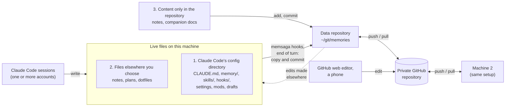
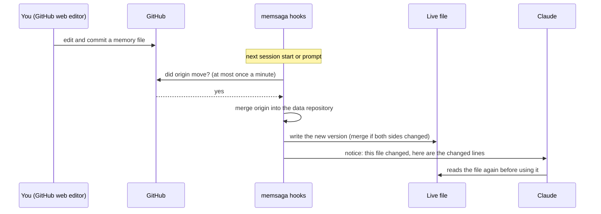

# memsaga

Version control and two-way sync for the files your AI coding agent works
with: what it remembers, how you configure it, and anything else you choose.

Claude Code keeps your global instructions in `~/.claude/CLAUDE.md`, writes
what it learns about each project into `~/.claude/projects/<slug>/memory/`,
and reads your skills, hooks and scripts from `~/.claude/`. None of that has
history. Two sessions that edit the same file on one day leave no trace of the
earlier version, and a memory clean-up that deletes or merges files is final.

memsaga keeps one git repository you own, the data repository, and fills it
from three places, told apart by where a file lives:

1. **Claude Code's config directory** (`~/.claude`). What Claude Code reads
   and writes there: memory, `CLAUDE.md`, skills, hooks, scripts and (if you
   want) `settings.json`, plus folders of your own such as drafts or
   hand-written mods. They are mirrored without changing where they live or how
   Claude Code writes them.
2. **Files elsewhere that you choose.** A notes file, a plan in your home
   directory, a dotfile: whoever edits it, you or Claude, the change is
   committed.
3. **Content that lives only in the repository.** It is a normal git
   repository: add notes, companion documents (translations or annotated
   copies of other repositories' docs), anything else; edit and push from
   anywhere. memsaga commits what you add and never deletes it.

At the end of every turn a hook copies what changed and commits it, one commit
per turn. Each commit names the session that made the change, by title and by
ID, so you can go from any change back to the conversation that caused it, and
from a conversation to everything it changed. The
repository can live on GitHub and be shared by several machines and Claude Code
accounts; an edit made in one place (another machine, GitHub's web editor, a
phone) reaches the live files everywhere else.



Status: early, in daily use by its author on macOS (CI also runs on Linux).
Claude Code is the only source today; other agents and sources are on the
roadmap. Contributor notes: [`docs/architecture.md`](docs/architecture.md).
Two-way sync: [`docs/two-way-sync.md`](docs/two-way-sync.md). Design record:
[`docs/design.md`](docs/design.md).

## Contents

- [Quick start](#quick-start)
- [What you can do with it](#what-you-can-do-with-it)
  - Claude Code's config directory
    1. [See what Claude remembered, and when it changed](#1-see-what-claude-remembered-and-when-it-changed)
    2. [Undo a bad edit or a memory clean-up](#2-undo-a-bad-edit-or-a-memory-clean-up)
    3. [Ask Claude about the history](#3-ask-claude-about-the-history)
    4. [Start with the history you already have](#4-start-with-the-history-you-already-have)
  - Files elsewhere, and content only in the repository
    5. [Version any file Claude edits for you](#5-version-any-file-claude-edits-for-you)
    6. [Add your own files to the repository](#6-add-your-own-files-to-the-repository)
    7. [Keep notes beside a repository without committing them](#7-keep-notes-beside-a-repository-without-committing-them)
  - Everywhere you work
    8. [Two Claude Code accounts](#8-two-claude-code-accounts)
    9. [Two machines](#9-two-machines)
    10. [Edit from anywhere](#10-edit-from-anywhere)
  - Going further
    11. [Let Claude reorganise its memory, safely](#11-let-claude-reorganise-its-memory-safely)
- [What memsaga does not cover, and what to use instead](#what-memsaga-does-not-cover-and-what-to-use-instead)
- [How it works](#how-it-works)
- [When something looks wrong](#when-something-looks-wrong)
- [Reference](#reference): [commands](#commands), [what is mirrored](#what-is-mirrored), [memory directory names](#memory-directory-names), [configuration](#configuration), [two-way sync](#two-way-sync), [commit messages](#commit-messages), [setting up another machine](#setting-up-another-machine)
- [Tests](#tests)
- [Roadmap](#roadmap)
- [The name](#the-name)

Diagrams: the overview above (where files flow), and one in
[use case 10](#10-edit-from-anywhere) (what happens when a file changed
elsewhere).

## Quick start

You need macOS or Linux, git, Rust (`cargo`) and Claude Code. `gh` (the GitHub
command-line tool) is optional, for creating the GitHub repository.

```sh
cargo install --git https://github.com/grimmerk/memsaga memsaga --locked
memsaga init --dry-run    # what would be imported, and how much history can be replayed
memsaga init              # create ~/git/memories, replay history, import the current state
memsaga install           # register the hooks in each Claude Code config directory
gh repo create memories --private --source ~/git/memories --push   # optional: a private remote
memsaga status            # last sweep, pending changes, push state
```

From then on nothing else is needed. Every turn that changed something in
scope ends with a commit, and the terminal shows a one-line notice. Pushes
happen on their own, at most once every ten minutes and at the end of a
session.

**Keep the data repository private.** Memory holds whatever Claude learned
while working with you, which often includes details of your work. memsaga
never copies credentials, `~/.claude.json` or transcripts, and copies
`settings.json` only if you ask. To keep one project's memory out entirely,
for example client work, exclude it by its Claude Code directory name:
`exclude_projects = ["*-git-client-*"]`.

## What you can do with it

Use cases 1 to 4 work right after the quick start (3 also needs
`memsaga install --skills`). 5 to 7 add files of your own. 8 to 10 are about
working in more than one place. 11 is one example of what a full history makes
safe to try.

### 1. See what Claude remembered, and when it changed

Every memory file, skill and your global `CLAUDE.md` gets a normal git history:

```sh
git -C ~/git/memories log -p -- claude/CLAUDE.md
git -C ~/git/memories log -p --follow -- claude/memory/HOME-git-webapp/MEMORY.md
```

Each commit says which session changed what, in which directory and account
(see [commit messages](#commit-messages)):

```
[fix login redirect] claude:memory:HOME-git-webapp

Event: Stop
Account: claude
Session: 08ad5ab3-28b7-4d51-bfeb-4cd32a95b22c
Cwd: /Users/me/git/webapp
Session-Title: fix login redirect after OAuth
```

The title and ID work in both directions:

- **From a change to the conversation.** The `Session:` line is the session ID.
  Its transcript is `~/.claude/projects/<slug>/<session>.jsonl`, and
  `claude --resume <session>`, run in the `Cwd:` directory, reopens it.
- **From a conversation to its changes.** Everything one session changed:
  `git -C ~/git/memories log -p --grep 'Session: <session>'`. By title, when
  you remember the topic but not the session:
  `git -C ~/git/memories log --grep 'Session-Title: .*login'`.

Claude Code deletes transcripts after 30 days by default; raise
`cleanupPeriodDays` in `settings.json` to keep them longer. The commits stay
either way.

Three more questions that git answers directly:

- **Why is this line in `CLAUDE.md`?**
  `git -C ~/git/memories blame claude/CLAUDE.md` gives the commit of each
  line, and that commit's `Session:` line gives the conversation.
- **When was a sentence added, or removed?**
  `git -C ~/git/memories log -S 'run the tests first' --oneline`
- **What changed this week?**
  `git -C ~/git/memories log --since=1.week --stat`

You also see changes as they happen. After a turn that committed, the terminal
shows one line such as `memsaga: 2 files committed (a1b2c3d)`, so a memory
Claude wrote on its own does not go unnoticed. For one commit per edit instead
of one per turn, set `granularity = "edit"`.

The repository is also easy to read on GitHub: `index.md` lists every project
with its real directory, and the memory files already use frontmatter and
`[[wikilinks]]`, so the repository opens as an Obsidian vault too.

### 2. Undo a bad edit or a memory clean-up

`memsaga restore` copies a file from history back to its live location. It
shows the diff first and asks before it writes:

```sh
memsaga restore claude/memory/HOME-git-webapp/notes.md --at HEAD~3
memsaga restore ~/.claude/CLAUDE.md --at a1b2c3d   # any git revision; the live path works too
memsaga restore --all --at a1b2c3d                 # every mirrored file as it was then
```

A deleted file comes back the same way. `--all` overwrites the files that
differ and never deletes anything.

### 3. Ask Claude about the history

`memsaga install --skills` adds the `memsaga-history` skill to each config
directory. Then questions such as "what did CLAUDE.md say about testing last
week?" or "when did this memory change, and why?" are answered from the
history: the skill knows the repository layout and the git commands, and it
restores a file only after you say yes.

### 4. Start with the history you already have

The first `memsaga init` reads your Claude Code session transcripts and replays
the edits they record as dated commits, so the repository starts with weeks of
history instead of a single snapshot. `memsaga init --dry-run` shows how much
can be replayed. (Transcripts only reach back as far as Claude Code keeps
them, 30 days by default.)

### 5. Version any file Claude edits for you

Claude often writes files outside its config directory: a plan in your home
directory, notes about a repository that you do not want to commit to it, a
config file it fixed. List each such file in `extra_files`, and memsaga commits
every change to it at the end of the turn, whoever made it:

```toml
extra_files = ["~/notes/plan.md", "~/.config/starship.toml"]
```

The copy is stored under `extra/` by its real path, is never deleted by
memsaga, and gets edits made elsewhere like any other file (use case 10). For a
group of files, make a folder under the config directory (for example
`~/.claude/drafts/`) and add it to `dirs`. The same goes for hand-written
Claude Code mods: add `"mods"` and their source is versioned and synced like
your skills, and add `"mods/*/.claude-plugin/types"` (the folder the mod engine
regenerates) to `exclude_paths`. Setting either key replaces its default list,
so start from the defaults in [configuration](#configuration) and append:

```toml
dirs = ["skills", "commands", "agents", "agent-memory", "rules", "output-styles",
        "themes", "workflows", "hooks", "scripts", "drafts", "mods"]
exclude_paths = ["skills/synced", "skills/.trash", "mods/*/.claude-plugin/types"]
```

Whole folders outside the config directory are not supported yet; until then,
list their files one by one.

### 6. Add your own files to the repository

The data repository is a normal git repository, so it can hold anything else
you want versioned next to your agent's files: reference notes, prompts you
reuse, a log of decisions. Put files at the top level, outside the account
folders such as `claude/` (for example in a `manual/` folder). The next sweep
commits them, or commit them yourself; memsaga never deletes what it did not
copy. You can also commit and push from another machine or edit in GitHub's
web editor. An edit to a mirrored file made in the repository, say to
`claude/CLAUDE.md`, is not overwritten: it goes to the live file (use case 10).

### 7. Keep notes beside a repository without committing them

Some documents belong with a repository but must not be committed to it: a
translation of its docs, your annotated copy, a draft written before the source
exists. The `companion-docs` skill puts them at
`~/git/memories/companion/<repo>/<path>`, keyed by the source file's path, so
they are versioned with the rest of your memory. `memsaga companions [repo]`
lists them, with whether each one is behind its source.

### 8. Two Claude Code accounts

If you run more than one account, each with its own config directory (for
example `~/.claude` and `~/.claude-work` through `CLAUDE_CONFIG_DIR`), list
each as a root. Each gets its own subtree in the repository (`claude/`,
`claude-work/`), and each commit's `Account:` line says which account made the
change. Files the second account shares through symlinks (a common pattern for
`CLAUDE.md` and `skills/`) are stored once, as relative symlinks.

[CodeV](https://github.com/grimmerk/codev), a macOS launcher for Claude Code
accounts, keeps a list of accounts. When your config names no roots, memsaga
reads that list if it exists, and otherwise uses `~/.claude`.

### 9. Two machines

Clone the data repository on the second machine and restore from it (the steps
are in [setting up another machine](#setting-up-another-machine)). After that
both machines commit and push. A push that GitHub rejects because the other
machine pushed first merges the other machine's commits and pushes again, and
their edits reach your live files as described in use case 10.

Everything in scope travels this way, not only memory: a skill, hook or script
written on one machine, and a hand-written Claude Code mod once its folder is in
`dirs`, is on the other machine's disk after its next prompt there. Your global
`CLAUDE.md` stays the same on both.

A project shares its memory between machines when it sits at the same path
relative to the home directory on both, for example `~/git/webapp`, even when
the user names differ (see [memory directory names](#memory-directory-names)).

### 10. Edit from anywhere

You can fix a memory file in GitHub's web editor, on a phone, on another
machine, or by hand in the local clone. memsaga does not overwrite such an edit.
It brings it to the live file:



1. At session start and at each prompt, a hook asks GitHub whether the
   repository moved. This takes about half a second and happens at most once a
   minute per machine.
2. If it moved, memsaga merges it. A file that changed only in the repository
   is written to the live file. If both sides changed different lines, the
   texts are merged. Edits to the same lines are left alone and reported.
3. The model gets a short notice with the changed lines, so it does not answer
   from the copy it loaded earlier.
4. Before a Read, Write or Edit of a file that changed elsewhere, the hook
   waits for that pull, so a write never overwrites the newer text.

To do this by hand: `memsaga sync` (both directions) or `memsaga pull` (only
inbound). Details: [two-way sync](#two-way-sync).

### 11. Let Claude reorganise its memory, safely

Memory grows by small additions: facts repeat across files, old ones go stale,
a `MEMORY.md` index drifts from the files it lists. Asking Claude to clean
that up is risky when the only copy is the live one. With every version kept,
it becomes a routine you can run boldly, a "dream" pass over what was learned:

1. Now and then, by hand or on a schedule, start a session with a prompt such
   as "read every file under `~/.claude/projects/*/memory/`, merge duplicates,
   drop what is no longer true, and keep `MEMORY.md` in step with the files".
2. Its edits land as ordinary commits, marked with that session's ID and title
   (use case 1). Review them like any change:
   `git -C ~/git/memories log -p --grep 'Session: <id>'`.
3. Keep what helps. Undo the rest one file at a time with `memsaga restore`, or
   everything with `memsaga restore --all --at <commit before the pass>`.
   `--all` never deletes, so a file the pass created stays until you remove it.

The same holds for any bold edit: a rewrite of `CLAUDE.md`, a skills refactor,
a new hook. Try it, read the diff, keep it or roll it back.

## What memsaga does not cover, and what to use instead

| What | Why memsaga leaves it | What to use instead |
|---|---|---|
| Session transcripts | Large, and mostly the content of your work rather than configuration | Raise `cleanupPeriodDays` in `settings.json` so Claude Code keeps them longer |
| Plugins installed from a marketplace | They are packages you can install again, not files you wrote | Install them again; with `settings.json` mirrored (opt-in, `files`), its `enabledPlugins` list records which ones |
| Hand-written Claude Code mods | Not in the default scope | Add `"mods"` to `dirs` (use case 5) to version and sync them; give a mod you share or develop seriously its own git repository too, since one commit per turn is a backup, not a development history |
| Credentials, OAuth tokens, `~/.claude.json` | Secrets and account state must never enter a repository | Your system keychain or a password manager |
| `settings.json` keys that change all the time (`model`, `effortLevel`) | Claude Code rewrites them on every `/model` and `/effort` | Nothing: memsaga leaves them out of the repository and keeps each machine's own values (`settings_ignore_keys`) |

## How it works

- **Hooks.** `memsaga install` registers memsaga in each config directory's
  `settings.json`. `PostToolUse` marks a turn that wrote a file, `Stop` copies
  and commits at the end of the turn, and `SessionEnd` pushes. `SessionStart`,
  `UserPromptSubmit` and `PreToolUse` bring in edits made elsewhere (use case 10).
- **Mirror.** The repository holds copies. Claude Code keeps reading and
  writing its own files in place; memsaga writes live files only when you
  restore, or when an edit made elsewhere arrives.
- **Cost.** A turn that changed nothing in scope costs a check of modification
  times. A turn that did costs a copy and a commit, well under a second, and
  runs in the background. Asking GitHub whether the repository moved costs
  about half a second, at most once a minute.
- **Safety.** One lock serialises concurrent sessions. A hook never fails a
  turn: errors go to a log and to `memsaga status`.

More: [`docs/architecture.md`](docs/architecture.md).

## When something looks wrong

- `memsaga status` shows the last sweep, the push state (a failed or deferred
  push, and why), files waiting to come in from elsewhere, and a missing config
  file.
- A hook never stops a turn. Its errors go to `<repo>/.git/memsaga/memsaga.log`,
  and every sweep, push and merge to `events.jsonl` next to it.
- `memsaga diff` shows what the next sweep would commit; `memsaga sweep`
  commits now.
- An edit from elsewhere that conflicts with yours waits, and `memsaga sync`
  reports it. Pick a side with `memsaga sync --take live <path>` or
  `--take repo <path>`, or edit the live file and run `memsaga sync` again.
- To stop, `memsaga uninstall` removes the hooks. The repository and its
  history stay.

## Reference

### Commands

| Command | What it does |
|---|---|
| `memsaga status [--json]` | Last sweep, pending dirty marker, push state (including a failing or deferred push), a missing config file, recent events; `--json` prints the same as one object for scripts and tools. Read-only |
| `memsaga log` | Recent commits |
| `memsaga diff [--stat]` | What the next sweep would commit (refreshes the mirror, commits nothing) |
| `memsaga restore <path> [--at <rev>] [-y]` | Copy one file from history back to its live location, diff first |
| `memsaga restore --all --at <rev>` | Every mirrored (in-scope) file of every root as it was at `<rev>`: overwrites what differs, never deletes, skips symlinks, keeps the live `settings_ignore_keys`; shows the diffs, one confirmation |
| `memsaga sweep` | Mirror and commit now |
| `memsaga push` | Push to `origin` now (pushes also happen on `Stop`, throttled, and on `SessionEnd`); a push rejected because origin moved merges origin first |
| `memsaga sync [--take live\|repo <path>]` | Both directions: commit live changes, merge origin, bring repository-side edits to the live files, commit, push |
| `memsaga pull [--check] [--path <file>]` | Inbound only (what the hooks run); `--check` asks whether origin moved, throttled across sessions |
| `memsaga paths` | The memory name → real directory map |
| `memsaga config` | The effective configuration |
| `memsaga companions [repo]` | List companion documents (status, path, source); `/companions` in a session prints the same |
| `memsaga install [--skills]` | Register the hooks in each config directory; `--skills` also writes the bundled skills (`memsaga-history`, `companion-docs`, `companions`) |
| `memsaga uninstall` | Remove the hooks |

Paths for `restore` can be repository-relative (`claude/memory/<name>/x.md`)
or the live path. A shorter command name is one alias away:
`alias mem=memsaga`.

### What is mirrored

Per config directory (root), by default, what you write there that Claude Code
reads ([its directory reference](https://code.claude.com/docs/en/claude-directory)):
`CLAUDE.md`, `keybindings.json`, `skills/`, `commands/`, `agents/`,
`agent-memory/`, `rules/`, `output-styles/`, `themes/`, `workflows/`, and every
non-empty `projects/<slug>/memory/`. Also `hooks/` and `scripts/`, which Claude
Code does not read itself but which hold what `settings.json` points at by
convention. A folder you add yourself, such as `drafts/` or hand-written
`mods/`, goes in `dirs`. `settings.json` is opt-in
(`files = ["CLAUDE.md", "keybindings.json", "settings.json"]`). Never:
transcripts, `~/.claude.json`, caches, `file-history`, plugins, and Claude
Code's own synced skills under `skills/synced/` and `skills/.trash/`.

Repository layout:

```
<repo>/
  claude/CLAUDE.md
  claude/skills/…  claude/hooks/…  claude/scripts/…
  claude/memory/<name>/{MEMORY.md, *.md}   <name>: see the next section
  claude-work/…                      second account; shared files stay symlinks
  index.md                           generated table of every project
  paths.json                         memory name → real working directory (~ for home)
  memsaga/config.toml                this config file, mirrored automatically
  extra/home/…  extra/root/…         extra_files, by their real path
  companion/  manual/  …             yours: committed, never deleted by the tool
```

### Memory directory names

A project's memory directory is named after its path. Claude Code's own name
(the "slug") is the absolute path with every non-alphanumeric character
replaced by `-` (`/Users/me/git/webapp` → `-Users-me-git-webapp`). In the
repository, a project under the home directory drops the home and starts with
`HOME` (`HOME-git-webapp`), so machines with different homes (another user
name, Linux's `/home/...`) share one directory per project. Anything outside
home keeps Claude Code's name.

One exception: if another directory on the machine encodes like a path under
home (`/Users/me-old` next to `/Users/me`), memsaga cannot tell them apart and
keeps Claude Code's names on that machine. Names from before this rule are
renamed by the next sweep, as one commit of renames, and older revisions stay
restorable by the new name. Before 2026-09-18 memory was stored at
`<label>/projects/<slug>/memory/`; the first sweep after upgrading moves it in
one commit, and `restore --at` still reads older revisions from the old path.

### Configuration

`~/.config/memsaga/config.toml`. Every key has a default, and `memsaga config`
prints the effective values.

```toml
repo = "~/git/memories"
files = ["CLAUDE.md", "keybindings.json"]
dirs = ["skills", "commands", "agents", "agent-memory", "rules", "output-styles", "themes", "workflows", "hooks", "scripts"]
memory = true
exclude = ["*.codev-bak*", "*.codev-tmp-*", ".DS_Store", "__pycache__"]
settings_ignore_keys = ["model", "effortLevel", "modelSettings"]  # left out of the mirrored settings.json: Claude Code rewrites them on every /model and /effort
exclude_projects = []            # slug globs
exclude_paths = ["skills/synced", "skills/.trash"] # root-relative subtrees
extra_files = []                  # single files outside every root, e.g. "~/.config/codev/accounts.json"
granularity = "turn"             # or "edit": one commit per Write/Edit
reporter = true                  # one-line notice in the terminal after a commit
push_min_interval_secs = 600     # at most one push per interval on Stop; a throttled push is deferred to the end of the window, not dropped. 0 disables pushes on Stop
push_on_session_end = true

[[roots]]
path = "~/.claude"
label = "claude"
```

Without `[[roots]]`, memsaga reads CodeV's `~/.config/codev/accounts.json` if
present, else uses `~/.claude`. If the config file disappears while the
repository still holds its mirrored copy, memsaga runs on its defaults: fewer
files are mirrored, and copies of files that drop out of scope are left in the
repository. The reporter prints a warning with the restore command after every
turn until the file is back.

### Two-way sync

An edit made outside the live files (in GitHub's web editor, on another
machine, or by hand in the local clone) is not overwritten by the next sweep.
It waits on a list (`memsaga status` shows it) until it is brought to the live
file. When only the repository changed, its version is written; when both
sides changed different lines (or made the same change), the texts are merged;
conflicting edits to the same lines are left alone and reported, and
`memsaga sync --take live|repo <path>` settles one by picking a side. A file
deleted in the repository is deleted live when the live file was unchanged.

The three synchronous hooks of use case 10 ask origin at most once a minute per
machine, and before a Write or Edit at most every ten seconds. Design and
measurements: [`docs/two-way-sync.md`](docs/two-way-sync.md).

### Commit messages

The subject is `[<session title>] <areas>`, for example
`[fix login redirect] claude:memory:HOME-git-webapp`. The title is cut to 32
characters there so the subject stays within 72; the `Session-Title:` line keeps
the whole title. The other lines: `Event:` (the hook or command), `Account:`
(from `CLAUDE_CONFIG_DIR`), `Session:` (the session ID), `Cwd:` and `Agent:`.
The prompt text is never copied into a commit.

### Setting up another machine

Tested with the same user name and the same `~/git` layout:

1. Install Claude Code and sign in once, so `~/.claude` exists. Create the
   directory of every other account in your config (for example
   `~/.claude-work`); a root that does not exist is skipped, with a count.
2. Clone the data repository: `gh repo clone <you>/memories ~/git/memories`.
   Do **not** run `memsaga init` there: it would commit the new machine's
   empty state on top of your history.
3. Install memsaga and copy the config:
   `cp ~/git/memories/memsaga/config.toml ~/.config/memsaga/config.toml`.
4. `memsaga restore --all --at HEAD`: read the list and the diffs, answer
   `n`; then run it again with `--yes`. Files get their content, executable
   bits and commit time back; links that share files between accounts are
   recreated; links that point outside the mirrored directories are listed
   and skipped. Nothing is deleted.
5. Verify: `memsaga sweep --event verify` should report `no changes`, and
   `memsaga diff --stat` should print `no changes since the last commit`.

If `settings.json` is in your `files` (it is not by default), restoring it
also registers the hooks, so new sessions on that machine start committing at
once; otherwise run `memsaga install` after the restore.

## Tests

`cargo test` runs behaviour tests that drive the real binary against fake
config directories in a temporary directory (`crates/memsaga/tests/e2e.rs`),
plus unit tests for pure logic. CI runs them on Ubuntu and macOS with
`cargo fmt --check` and `cargo clippy -D warnings`.

## Roadmap

Plans, not promises:

- More sources: other coding agents (Codex first), whole folders outside the
  config directory, data fetched from an API.
- A Claude Code mod that shows the sync state in the status line, and later
  runs the hook work inside Claude Code instead of a new process per event.
- Folder aliases for machines whose project folders differ below home
  (`~/code` on one, `~/git` on the other).
- Files that belong to one machine only, kept per machine in the repository.

## The name

mem, for memory, and saga, from Old Norse for "story" or "history", the word
for the medieval Icelandic narratives that followed people and events across
generations. A repository of memory that keeps every version is the story of
how that memory came to be, one change at a time.

## License

MIT
