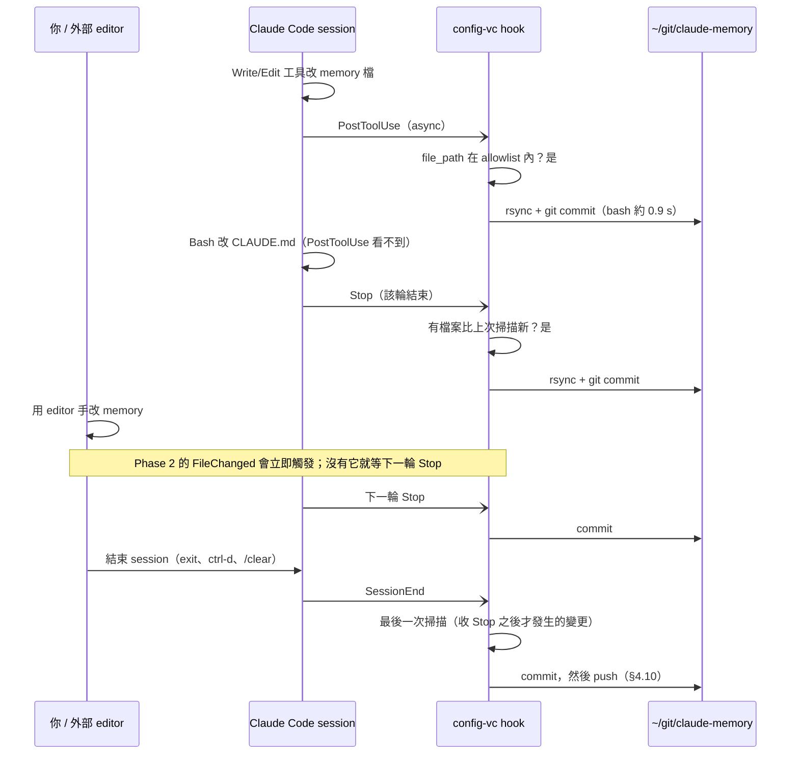
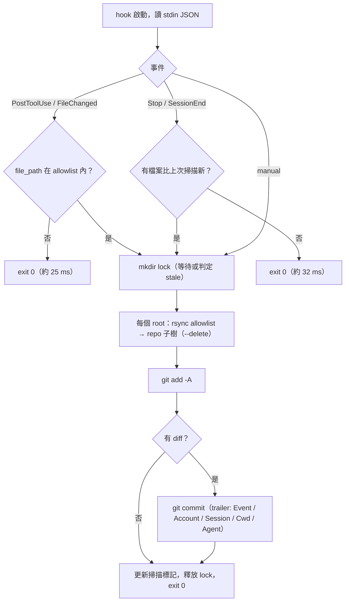
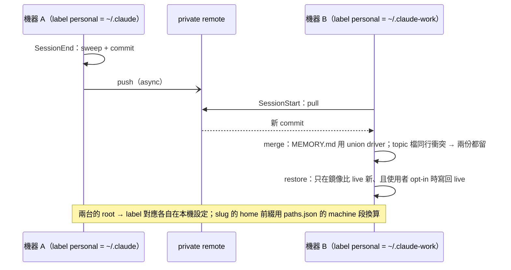
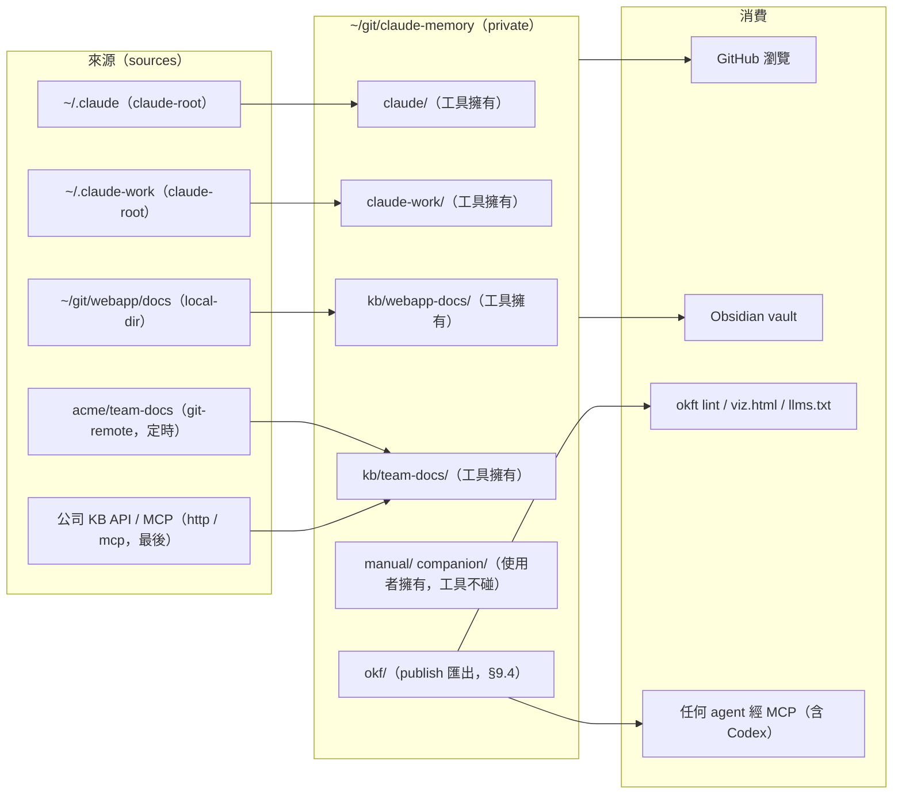
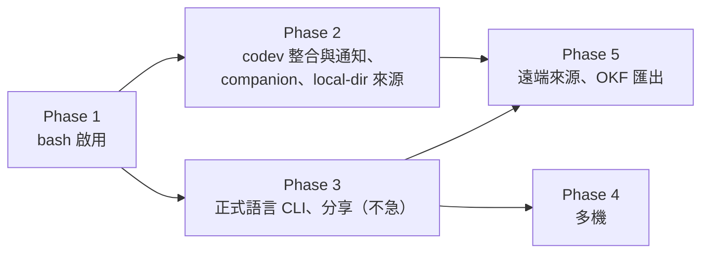

# Claude Code 記憶與設定的版本控制：設計文件

> 英文版：[`design.md`](design.md)。作者雇主及其私有 repo 的名稱（以及工作帳號的簡稱）已換成佔位名稱，例如 `acme`、`webapp`、`team-docs`、`work`。

版本 0.1，2026-09-13。作者：author + Claude Code（Fable 5.1）。狀態：設計已定案到 Phase 1 可施工，等 author 拍板未決事項（§12）後安裝。

本文件的讀者假設沒有這次討論的脈絡。名詞在第一次出現時解釋；量測數據全部來自 author 這台機器的實測，附錄 A 有原始數字。

---

## 0. 一頁摘要

**要解決的問題**：Claude Code 會把「全域指令」寫在 `~/.claude/CLAUDE.md`，把每個工作目錄學到的事實寫成 `~/.claude/projects/<slug>/memory/*.md`（auto-memory）。這些檔案沒有任何歷史：同一天兩個 session 並行改同一份 CLAUDE.md，沒有東西能告訴你上一版長什麼樣；前幾天請 Claude 整理 memory（刪、搬、合併）之後，被刪掉的內容就消失了。需求是**版本控制**：歷史、diff、回滾、歸屬（哪個 session 改的）、可瀏覽、將來可多機。git 是實作它的一種方式，也是目前最均衡的一種（§3.3）。

**方案**：一個 hook 驅動的「鏡像 repo」。

- Claude Code 的官方 hooks 在三個時點叫一支 script：`PostToolUse`（Write/Edit 剛寫完檔）、`Stop`（一輪結束）、`SessionEnd`。
- Script 把 allowlist 內的檔案（CLAUDE.md、每個專案的 memory、opt-in 的 skills 等）用 rsync 複製到 `~/git/claude-memory`（private git repo），有變更就 commit，commit message 記錄事件、帳號、session、cwd。
- Live 檔案永遠不在 repo 的 work tree 裡，所以任何 `git checkout`、`git clean` 都碰不到正在用的設定。
- 兩個 Claude 帳號（`~/.claude` 與 `~/.claude-work`，由 codev 管理）都收，各自一棵子樹。

**已完成**：142 行 bash 原型 `hook/config-vc.sh`，7 項測試（含 8 個 session 同時觸發）連跑 5 次全過；對真實資料 dry run 234 個檔、0.9 秒；hook 每輪平均成本 59 ms wall（async，不擋你）。尚未註冊進 settings.json。

**實作狀態（2026-09-18）**：Phase 1 已用 **Rust** 完成並上線於 main 帳號。工具 `~/git/memvc`（workspace：`memvc-core` library + `memvc` CLI，binary 裝在 `~/.cargo/bin/memvc`，2.8 MB），24 個測試全過（15 個 e2e 行為測試跑真 binary 與真 git、9 個 unit）。資料 repo `~/git/ccmem`：`init` 先從 transcript 回填（1,222 次寫入 → 502 個帶原始日期的 commit，697 個版本可重建、525 個不可）再匯入現狀，共 503 個 commit、`.git` 22 MB、1 分 18 秒。實測 hook 成本：PostToolUse 無關檔 5.2 ms、Stop 無變更 24 ms、reporter 4.4 ms。設定檔 `~/.config/memvc/config.toml`；hook 已註冊進 `~/.claude/settings.json`（work 帳號先不裝，跑一週再說）；`memvc-history` skill 已放進 `~/.claude/skills/`。尚未做：GitHub remote 與 push（§4.10）、codev 整合、`log.md`。細節見 §13。

**建議路線（原始）**：Phase 1 用 bash 原型正式啟用（本週可做）；Phase 2 codev 輕量整合（開關、安裝、開歷史）；Phase 3 若要分享給別人就移植成 Go 或 Rust 的單一 binary，bash 版退為測試規格；Phase 4 多機；Phase 5 擴充成中心化知識庫。細節見 §10。

---

## 1. 目標與範圍

### 1.1 要版控的東西

| 優先 | 內容 | 位置 | 預設 |
|---|---|---|---|
| 必要 | 全域指令 CLAUDE.md | `<root>/CLAUDE.md` | 收 |
| 必要 | 每個專案的 auto-memory | `<root>/projects/<slug>/memory/*.md` | 收 |
| 建議 | skills | `<root>/skills/**` | 收（commands 是舊機制，不收） |
| opt-in | settings.json、settings.local.json、statusline、hooks/ | `<root>/*` | 不收 |
| 永不 | transcripts、`~/.claude.json`（含 OAuth）、file-history、plugins、cache | | 不收，allowlist 以外一律進不來 |

`<root>` 是一個 Claude 設定目錄。author 有兩個：`~/.claude`（帳號 main）和 `~/.claude-work`（帳號 work，用 `CLAUDE_CONFIG_DIR` 切換）。

### 1.2 要求

1. **零手動**：改檔就有歷史，不需要在對話裡多做任何事。
2. **不擋人**：hook 必須 async、快速退出、永遠 exit 0。
3. **不碰 live 檔案**：工具只讀設定目錄、只寫 repo。還原是明確的使用者動作。
4. **可瀏覽**：在 GitHub 或本機 `git log` 就能讀。
5. **private**：CLAUDE.md 有公司內部 infra 名稱，memory 有客戶與 incident，repo 從第一天就 private。
6. **兩個帳號**相容 codev 的 Sharing（第二帳號的 CLAUDE.md、skills、commands 是 symlink 指回 `~/.claude`）。

### 1.3 不在範圍（本版）

多機 sync（§8 只留設計）、Codex 支援（§9.3 只留彈性）、語意檢索（§3.3 說明為何不做）。

---

## 2. 現況

### 2.1 實體位置

```
~/.claude/                                   ← 帳號 main（anchor）
├── CLAUDE.md                                ← 全域指令，唯一實體
└── projects/
    ├── -Users-me-git/                  ← cwd = ~/git
    │   ├── <session-id>.jsonl               ← transcripts（不鏡像）
    │   └── memory/                          ← 21 個檔
    │       ├── MEMORY.md                    ← index，session 開始時載入前 200 行
    │       └── <topic>.md                   ← 一檔一事實
    ├── -Users-me-git-webapp/memory/      ← 89
    ├── -Users-me-git-webapp-ui/memory/   ← 1（transcript 已被 Claude Code 清掉，只剩 memory）
    ├── -Users-me-git-webapp-some-branch-packages-some-package/memory/  ← 1
    └── …（共 13 個有內容的 memory 目錄）

~/.claude-work/                              ← 帳號 work，獨立的一棵樹
├── CLAUDE.md -> /Users/me/.claude/CLAUDE.md     ← codev Sharing 建的 symlink
├── skills   -> /Users/me/.claude/skills
├── commands -> /Users/me/.claude/commands
└── projects/
    ├── -Users-me-git/memory/           ← 6（跟 main 的 ~/git memory 是不同檔案）
    ├── -Users-me-git-webapp/memory/      ← 33
    └── …（共 6 個）
```

三個事實：
- **slug 就是 cwd 絕對路徑把非英數字元換成 `-`**。用 `history.jsonl`（每次 prompt 記錄 `project`）反查，19 個 memory 目錄中 18 個能還原真實路徑，0 個 slug 碰撞。
- `~/git` 和 `~/git/webapp` 是**兩個互不相干**的 memory 目錄，沒有父子關係。
- `projects/` 本身攤平一層，層次只留在 slug 字串裡。

### 2.2 誰在寫這些檔（243 份真實 transcript）

| 寫入方式 | 次數 | 佔比 | 哪個 hook 看得到 |
|---|---|---|---|
| Write / Edit 工具 | 1,048 | 70% | `PostToolUse` 立即 |
| Bash（`python3 - <<'PY'` 字串替換、`printf >>` 等） | 441 | 30% | 只有 `Stop` 掃描 |

61 個 session 用過工具寫、49 個 session 用過 Bash 寫。**結論：`Stop` 掃描不是備援，是必要的一層。**

### 2.3 codev 的角色

codev（author 的 open source macOS app：VS Code 專案切換器 + Claude Code session 管理）已經管理兩個帳號：registry 在 `~/.config/codev/accounts.json`；`claude work` 是 shell function，實際執行 `env CLAUDE_CONFIG_DIR=$HOME/.claude-work claude`；Sharing 用絕對路徑 symlink；每次啟動用 read-merge-write 把自己的 status hook 寫進**兩個**帳號的 settings.json（保留別人的 entry，但非 atomic）；不讀寫 CLAUDE.md、memory、file-history；沒有 chokidar，只 `fs.watch` 自己的 status 目錄。

---

## 3. 替代方案調查

### 3.1 Open source（兩輪搜尋，GitHub 全語言 + web）

原則上能做「CLAUDE.md + memory + git + hook」的：

| Repo | 語言 / 星 / 最後 push | 涵蓋 | 觸發 | 缺口 |
|---|---|---|---|---|
| toroleapinc/claude-brain | Shell / 88 / 2026-06 | CLAUDE.md、memory、skills、settings | SessionStart/End hook + git | memory 合併靠 `claude -p`，6 月後無更新 |
| cmacha2/cenv | Rust / 0 / 08-31 | CLAUDE.md、settings、白名單 memory | Stop/SessionEnd hook | 單一 config dir；有 gitleaks 閘門值得學 |
| nanzhi84/harness-sync | TS / 1 / 06-20 | CLAUDE.md、settings、skills、memory 快照含 slug 重對應，也管 Codex | launchd + SessionEnd hook | 快照而非逐次 commit |
| weisbert/claude-memory-overhaul | Shell / 1 / 08-27 | memory 目錄原地變 git repo | Stop + SessionEnd 自動 commit | 原地 repo（§4.1 風險） |
| Beennnn/memvault | Shell / 0 / 07-09 | memory + rules 進雲端硬碟 | PostToolUse/Stop/SessionStart hook | 沒有 git |
| renefichtmueller/claude-sync | TS / 27 / 06-24 | 整個 `~/.claude` 含 credentials 與 transcript | README 說有 hook，程式裡沒有 caller | 實際只能手動 |
| schemann/claude-project-sync | TS / 1 / 07-18 | 同機不同 config dir 之間搬 memory | 手動 | 唯一支援 `CLAUDE_CONFIG_DIR`，但不跨機 |

另有十幾個 0 到 1 星的個人 script（附錄 B）。共同點：單人、活躍期幾週到幾個月、沒有一個同時做到「每次編輯立即 commit + 每輪掃描補漏 + 兩個 config dir + 可瀏覽 layout」。採用任何一個都要先讀完它的 code 才敢掛在每次編輯上，工作量與自寫 142 行相當。**決定：自建。**

### 3.2 路線 B：`autoMemoryDirectory`

Claude Code 有 `autoMemoryDirectory` 設定（v2.1.74+，任何 settings 層級）可以把 memory 搬到指定目錄。若每個專案在自己的 `.claude/settings.local.json` 指向 `~/git/claude-memory/<project>/`，Claude 直接寫進 git repo，hook 只需 `git commit`，沒有複製、沒有 slug。

| | 鏡像（本設計） | 路線 B |
|---|---|---|
| 設定 | 一次，全域 | 每個 cwd 一次（worktree、子目錄各算一個） |
| 既有 19 個目錄 | 不動 | 要搬遷 |
| live 檔案在 git work tree 裡 | 否 | 是，`git checkout .` 會碰到正在用的 memory |
| 延遲 | 下一次 hook | 零 |
| 兩個帳號 | 各自子樹 | 各自設定 |

2026-09-17 實測（scratch 專案、`claude -p`、對照組設計）：

| 做法 | 結果 |
|---|---|
| 真實 memory 目錄（對照組） | Write 自動放行，檔案落地 |
| memory 目錄是 symlink，目標在 `~/.claude` 之外 | Write 被擋：「requested permissions to edit … which is a sensitive file」 |
| memory 目錄是 symlink，目標在 `~/.claude` 之內 | 同樣被擋 |
| 專案的 `.claude/settings.local.json` 設 `autoMemoryDirectory` 指到 repo 內 | Write 自動放行，直接寫進指定目錄，預設 slug 目錄下只剩 transcript |

所以「把 live memory 目錄 symlink 進 repo」這條捷徑被 Claude Code 自己的 sensitive-file 防護擋死，而 `autoMemoryDirectory` 是它認可的搬家方式。路線 B 的兩個新事實：(1) 它是 per-project 設定，工具可以在 `Stop` 時替當前 cwd 的 git root 自動寫入 `.claude/settings.local.json`，並把既有 memory 搬過去；(2) 同一個 cwd 的 settings.local.json 對兩個帳號都生效，所以 **main 和 work 在同一專案會共用一個 memory 目錄**（現在是分開的，例如 webapp 有 89 對 33 個檔），這是採用前要決定的事。CLAUDE.md 和 skills 用 symlink 指進 repo 則已被 work 帳號證明可行（文件只提醒 Cowork session 會跳過 symlink 的 `~/.claude/CLAUDE.md`）。

upstream issue anthropics/claude-code#25947（project-local memory dir）還開著。**決定：Phase 1 先鏡像（安全、已完成）；Phase 2 評估雙向時，路線 B 是候選之一，見 §4.12。**

### 3.3 Agent memory DB vs git

調查 mem0、Letta、Zep/Graphiti、LangMem、Cognee、Honcho、Supermemory、ChatGPT、claude.ai 的版本機制：

| | Markdown in git | 事件溯源 DB（mem0） | 雙時序圖（Zep） | 向量庫覆寫式 |
|---|---|---|---|---|
| 歷史粒度 | 每 commit，行級 | 每次操作 old/new | 每個事實的有效區間 | 無 |
| 人能 browse / diff | log / diff / blame | 有表，無 diff | 可查某時點，無 diff | 無 |
| 回滾 | revert / checkout | 手動重寫 | 無 | 無 |
| 多機合併 | push / pull，三方合併 | 無 | 走 server | 走 server |
| 工具外可編輯 | 是 | 否 | 否 | 否 |
| 語意查詢 | 要另建索引 | 有 | 有 | 有 |
| 「X 日時我知道什麼」 | 只有 commit 時間 | 操作時間 | 有效期 + 交易時間 | 無 |
| 依賴 / lock-in | git | SQLite + 向量庫 + LLM | 圖資料庫 + LLM | 向量庫 |

git 真正弱的三點：檢索是字面的；時間查詢答「檔案何時變」不是「事實何時為真」；多寫入者同時改同一行只會把衝突攤給人。DB 派弱在不透明、不能手改、lock-in。旁證：Letta 在 2026-02 把 Letta Code 的 memory 改成 git 管的 markdown；file-first 工具（ai-memory、basic-memory、obsidian-mind）清一色「git markdown 當 source of record，索引可重建」。**決定：git 當 system of record；語意檢索若要，另建可重建的索引。**

---

## 4. 架構

### 4.1 資料流

```
                 hook events                              ┌──────────────────────────┐
┌──────────────┐ PostToolUse(Write|Edit) / Stop / SessionEnd │ config-vc（executor）      │
│ Claude Code  │ ────────────────────────────────────────▶│ 1 判斷路徑是否在範圍內    │
│ 帳號 main    │   stdin: hook JSON                        │ 2 mtime fast path         │
│ 帳號 work      │   env: CLAUDE_CONFIG_DIR（work 才有）        │ 3 mkdir lock              │
└──────────────┘                                          │ 4 rsync allowlist → repo  │
   ▲ 讀取                                                  │ 5 git add / commit        │
   │                                                      └────────────┬─────────────┘
┌──┴───────────────────────┐        只讀                                │ 只寫
│ ~/.claude, ~/.claude-work │ ◀───────────────────────────────────────┘
│ (live 設定目錄)            │                                    ┌──────────────────────┐
└──────────────────────────┘                                    │ ~/git/claude-memory   │
                                                                │ private git repo      │
                                                                │ claude/ claude-work/  │
                                                                └──────────────────────┘
```

為什麼是鏡像而不是在 `~/.claude` 裡 `git init`：(1) 排除 `projects/` 就丟掉 memory，收 `projects/` 就要靠 `.gitignore` allowlist 擋 transcript，寫錯一條就把對話內容 commit 進去；(2) live 目錄裡有 `.git` 後，任何 session 在那裡跑 `git checkout .` 或 `git clean` 都直接改掉正在用的設定；(3) 兩個帳號目錄不可能是一個 in-place repo。另一個候選是「bare repo + work-tree 指到 `~/.claude`」的 dotfiles 技巧，解決 (2) 但不解決 (3)。

### 4.2 三層觸發

| 層 | Hook | 抓到什麼 | 延遲 | 狀態 |
|---|---|---|---|---|
| 1 | `PostToolUse`，matcher `Write\|Edit`（或 `PostToolBatch`） | Claude 用工具改 CLAUDE.md、memory、skills | 立即偵測；預設在該輪 Stop 才 commit（見下「commit 粒度」） | 原型是立即 commit，粒度調整待改 |
| 2 | `Stop` + `SessionEnd` | 用 Bash 改的（30%）、刪除、任何漏網 | 該輪結束 | 已做 |
| 3 | `FileChanged` + `watchPaths` | 你自己用 editor 改的、外部程式改的 | 立即 | Phase 2 實驗 |

一輪對話裡三層各自在什麼時點接手：



**Stop 與 SessionEnd 的定義和我們的用法。** `Stop` 在 Claude 每回答完一次 prompt 時觸發，也就是每一輪對話結束；`SessionEnd` 在整個 session 結束時觸發一次（你 exit、ctrl-d、`/clear`、或視窗關掉）。兩者對 script 是同一件事：掃描。差別在時機：`Stop` 是常態的第 2 層，一輪只掃一次；`SessionEnd` 是最後保險，收「這輪 Stop 之後、session 結束之前」的變更（例如你在 Claude 回答完之後自己用 Bash 改了 memory 才離開），也是做 push 和送一則摘要通知的自然時點，因為那時不會再有人等。

**Commit 粒度：預設「一輪一個 commit」，不是「一次編輯一個 commit」。** 原型的第 1 層是每次 Write/Edit 命中就掃描並 commit。這在 Claude 一輪內對同一檔連改多次時會產生碎歷史：一次訊息裡平行發 15 個 Edit（Claude Code 會把同一則回覆裡的多個工具呼叫當一批平行執行），15 個 hook 同時啟動、被 lock 序列化，結果是好幾個 commit 各含一部分。修法是把「偵測」和「commit」分開：

| 事件 | 做什麼 | 成本 |
|---|---|---|
| `PostToolUse`（Write/Edit 命中範圍） | 只 `touch` 一個 dirty 標記，不掃描 | 約 5 ms |
| `PostToolBatch`（一批平行工具呼叫結束時觸發一次，input 帶整批 `tool_calls[]`） | 同上，可取代 PostToolUse 減少 spawn 次數 | 每批一次 |
| `Stop` | dirty 或 mtime 比上次新 → 掃描 + **一個** commit，message 列出該輪全部改動的檔 | 有變更才付 0.9 s |
| `SessionEnd` | 同 Stop，再 push | |

這樣一輪內不論改幾次、幾個檔，就是一個 commit，trailer 的 session 與 cwd 也剛好是同一輪的。代價是「立即」變成「該輪結束」，通常是幾十秒到幾分鐘；要保留每次編輯一個 commit 的人可以開 `CCVC_GRANULARITY=edit`。Mod 版天然有這個粒度（`turn.complete`）。

第 3 層評估（2026-09-16 實測，scratch 專案 + `claude -p`）：Claude Code 用真正的 filesystem watcher，誰寫的都抓，hook 收到 `file_path` 與 `event`（change / add / unlink）。matcher 只認 cwd 內的檔名，絕對路徑要靠 `SessionStart` hook 回傳 `watchPaths`。實測結果：`watchPaths` **接受目錄**（目錄下 `b.md` 的修改和 `c.md` 的新增都觸發）；**有 debounce**（連續 5 次 append 只發 1 個事件，間隔 1 秒的寫入則各發一個）；`-p` 模式也會觸發。所以要用的話是可行的，只要 SessionStart 回傳 19 個 memory 目錄加兩個 CLAUDE.md 的絕對路徑即可。

「不會自我觸發」的意思：一個 FileChanged hook 如果自己去改被監看的檔，會再觸發自己，形成迴圈（官方文件的 CRLF 正規化範例就在防這個）。我們的 script 只讀 memory 目錄、只寫 `~/git/claude-memory`，後者不在監看清單，所以沒有迴圈。同一次 Write 會讓第 1 層和第 3 層各跑一次，第二次因為檔案 mtime 早於上次掃描時間而在 32 ms 內退出。

「你自己改」有兩種，方向不同：(1) 直接改 `~/.claude/projects/…/memory/` 的 live 檔，第 2 層下一輪會收、第 3 層可立即收；(2) 改 `~/git/claude-memory` 裡的鏡像副本，**不會**同步回 live 檔，鏡像是單向的，寫回只有明確的 restore 動作（§4.6、§8）。鏡像裡工具擁有的子樹（`claude/`、`claude-work/`）下一次掃描會被 rsync 覆寫回 live 的樣子，所以在那裡手改等於白改；使用者擁有的路徑（`manual/`、`companion/`）則會被下一次掃描 commit 進歷史（§9.1）。

第 3 層的價值是把 editor 手改的 commit 從「下一輪結束」提前到「立即」，第 2 層已保證正確性，所以排 Phase 2。

Hook 全部 `async: true`、`timeout: 30`。Script 沒有 `set -e`、沒有 `trap ERR`（macOS bash 3.2 會在 `||`/`&&` 串裡誤觸發 ERR，原型踩過），每步容錯，永遠 exit 0。

### 4.3 Script 流程細節



1. 讀 stdin JSON，取 `hook_event_name`。
2. `PostToolUse`：從 `tool_input.file_path` 判斷是否在任一 root 的 allowlist 內，不在就退出（25 ms）。
3. `Stop`/`SessionEnd`：判斷「有沒有檔案比上次掃描新」。做法是每次掃描開始時 `touch` 一個空的標記檔 `.git/config-vc.last-sweep`，它的 mtime 就是「上次掃描時間」；下一次用 `[ 檔案 -nt 標記 ]`（單一檔案）和 `find 目錄 -newer 標記 -print -quit`（目錄，找到第一個就停）去問檔案系統有沒有任何東西在標記之後被改過。這只是幾個 `stat` 系統呼叫，不讀檔案內容，所以 32 ms。刪除也抓得到，因為刪檔會更新父目錄的 mtime。symlink 的目錄要用 trailing slash 讓 `find` 跟進去（實測沒有 slash 會漏）。
4. 取 lock。lock 的用途是**互斥**：你同時開著好幾個 Claude session，它們的 hook 可能在同一秒各自啟動一個 script，若兩個同時 rsync 加 `git commit`，會撞 `index.lock` 或互相蓋掉。所以 script 先「佔位」，佔到的才做事，其他的等（最多 10 秒）或放棄。佔位用 `mkdir .git/config-vc.lock`：`mkdir` 在檔案系統層是 atomic，兩個 process 同時做只會有一個成功，這是 macOS 沒有 `flock` 指令時的標準替代。過期判定只在 `stat` 成功且超過 120 秒時才視為 stale（上一個 script 死掉沒清）；`stat` 失敗代表別人剛釋放，重試即可。原型第一版把 `stat` 失敗當 stale 而刪掉別人剛建的 lock，已修。
5. 每個 root：`rsync -a --delete` allowlist 內的檔與目錄到 `<repo>/<root 名>/`，排除 `*.codev-bak*`、`*.codev-tmp-*`、`.DS_Store`；memory 目錄逐一 rsync 到 `<repo>/<root 名>/memory/<slug>/`（2026-09-18 前是 `projects/<slug>/memory/`），空目錄跳過，來源消失的 slug 從 repo 移除。symlink 保留為 symlink。
6. `git add -A`；無 diff 就更新標記並退出；有 diff 就 commit（`-c commit.gpgsign=false`，避免 1Password 在 hook 裡跳簽章提示）。
7. 8 個 session 同時觸發的測試：嚴格序列化、1 個 commit 收齊 8 個檔、0 失敗、無殘留 lock。

完整掃描 940 ms 是「複製 234 個檔 + git」本身的成本，跟 hook 機制無關，任何實作都要付 git 的約 75 ms 加複製時間；bash 多付的是 subshell fork（§5.1）。一個還沒做的優化是**定向掃描**：`PostToolUse` 已經知道改的是哪個檔，只 rsync 那個 root 的那一個 memory 目錄而不是 21 個，估計 940 ms 可降到約 150 ms，bash 就能做；`Stop` 維持全掃。

### 4.4 Repo layout

**Layout A（Phase 1 採用）**：照抄 slug。

```
~/git/claude-memory/
├── README.md                    ← 自動產生的索引（§4.7）
├── paths.json                   ← slug ↔ 真實路徑對照，從 history.jsonl 產生
├── claude/
│   ├── CLAUDE.md
│   ├── skills/…                 （opt-in）
│   └── memory/                  ← live 端是 projects/<slug>/memory/，repo 端拿掉 projects 這層（2026-09-18 起）
│       ├── -Users-me-git/…
│       ├── -Users-me-git-webapp/…
│       └── …
└── claude-work/
    ├── CLAUDE.md -> ../claude/CLAUDE.md      ← 相對 symlink，repo 自洽（Phase 1.1）
    ├── skills   -> ../claude/skills
    └── memory/
        └── -Users-me-git-webapp/…
```

還原接近零腦力：只有 memory 這一種路徑要對映（`projects/<slug>/memory/` ↔ `memory/<slug>/`），其餘一比一。缺點：跟來源一樣攤平，靠 README 索引補瀏覽性。

**Layout B（之後可轉）**：還原成真實路徑樹，`home/git/webapp/memory/…`，非 home 路徑放 `root/…`，反查不到的 slug 放 `_unresolved/<slug>/`。從 A 轉 B 是一個 `git mv` commit，`git log --follow` 保留每個檔的歷史；`paths.json` 隨時可從 `history.jsonl` 重新產生。author 傾向先 A，理由是 B 要處理 root 在 `/` 之下的一般情況。**決定：A，B 保留為之後的選項。**

子樹名稱用 root 目錄的 basename（`claude`、`claude-work`），不用 codev 的帳號 label（label 可改名，改了就是整棵樹搬家）。多機時的 label 對應見 §8。

### 4.5 兩個帳號與 symlink 的相容

在 work 帳號的 session 裡，Claude 寫 `~/.claude-work/CLAUDE.md`（symlink）：hook 收到的路徑是 `~/.claude-work/CLAUDE.md`，命中 root `~/.claude-work` 的 allowlist；fast path 的 `-nt` 會跟隨 symlink（實測 DETECTS）；掃描結果是內容變更落在 `claude/CLAUDE.md`，`claude-work/CLAUDE.md` 仍是 symlink；commit trailer `Account: work`（hook 繼承 `CLAUDE_CONFIG_DIR`，對照 accounts.json 得到 label）。若 author 之後在 codev 按「Unlink & restore」把 symlink 換回真檔，鏡像會把這個轉換記成一個普通 commit。

```
  work 帳號的 session                          main 帳號的 session
  Write ~/.claude-work/CLAUDE.md             Write ~/.claude/CLAUDE.md
          │                                          │
          ▼                                          ▼
  ~/.claude-work/CLAUDE.md ───symlink───▶  ~/.claude/CLAUDE.md（唯一實體）
          │ hook：root=~/.claude-work 命中           │ hook：root=~/.claude 命中
          │ -nt 跟隨 symlink，看到新 mtime            │
          ▼                                          ▼
  repo/claude-work/CLAUDE.md -> ../claude/CLAUDE.md   repo/claude/CLAUDE.md（內容變更在這裡）
  commit trailer  Account: work                         commit trailer  Account: main
```

### 4.6 Memory 整理（刪、搬、合併）

`rsync --delete` 讓刪除傳播；搬移在 git 裡是 delete + add，`git log --follow` 或 `-M` 在內容相似度過半時顯示為 rename；合併是一檔變大、其他檔消失。找回上週刪掉的：

```
git -C ~/git/claude-memory log --diff-filter=D --since='7 days ago' --name-only
git -C ~/git/claude-memory show <sha>^:claude/memory/<slug>/<file>.md   # 2026-09-18 前的 revision 是 claude/projects/<slug>/memory/
```

原型測試 5 就是「Claude 用 Bash 刪 memory 檔，Stop 掃描後 commit 出 deletion」。兩種 layout 都適用；整個專案 memory 清空時該節點會被移除。

### 4.7 Commit message 與索引

三種模式，設定 `CCVC_MSG=auto|prompt|llm`：

- `auto`（預設，零成本）：subject `<事件>: <帳號>:<區域>, …`，body 是 `git diff --name-status`，trailer `Event / Account / Session / Cwd / Agent`。
- `prompt`（零成本，訊息含對話內容）：從 hook 給的 `transcript_path` 取該輪最後一句 user prompt 前 60 字當 subject。
- `llm`（opt-in）：`claude -p` 用 Haiku 摘要 diff。實測一次 12.4 秒、約一兩千 token；關掉 MCP server 只降到 8.5 秒，主要是 CLI 啟動；`claude -p` 沒有 fast 旗標，`/fast` 是互動模式下 Opus 的輸出加速，跟這裡無關，Haiku 本身已是最快的模型；直接打 API 約 1 到 2 秒但要 API key。不論哪種，都不該讓 LLM 擋 commit：commit 先用 `auto` 訊息，摘要事後用 `git notes` 附在 commit 上。git notes 是 git 內建的「附註」：`git notes add -m '摘要' <sha>` 把文字掛在既有 commit 上而不改變它的 SHA，`git log` 會一起顯示，存在 `refs/notes/commits`，要另外 `git push origin refs/notes/*`；缺點是 GitHub 網頁自 2014 年起不顯示 notes，所以要在 GitHub 上看得到的摘要，寫進 `log.md` 比較實際。防遞迴：`claude -p` 會啟動 session 並觸發 Stop hook，`--bare` 跳過 hook 但不吃 OAuth 登入，所以用環境變數 `CCVC_INNER=1` 讓子 session 的 hook 直接退出。

`README.md` 索引：每次有 commit 時重新產生，每個專案一列（真實路徑、memory 檔數、最後 commit），檔名連到 slug 目錄。GitHub 首頁就是目錄，不需要 layout B 也能瀏覽。本機瀏覽的另一條路是把資料 repo 當 Obsidian vault 打開（§9.3）：wikilink、backlinks、graph、properties 檢視全部免費。

### 4.8 設定檔

`~/.config/claude-config-vc/config.sh`（Phase 3 改成 TOML）：

```
CCVC_REPO=~/git/claude-memory
CCVC_ROOTS=                       # 空 = 讀 codev accounts.json，再退回 ~/.claude
CCVC_FILES="CLAUDE.md"            # 每個 root 的頂層檔
CCVC_DIRS="skills"                # 每個 root 的頂層目錄
CCVC_MEMORY=1                     # projects/*/memory
CCVC_MSG=auto
```

Root 的探索順序：明確設定 > codev registry > 預設 `~/.claude`。codev registry 是**可選的探索來源**，檔案不在就退回；工具不需要 codev 存在。這個形狀（root + 檔案清單 + 目錄清單 + memory glob + 排除）是 §9 通用化的基礎。

### 4.9 通知與可見性：工具只發事件，UI 各自呈現

需求：sync 發生時有地方看得到，可以是一閃而過，也可以是事後查清單。原則：**工具負責寫一份機器可讀的事件記錄，所有呈現方式都是它的 consumer**，這樣終端、macOS 通知、codev、notch 類 app 都能接，而工具不依賴任何一個。

```
                         ┌──────────────────────────────┐
  sweep / commit ───────▶│ events.jsonl（每次 sweep 一行）│
                         │ ts, event, account, session,  │
                         │ cwd, files, sha, duration     │
                         └──────┬───────┬───────┬───────┘
                                │       │       │
        ┌───────────────────────┘       │       └────────────────────┐
        ▼                               ▼                            ▼
  ① 終端內一閃                    ② macOS 通知                  ③ codev（Phase 2）
  reporter hook（sync，約 5 ms）   osascript，opt-in            Sessions 列表每列的 sync 徽章
  systemMessage 一行              每次 commit 一則太吵          menu bar「最近同步」清單
                                                              Electron Notification，可點開 diff
  ④ notch 類 app（vibe-island 等）：只在它提供輸入介面時，當作另一個 consumer
```

| 層 | 做在哪 | 機制 | 成本與噪音 | 狀態 |
|---|---|---|---|---|
| 事件記錄 + `status` / `log` 命令 | 工具 | 每次 sweep 追加一行 JSON；`status` 顯示最後成功時間與最近 N 筆 | 零 | Phase 1，這是「事後查清單」 |
| ① 終端內一閃 | 工具 | 「一閃」指 Claude Code 終端在該輪結尾印一行灰字，像它自己的「Saved 2 memories」那樣。做法是一支獨立的 **sync** reporter hook（reporter 就是「回報用的 hook」）掛在 `Stop`：讀上次回報之後的事件，回傳 `{"systemMessage": "…: 2 files → abc123"}` | 約 5 ms 同步；只在有 commit 的輪次出現 | author 對終端內通知中性偏可，不是重點：**預設開但安靜**（只在有 commit 時印一行），一個設定可關 |
| ② macOS 通知 | 工具 | commit 或 SessionEnd 後 `osascript -e 'display notification'`，或 terminal-notifier | 免依賴；寄件者顯示為 Script Editor、不能點；估計約一成的輪次有 commit，逐則會吵 | 沒有 codev 時的替代；建議只在 SessionEnd 送一則摘要 |
| ③ codev | codev | `fs.watch` events.jsonl（跟它看 codev-status 同一個模式）。三個呈現點：menu bar 子選單「最近同步」清單；macOS 通知用 Electron `Notification` 送，有 codev 的 app 身分、可點開 GitHub commit、Obsidian 或 codev 自己的歷史視窗；以及「Sessions 列表徽章」，意思是 codev Quick Switcher 的 Sessions 模式每列已經有狀態燈，事件帶 session id，所以可以在同一列多畫一個小計數「這個 session 同步了 3 次」，選配 | 工具零成本 | Phase 2，**主要呈現方式**（author 要的是 macOS 通知與 menu bar，不是終端） |
| ④ notch 類 app | 該 app | vibe-island 的 bridge 只接受 `--source <agent> [--event <name>]` 轉送 Claude 的 hook JSON，沒有文件化的自訂事件入口 | | 只在它開 API 時再接 |

為什麼 ① 要另外一支 sync hook：async hook 回傳的 `systemMessage` 會在下一輪交給 Claude 而**不會顯示給使用者**（hooks reference「How async hooks execute」），只有同步 hook 的 `systemMessage` 會顯示在終端。所以掃描維持 async（0.9 秒不擋人），回報用一支只讀事件檔的同步 hook（5 ms）。同一個機制也可以 opt-in 把「memory 剛 commit 了 abc123」以 `additionalContext` 給 Claude，配合 §Phase 1 的 `config-history` skill，但預設關，對 model 是噪音。

事件記錄放哪：資料 repo 的 `.git/config-vc.events.jsonl`（不進版控、隨 repo 走），`status` 讀它。codev 只需要知道資料 repo 路徑就能找到。

---

### 4.10 Push：何時、怎麼認證、失敗怎麼辦

commit 是本機的；push 到 private GitHub remote 是另一個動作，設計上分開，因為 push 需要網路和認證，不能拖慢 hook。

- **時機**：`SessionEnd` 是「你離開 Claude Code 或 `/clear`」那一刻，不是每輪，author 認為太少。所以改成：`Stop` 時若本機領先 remote **且**距上次成功 push 超過 10 分鐘就 async push 一次（節流，避免每輪都打網路），`SessionEnd` 再補一次，`manual` 命令可手動 push；有 §4.11 的 role-b 或 codev 時由它們定時做。不在 `PostToolUse` push。
- **認證是關鍵**，而且 commit 和 push 是兩件事。查過 author 的設定：`gpg.format = ssh`、`SSH_AUTH_SOCK` 和 `~/.ssh/config` 的 `IdentityAgent` 都指向 1Password 的 agent，所以**簽章和 SSH 連線都經過 1Password**。commit：hook 帶 `-c commit.gpgsign=false`，不簽就不會碰 agent，測試裡的 commit 全部成功，PoC 不會因此失敗。push：走 SSH 會碰 agent，agent 若要求確認就在無 TTY 的 hook 裡卡到 timeout；走 HTTPS 則 `gh` 已登入且 token 有 `repo` scope，但 `credential.helper` 目前沒設，所以要先跑一次 `gh auth setup-git`，之後 HTTPS push 是非互動的。上線前用 `GIT_TERMINAL_PROMPT=0 git push </dev/null` 驗證一次。PoC 階段 push 失敗只是 remote 落後，commit 不受影響。
- **失敗處理**：push 失敗只寫 log 和事件記錄（§4.9），下次 SessionEnd 再試；永遠不 force-push；remote 落後於本機不是錯誤，多機 sync 的 pull/merge 是 §8 的事。
- **隱私**：remote 必須是 private repo；`status` 命令顯示「本機領先 remote N 個 commit」讓你知道有沒有 push 成功。

### 4.11 輕量 hook + 常駐處理端：spool 目錄與 launchd

author 的構想：hook 只做一個很輕的 role-a'（spawn 但幾毫秒），把工作交給一個常駐的 role-b 處理。macOS 上最省的做法不是自己養一個永遠在跑的 process，而是 **spool 目錄 + launchd**：

```
hook（任何語言，2 到 5 ms）                         role-b（launchd 啟動的 job）
  寫一個 JSON 事件檔到 spool/（先寫 tmp 再 rename，atomic）  ──▶  launchd QueueDirectories / WatchPaths 看到 spool 有檔就啟動
  立刻 exit 0                                              讀完整批事件、去重、合併同一 session 的多次編輯
                                                           掃描 + commit（lock 在自己 process 內，不再需要 mkdir lock）
                                                           節流 push、寫 events.jsonl、送通知
                                                           處理完 exit；沒事時不佔任何 CPU
```

好處：hook 的固定成本降到 process 啟動的底線；多個 session 的事件在 role-b 裡自然合併；歸屬不會丟，因為事件檔帶 session id 和 cwd；push 節流、通知、任意資料夾監看（`WatchPaths`）都在 role-b 一處。codev 也可以扮演 role-b（它已經常駐、已經 `fs.watch`），兩者可以並存：launchd job 是沒有 codev 時的預設。代價：多一個 launchd plist 要安裝；hook 要有 fallback，spool 寫不進去時自己做掃描。這是 Phase 2 到 3 的架構方向，跟 §4.9 的事件記錄是同一個檔案格式。

### 4.12 雙向：在 repo 裡改（自己或 AI 改措辭、排版），怎麼回到 live

author 把雙向定為 nice-to-have 與 must 之間：repo 就是拿來 browse 的，看到就會想改。三條路，兩條實測過（§3.2）：

| 路線 | 做法 | 實測 | 優點 | 代價 |
|---|---|---|---|---|
| C：symlink live memory 目錄到 repo | `projects/<slug>/memory -> repo/…` | **被 Claude Code 擋**（sensitive file） | | 不可行 |
| B：`autoMemoryDirectory` 搬家 + CLAUDE.md/skills symlink | memory 直接住在 repo，hook 只做 `git commit` | 可行，自動放行 | 零複製、零延遲、天生雙向；掃描只剩 git 的 75 ms；Obsidian 或 GitHub 改完立即生效 | per-project 設定（工具可自動寫）；兩帳號同專案共用 memory；live 檔在 git work tree 內，`git checkout`/`clean` 會動到；新機器 clone 前 memory 是空的 |
| D：鏡像不變，加「寫回」 | 每個檔以上次同步的 commit 為 base，做 3-way merge：`git merge-file 鏡像版 base live版` | 未實作，機制是 git 標準功能 | 架構不變、兩帳號分開、live 不在 work tree | 要寫 merge 與衝突策略；衝突時保留 live、另存 `.conflict.md` 並通知；寫回時機在 Stop 或 SessionStart |

**建議**：Phase 1 維持單向鏡像。Phase 2 決定 B 或 D：若接受「同一專案兩帳號共用 memory」，B 最簡單也最快，整個工具退化成「commit + push + 通知」；否則 D。兩者都讓 `companion/` 與 `manual/` 的手改直接進歷史。不論哪條，「還原到某個歷史版本」永遠是明確的使用者動作。

### 4.13 初次匯入（pre-scan）、選擇範圍、回填歷史

**現狀本來就會全部進去，不只新變更。** 鏡像是「狀態」不是「變更記錄」：每次掃描都把 allowlist 內的**全部**檔案 rsync 一遍，第一次掃描就是完整匯入（dry run 的第一個 commit 是 234 個檔），之後沒動過的檔案也一直在 repo 裡。所以「上週某專案的 memory 這週沒更新但想 browse」一定做得到。不過要把它做成明確的步驟，並且可以選：

- `init`：先掃描不 commit，列出每個帳號、每個專案（slug 加反查的真實路徑）、檔案數、最後修改時間、大小，讓你看一眼要收什麼。
- 選擇：預設全收；設定檔的 `exclude` 用 glob 排除（例如某個實驗專案的 slug、或 `*/memory/scratch-*.md`），`--only` 反過來只收指定的。排除規則之後的掃描也一直生效，不只初次。
- 初次 commit 的粒度：預設**一個帳號一個 commit**（「import claude: 13 projects, 174 files」），`--split project` 改成一個專案一個 commit 方便 `git log` 逐專案看。commit 日期是匯入當下；若想讓時間軸有意義，用下面的回填。

**回填歷史（backfill，Phase 2 選配）。** 匯入時 memory 檔的「上一版」其實還找得到：transcript 記錄了每一次 Write（含完整內容）和 Edit（含 old/new 字串）以及時間戳，`file-history/` 也有 Claude 編輯過的檔案快照。這台機器的 transcript 從 2026-07-06 到現在約 10 週，其中對 memory 和 CLAUDE.md 的工具寫入約 1,000 次可以重放，Bash 改的 441 次是缺口，缺口用下一次完整 Write 或 file-history 快照補齊。做法：按時間重放這些操作，每個時間點產生一個帶 `GIT_AUTHOR_DATE` 的 commit（或按天合併），trailer 一樣記 session 與 cwd。結果是 repo 一建立就有過去 10 週的歷史，`git log --since='2 weeks ago'` 立刻有意義。限制：Claude Code 依 `cleanupPeriodDays` 清舊 transcript，官方預設 **30 天**（你沒設；這台機器實際還留著 7 月 6 日起的檔，代表清理是有條件的，但不能指望），`file-history` 只留最近 100 個 checkpoint 且隨 session 一起清；memory 目錄本身不會被清。回填深度以此為限，所以**排進 Phase 1 的 `init`**：`init` 先重放 transcript 產生歷史 commit，再疊上現狀的匯入 commit，repo 從第一天就有過去幾週的歷史。重放結果與現在的檔案不一致時以現在的檔案為準，差異記在 commit message。

若 Phase 1 來不及做回填，之後補也不必重建 repo：用 `git replace --graft <匯入 commit> <回填的最後一個 commit>` 把回填歷史接在匯入 commit 前面，再用 `git filter-repo` 固化。這會改寫匯入之後所有 commit 的 SHA，但內容全部保留，包含期間手改鏡像或雙向寫回產生的 commit；私有個人 repo 沒有協作者，force-push 一次沒有問題（雇主 repo 禁 force-push 的規則不適用於此）。真正會損失的只有被清掉的 transcript，這是「早做」的唯一理由。這正是 okf-skills 的 `backfill` 想法，也是 §3.2 自製的理由之一：沒有現成工具做這件事。

## 5. 成本

### 5.1 各種情況（真實 transcript：9,651 輪、63,389 次工具呼叫、10,571 次 Write/Edit）

| # | 情況 | 會叫 hook 嗎 | 佔比 | bash 現在 | bash 優化（估） | Go/Rust（估） |
|---|---|---|---|---|---|---|
| 1 | Read、Bash、Grep 等非 Write/Edit 工具 | 否 | 83% 的工具呼叫 | 0 | 0 | 0 |
| 2 | Write/Edit 到 CLAUDE.md / memory | 是，立即完整掃描 | 1.7% 的工具呼叫（10% 的 Write/Edit） | 940 ms wall，約 0.5 s CPU | 約 450 ms | 約 100 ms |
| 3 | Bash 改 CLAUDE.md / memory | 該輪 Stop 時完整掃描 | 441 次 / 9,651 輪 ≈ 4.6% 的輪 | 940 ms（在輪末） | 約 450 ms | 約 100 ms |
| 4 | Write/Edit 到其他檔 | 是，判斷後退出 | 15% 的工具呼叫（90% 的 Write/Edit） | 25 ms | 約 10 ms | 約 3 ms |
| 5 | 每輪 Stop，沒有任何變更 | 是，比對 mtime 後退出 | 幾乎每一輪 | 32 ms | 約 12 ms | 約 5 ms |
| 6 | SessionEnd | 同 5 或 3 | 每個 session 一次 | 同上 | | |

每輪平均 1.1 次 Write/Edit，所以 bash 現在每輪約 59 ms wall、0.03 到 0.05 秒 CPU，全部 async；9,651 輪的歷史加總約 10 分鐘 CPU。

表中「其他檔」指 allowlist 以外的任何檔，主要是專案原始碼；hook 看到路徑不在範圍就退出。CLAUDE.md 和 memory 放同一列是因為成本同一級：實測 CLAUDE.md 115 KB、memory 檔 1.4 到 89 KB，單檔 rsync 都是 13 到 22 ms，改 CLAUDE.md 的 git add + commit 60 ms、改小 memory 檔 47 ms，差 13 ms，檔案大小不是因素，940 ms 是固定開銷。**commit 頻率**（一輪一 commit 的粒度，11,351 輪真實資料）：有 memory 或 CLAUDE.md 變動的輪佔 **10.9%**（1,233 輪；其中只用工具改 746、只用 Bash 改 399、兩者都有 88），這些輪平均 1.5 次編輯、最多 14 次。所以那 450 到 940 ms 大約每 9 輪付一次，而且是 async。完整掃描 940 ms 的組成：21 次 rsync spawn 約 284 ms、git add 20、git diff 15、git commit 40、其餘是 bash 的 subshell（`$(…)` 每次 fork 約 3 ms，掃描裡有幾十次）。編譯型工具用原生 stat walk 代替 rsync（Python 實作 1.3 ms，編譯後更低），所以 Go/Rust 版的完整掃描主要剩 git 的 75 ms。

### 5.2 各 runtime 的固定成本（直接 spawn，50 次取中位數）

| Runtime | 啟動 + 讀 stdin | 備註 |
|---|---|---|
| bash 空殼 | 2.2 ms | |
| bash + jq | 5.3 ms | 目前 hook 的底線 |
| python3 3.12 | 15 ms | |
| node 24 | 18 ms | 先前量到 270 ms 是經過 nvm shell function，誤量 |
| C | 2.0 ms | 33 KB |
| Go | 2.3 ms | 3 MB |
| Rust | 2.7 ms | 440 KB |

Repo 大小：兩個全量 commit 後 `.git` 2.2 MB；每次 CLAUDE.md 改動加一個約 30 KB 的壓縮 blob，`git gc` 做 delta。

---

## 6. 語言選擇

### 6.1 比較

| | bash（現在） | Python | TypeScript | Go | Rust |
|---|---|---|---|---|---|
| 使用者要先裝什麼 | 無（macOS 內建 bash 3.2） | python3 | node | **無** | **無** |
| 單一 binary | 否 | 否 | 否 | 是，3 MB | 是，0.5 MB |
| hook 固定成本 | 5 ms 底線，現在 25 | 15 ms | 18 ms 起 | 2 ms | 3 ms |
| 跨平台 | 差：`stat -f`、無 `flock`、bash 3.2 的 trap 行為 | 好 | 好 | 好，交叉編譯內建 `GOOS/GOARCH` | 好，交叉編譯要裝 target 或用 cargo-zigbuild |
| 發布給別人 | 複製檔案 | pipx | npm | goreleaser 一次產 GitHub Releases + Homebrew tap | cargo-dist 同樣可，另有 cargo-binstall |
| 別人怎麼裝 | curl 下載 | `pipx install` | `npm i -g` | `brew install <tap>/<tool>` 或下載 binary；`go install` 要 Go toolchain | `brew install` 或下載 binary；`cargo install` 要編譯數分鐘 |
| 開發速度 / 可讀性 | 短但坑多 | 高 | 高 | 高 | 中，學習曲線 |
| 這類 CLI 的生態 | | | | gh、kubectl、terraform、hugo | ripgrep、fd、bat、uv、ruff |
| 這裡的熟悉度 | | | codev 是 TS | 作者的雇主有 Go 服務 | 個人已裝 cargo |

**安裝便利性的答案**：Go 與 Rust 對使用者是一樣的，都是一個 binary，用 Homebrew tap 或直接下載；差別在開發者這邊：Go 的交叉編譯與 goreleaser 一條龍最省事，Rust 要多裝 target 但 cargo-dist 也做得到。體感上「越來越多 Rust CLI」是真的（uv、ruff、bat、fd），Go CLI 在 devops 工具圈仍是主流（gh、kubectl）。這個工具的內容是檔案走訪、rsync 邏輯、呼叫 git，是 process 編排不是計算，Rust 的無 GC 與零成本抽象用不上。

### 6.2 2026-09-17 的補充：要不要直接跳 Go

author 的前提改變了：他不會深讀任何一種實作，shell 和 Rust 對他一樣不透明，Go 是他讀得最懂的；而且由 Claude 來寫，寫作速度不是變數。在這個前提下：

- **shell 版先跑一週的價值**：驗證的是 hook 接線、兩帳號、codev 互動、1Password、commit 頻率與噪音這些「環境」問題，這些跟語言無關，用 Go 版跑一週得到的資料一樣。shell 版真正的優點只剩「已經寫好、已經測過」，但 §4 後來加的東西（一輪一 commit 的 dirty 標記、`git status` fast path、事件記錄、`status` 命令、push 節流、`index.md`/`log.md` 產生）它都還沒有，補起來大概再 150 行 bash，而 bash 3.2 的坑已經踩過兩次。
- **直接跳 Go 的代價**：一個新 codebase，估 800 到 1,200 行加測試，一個 session 可完成；風險是年輕的 binary 掛在每次 Write/Edit 上，但 hook 是 async、永遠 exit 0、只寫 repo 不寫 live 檔，最壞情況是「沒 commit」而不是「壞資料」，`status` 看得到。
- **Rust**：author 想練，但他讀 Go 比較懂，而 Phase 2 的 spool daemon、來源通用化、通知都需要快速迭代。建議工具用 Go；想練 Rust 可以之後把 hook 端的 shim（讀 stdin、寫 spool 檔、幾十行）用 Rust 寫當練習，它小到不會拖慢主線。
- **測試能不能延用**：可以，而且是主要價值。現在的 `test/test.sh` 是黑箱測試：用假的 config 目錄、把 hook JSON 餵進 stdin、檢查 repo 裡的 commit 和檔案，完全不看實作。只要新實作維持同一個契約（stdin JSON、環境變數設定、exit 0、repo layout、commit trailer），同一份 harness 換一個執行檔路徑就能跑，等於把 shell 版變成規格。Go 版再加自己的單元測試（slug 對應、fast path 判斷、merge 策略）。

**2026-09-17 的建議是 Go；2026-09-18 author 改選 Rust，理由成立，改為 Rust。** 三個理由裡最重的是架構性的：codev 是 Electron，Rust 的 core 可以透過 napi-rs 直接被 codev 在 process 內呼叫（Node-API 是 ABI 穩定的，Electron 不必 rebuild），這樣 CLI、hook、codev 的歷史視窗與 `init`/backfill 共用同一份實作；Go 要做同樣的事得走 cgo 或 child process，差很多。另外兩個：他想藉此練 Rust；不管 Go 或 Rust他都只會大概看，可讀性差距對他不構成決定因素。

Rust 的形狀：

- 一個 workspace，三個 crate：`memvc-core`（library：設定、roots 探索、slug 對應、fast path、掃描、commit、事件記錄、backfill、之後的 merge 策略）、`memvc`（CLI，`clap`，子命令 `hook init sweep status log install push backfill`）、`memvc-node`（napi-rs，Phase 2 給 codev 用，先留空殼）。
- git 一律 spawn 系統的 `git`（`std::process::Command`），不用 `git2`/libgit2：行為跟你手上的 git 設定一致（credential helper、`gpgsign` 覆寫、hooks），也少一個 C 依賴。
- 檔案走訪 `walkdir` 或 `ignore`，JSON `serde_json`，錯誤 `anyhow`，log `tracing`，Phase 2 的 watcher `notify`。不用 async runtime，這個工具沒有需要它的地方。
- 為了讓 author 能大概讀懂：模組小、函式短、避免 lifetime 重的 API、用 `String`/`PathBuf` 不用借用技巧、每個模組頂端一段用途註解、錯誤用 `anyhow::Context` 帶路徑。

測試策略（照 author 的 global 偏好：行為測試優先，e2e > integration > unit，不寫套套邏輯的 unit test，每個行為在最高合理層級測一次）：

- **e2e / behavior**：`tests/*.rs` 用 `assert_cmd` 跑編譯出來的 binary、`tempfile` 建假的 config 目錄、餵 hook JSON 到 stdin、用真的 `git` 檢查 repo 狀態。這就是現在 `test/test.sh` 七個案例的 Rust 版：初次匯入、無變更不 commit、範圍外路徑快速退出、範圍內寫入的 commit 與 trailer、刪除傳播、8 個並行 hook 無遺失、symlink 保留，再加新的：一輪一 commit、`git status` fast path 收 `companion/`、`init` 的 exclude、backfill 重放、push 節流（對本機 bare repo）。
- **契約測試**：原本的 bash harness 保留，改成跑 Rust binary，作為「兩個實作行為一致」的交叉檢查，等 Rust 版穩定後可退役。
- **unit** 只留純邏輯：slug 與真實路徑互轉、fast path 的 mtime 判斷、backfill 的操作排序與缺口處理、merge 策略。
- **不變量要 mutation-verify**：兩條「絕不」，工具永不寫 live 檔（除了明確 restore）、`rsync --delete` 永不越出工具擁有的前綴，各寫一個測試，然後故意把守衛拿掉確認測試會紅（global CLAUDE.md 的規則）。

**原本 2026-09-17 的建議（保留脈絡）**：直接用 Go 寫 Phase 1，shell 原型退為參考實作與契約測試。若 author 想保守，替代方案是 shell 版加上 dirty 標記後先掛 main 帳號跑一週，同時開始寫，一週後切換；兩者的 hook 註冊方式相同，切換只是改 settings.json 裡的 command 路徑。

**原本的建議（2026-09-13）**：Phase 1 用 bash（已完成、已測）。要分享（Phase 3）時移植成 **Go**（開發快、交叉編譯內建、goreleaser 發布、公司有 Go 經驗）；若 author 想順便練 Rust，Rust 一樣合格，差別只在開發者體驗。bash 版退為規格與測試案例。TypeScript 原本不建議（使用者不一定有 node），但 §9.5 的 Claude Mods 改變了這一點：mod 必然是 TS，若 Mods GA，TS 共用核心加 `bun build --compile` 的單一 binary 會是避免兩套實作的選項。**Phase 3 的語言決定建議延到 Mods GA 之後。**

---

## 7. codev 整合

### 7.1 層次

| | 不整合 | 輕量整合（建議） | 深度整合 |
|---|---|---|---|
| codev 做什麼 | 什麼都不知道 | Accounts 頁一個開關；安裝 hook 到每個帳號的 settings.json；寫工具設定的 roots；一顆「開歷史」按鈕 | 引擎搬進 codev：watcher、commit、歷史與 diff、restore UI、sync |
| 工具做什麼 | 全部，含 installer | executor + CLI | 沒有獨立工具 |
| commit 依賴 codev 在跑 | 否 | 否 | 是，除非 hook 再呼叫 codev 的 CLI，而 Electron 啟動要幾百 ms |
| 可分享給別人 | 是 | 是，codev 只是加值 | 否，綁 macOS 與 codev |
| 帳號來源 | 自己設或讀 accounts.json | codev 寫進工具設定 | 內建 |

**建議：輕量整合。** 資料流由工具定義，安裝與呈現由 codev 加值。

### 7.2 兩個方向

- 「工具去整合 codev」：工具讀 `~/.config/codev/accounts.json` 探索 roots。這是 Phase 1 就有的**可選探索**，優先序在明確設定之後、預設之前；檔案不在就退回。功用只是省掉手填兩個路徑。
- 「codev 去整合工具」：codev 在 Accounts 頁提供開關，按下去 codev 用它既有的 `installHooks` read-merge-write 把三個 hook entry 寫進**每個**帳號的 settings.json，並把 roots 寫進工具的設定檔。這一側的程式碼**放在 codev repo**，工具 repo 不需要知道 codev。一旦 codev 負責寫設定，工具讀 accounts.json 的 fallback 可以保留也可以拿掉。

```
codev repo                                  claude-memory-sync repo
┌───────────────────────────────┐           ┌──────────────────────────┐
│ Accounts 頁                    │           │ hook / CLI executor       │
│  [x] Version-control memory   │ 寫入      │  read config → sweep      │
│  repo: ~/git/claude-memory    │──────────▶│  → git commit             │
│  [Open history]               │ 設定檔 +  │                          │
│                               │ settings  │ 不 import codev，         │
│ installer（既有 installHooks） │ hooks     │ 可選地讀 accounts.json    │
└───────────────────────────────┘           └──────────────────────────┘
```

### 7.3 相容性風險（已對照 codev 程式碼）

- codev 每次啟動都 read-merge-write 兩個帳號的 settings.json，非 atomic。工具從不寫 settings.json，唯一的 race 是一次性的註冊動作，避開 codev 啟動瞬間即可。
- codev 切換 toggle 會重排版該檔（2 空格、無結尾換行）；只有 settings.json 被 opt-in 進版控時才會看到純空白 diff。
- `*.codev-bak-*`、`*.codev-tmp-*` 從不清理，rsync 已排除，測試確認 HEAD 裡 0 個。
- 工具的 Stop hook 是 async，跟 codev 那個 `timeout: 5` 的 status hook 平行跑，不拖慢 idle 狀態。
- codev 沒有任何 config 版控的計畫、issue 或 TODO，這是全新功能。

### 7.4 程式碼放哪

- **工具**：獨立 repo `~/git/claude-memory-sync`（可公開）。內容：hook script（之後的 CLI）、測試、設計文件。
- **資料**：`~/git/claude-memory`（private）。工具的狀態檔（`paths.json`、README 索引）放在這裡。
- **整合層**：codev repo。

---

## 8. 多機與帳號名不同（設計預留，Phase 4）

同一人兩台電腦，帳號名可能相反（這台的 `~/.claude` 是個人、那台的 `~/.claude` 是公司）。設計：

1. Repo 子樹用**邏輯標籤**（例如 `personal/`、`work/`），每台機器的設定檔決定「本機哪個 root 對到哪個標籤」，而不是用目錄 basename。這是 Phase 1 唯一要先定的形狀：`roots = [{path: ~/.claude, label: personal}, …]`。Phase 1 的預設 label 就是 basename，之後改設定即可。
2. Slug 含 home 路徑（`-Users-me-…`）。換 username 的機器在 restore 時套 prefix 對應表（`-Users-author` ↔ `-home-author`）；`paths.json` 以 machine id 分段存兩台的路徑。Layout B 的 `home/` 抽象天然處理這件事，是它的一個優點。
3. `MEMORY.md` 設 `.gitattributes` 的 `merge=union`（實測：兩邊各加一行 index，merge 後兩行都在）。Topic 檔同一行兩邊改會 conflict（實測），策略是「兩份都留、不阻塞 session」：保留本機版，另一版存成 `<file>.conflict-<host>.md` 並在 log 記一筆。
4. 流程：SessionEnd push（async），SessionStart pull + restore（只在鏡像比 live 新時寫回，而且要明確 opt-in）。



---

## 9. 擴充

### 9.1 中心化知識庫（Phase 5，nice to have）

把「來源」通用化：

```
[[sources]]                          # Phase 1 的 Claude root 也是一種 source
type = "claude-root"   path = "~/.claude"        label = "personal"
[[sources]]
type = "local-dir"     path = "~/git/webapp/docs"  include = ["**/*.md"]  dest = "kb/webapp-docs"
[[sources]]
type = "git-remote"    url  = "git@github.com:acme/team-docs.git"  paths = ["docs/"]  dest = "kb/team-docs"  schedule = "hourly"
[[sources]]
type = "http" | "mcp"  …                          # 之後才定
```

- `local-dir`：同一套 sweep，只是多幾個 root。觸發源有三種，看需求選：session 內用 `FileChanged` + `watchPaths`（已實測，檔案和目錄都可，有 debounce）；隨時都要的話用常駐 watcher（launchd 跑 `fswatch`/`watchexec`，或 codev 的 `fs.watch`）；最省事的是 `Stop` 的 mtime fast path 順便掃這些路徑。任何一個特定檔案或資料夾都能列進來。
- `git-remote`：不必 clone，`git archive` 或 sparse checkout 取指定路徑，定時跑。
- `http` / `mcp`：呼叫 API 或帶特定 prompt 的 MCP 工具把結果存成 md。重，最後做。
- 分組：`dest` 決定在資料 repo 裡的位置，repo-a 和 repo-b 的 md 可以落在同一個 `kb/<group>/` 下。
- 工具擁有的子樹（`claude/`、`kb/…`）用 `rsync --delete` 覆寫；其他路徑是使用者擁有，工具不碰。手動維護的 memory 放 `manual/`，不會跟自動鏡像衝突。



- 哪些用 bash 就做得到：`claude-root` 和 `local-dir` 是同一套 rsync，`git-remote` 是 `git archive`，都是 shell 的強項。`http` 和 `mcp` 牽涉 JSON、認證、重試，才值得等 Phase 3 的正式語言；Codex 也就是一個 `type = "codex-root"` 的來源（root `~/.codex`、檔案 `AGENTS.md config.toml`、memory glob `memories/` 排除其中的 `.git` 與 sqlite），§9.3 的 adapter 只剩 hooks.json 的安裝。

**繁中對照文件（提前到 Phase 2）。** 情境：公司 repo 的英文 md 已 commit，你請 Claude 產一份繁中版，但不能 commit 進公司 repo。做法：

1. 路徑慣例：資料 repo 的 `companion/<repo 名>/<repo 內相對路徑>.zh-tw.md`，例如 `companion/webapp-service/docs/some-package.md` 的翻譯放 `companion/webapp-service/docs/some-package.zh-tw.md`。這是使用者擁有的路徑，rsync 不碰。
2. 讓 Claude 知道往哪寫：一個 `companion-docs` skill（自己也被版控），描述路徑慣例、「翻譯不進公司 repo」的規則、以及怎麼從公司檔案路徑推出對照路徑。Claude 用 Write 寫進去。
3. 進歷史：Write 的路徑不在 root 的 allowlist 內，所以第 1 層不會觸發；第 2 層 `Stop` 的 fast path 要多一步 `git -C ~/git/claude-memory status --porcelain --untracked-files=all`（約 20 ms），有東西就走一般的 `git add -A` 加 commit。這一步同時涵蓋 `manual/` 和任何使用者擁有的路徑。
4. 閱讀：GitHub 或 Obsidian 並排開英文原檔與 `.zh-tw.md`；Obsidian 可以用 `[[companion/…]]` 互連。

**不要放進 memory 目錄**：`MEMORY.md` 前 200 行會載入 context，topic 檔也會被讀，翻譯全文放進去是噪音；要讓 Claude 找得到就在 memory 放一行指標指向 `companion/` 路徑。

### 9.2 Obsidian：直接可用的部分與可借的設計

**直接可用：把資料 repo 當 Obsidian vault 打開。** 實測 232 個 memory 檔中 174 個用 `[[wikilink]]`（Claude Code 的 memory 規範本來就用 `[[name]]` 互連），213 個有 YAML frontmatter（`name`、`description`、`metadata.type`）。這些都是 Obsidian 原生格式：wikilink 變成可點的連結與 backlinks、graph view 免費、frontmatter 變成 properties，可以用 Bases 或 Dataview 做「所有 `type: feedback` 的記憶」這種檢視、全文搜尋內建。author 機器上已裝 Obsidian。Vault 的 `.obsidian/` 設定目錄放在 repo 根，屬於使用者擁有的路徑，工具不碰。一個已知限制：wikilink 以檔名解析，每個專案都有 `MEMORY.md`，同名時 Obsidian 挑最短路徑，跨專案的 index 連結可能指錯，topic 檔名則多半唯一。這是 §1.2 第 4 點「可瀏覽」最便宜的解法，不需要 layout B。

**可借的設計（obsidian-git 社群外掛）**：三種自動 commit 觸發，固定間隔的 `Auto commit-and-sync interval`、停止編輯後 X 分鐘的 `Auto commit-and-sync after stopping file edits`、以及以最後一次 commit 起算的變體。我們的 `Stop` hook 就是 idle-based 的自然邊界，設計方向一致。它的 Source Control view（stage、diff）、History view（git log 加 diff）、Line Authoring（編輯器內 blame）正是 Phase 2「開歷史」要給的體驗；如果 vault 就是資料 repo，這些 UI 直接可用，不必自己做。桌面版用系統 git，行動版用 isomorphic-git 且不支援 rebase 與 submodule。

**不建議拿來取代的部分**：Obsidian Sync 的版本歷史是付費、按時間過期（Standard 保留 1 個月、Plus 12 個月、附件 2 週）、無 merge 語意、對 hook 不可見，不能取代 git 做多機；File Recovery core plugin（預設每 5 分鐘快照、保留 7 天、存在 vault 外、只還原 `.md` 與 `.canvas`）跟 Claude Code 自己的 file-history 同類，是安全網不是歷史，可以留著當 vault 內手動編輯的額外保險；obsidian-git 只在 Obsidian 開著時跑、也看不到 Claude 的 session 歸屬，不能取代 hook 做 commit。

### 9.3 Codex（權重低，只留彈性）

查到的差異：Codex 的全域指令是 `~/.codex/AGENTS.md`（這台機器目前 0 bytes）；memory 是 `[features] memories = true` 開的**單一全域** `~/.codex/memories/` 加一個 SQLite，每筆記 cwd，目錄裡自帶 `.git` 供它的整併 pipeline 用（這台沒開、DB 0 筆）；hooks 有 `hooks.json`，事件名與 stdin 欄位幾乎相同；`CODEX_HOME` 對應 `CLAUDE_CONFIG_DIR`。

現在要付的成本：零，因為 §4.8 的設定形狀已經是「root + 檔案 + 目錄 + memory glob + 排除」。真要做時：一個 root `~/.codex`、檔案 `AGENTS.md config.toml`、memory glob `memories/` 並排除其中的 `.git` 與 sqlite、一個寫 `hooks.json` 的安裝 adapter。相容做多的只有 adapter；分開做會複製 lock、commit、layout、restore 這些跟工具無關的七成邏輯。**前提**：不為了 Codex 改 Claude 這邊的資料模型，例如把 per-project memory 攤成全域。

---

### 9.4 Open Knowledge Format（OKF）：拿來當「匯出格式」，不拿來改既有檔案

OKF 是 **Google Cloud** Data Cloud 團隊的規格（不是 Microsoft），v0.1 於 2026-06-12 公布，v0.2 於 07-25，Apache-2.0，spec repo `GoogleCloudPlatform/open-knowledge-format`（422 星）。內容：一個目錄的 markdown + YAML frontmatter；唯一必填欄位 `type`（不集中登錄，consumer 必須容忍未知值）；建議欄位 `title`、`description`、`resource`、`tags`；v0.2 加入 provenance（`sources[]`）、trust（`generated`、`verified`，由 `human:<id>` 前綴推出三個信任層）、lifecycle（`status: draft|stable|deprecated`、`stale_after`）；保留檔名 `index.md`（分組目錄）與 `log.md`（新到舊的變更史，ISO 日期標題）；連結用一般 markdown link，建議 bundle 根相對的 `/path.md`；consumer 必須容忍未知 key、壞連結、缺 index。Google 自己在公告裡把 Karpathy 的 LLM wiki、Obsidian vault、「AGENTS.md / CLAUDE.md 那一家」、到處都有的 index.md/log.md repo 列為它要統一的既有模式。三個月內的生態：okf-skills（Claude Code plugin，384 星，`.okf/` 目錄、validate、visualize、從 git 歷史 backfill）、pi-llm-wiki（575 星，Obsidian 相容的 OKF wiki）、okf-rs（Rust）、openknowledge（Go CLI：check、search、publish 成 llms.txt 與靜態檢視器）、okft（Python linter + MCP server）、BundleDex（440 多個 bundle 的目錄）。

**(a) 工具層：有價值，做成派生的匯出。** 本工具的鏡像必須忠實（還原用），又不能改 live 檔，所以 OKF 不套在來源上，而是加一個 `publish` 步驟輸出到 `okf/` 子目錄或另一個 branch：frontmatter 正規化（`type` 取自 `metadata.type`、`title` 取自 `name`、`generated.by` 取自 commit trailer 的 Agent 與 model、`generated.at` 取自 `modified`）、`[[wikilink]]` 改寫成 markdown link、每個 bundle 產生 `index.md` 與 `log.md`（後者直接從 `git log` 生成）。得到的是：現成的 viz.html 圖、`okft lint` 檢查壞連結與過期、llms.txt、以及用 knowledge-mcp 或 okft 以 MCP 對**任何** agent 提供這份記憶。這也改寫了 §9.3 的 Codex 答案：不必把 Claude 的 memory 同步進 Codex，用 OKF + MCP 讓 Codex 讀就好。Phase 1 只借兩個慣例：README 索引改叫 `index.md`、變更史產生 `log.md`，幾乎免費。

**(b) skills、CLAUDE.md、memory：不採用，也不需要。** SKILL.md 的 frontmatter 屬於 Agent Skills 開放標準（Anthropic 發起，Codex、Cursor、Copilot 等已採用）；claude.ai 上傳與 Skills API 對未知 top-level 欄位是硬錯誤，本機 Claude Code 未文件化；唯一的自由槽是 `metadata:`。OKF 要求 top-level `type`，兩個標準搶同一層，所以 SKILL.md 不動。CLAUDE.md 不支援 frontmatter，放了就是整段 YAML 進 context。Memory 檔：官方文件說 `type` 在 top-level（`user|feedback|project|reference`），本機 232 個檔有 14 個如此、147 個是這個 harness 寫的 `metadata.type`；top-level 版本剛好符合 OKF 的最低要求，但 model 重寫檔案時額外欄位不保證留存、也沒有 consumer 會看，而 `[[wikilink]]` 是 memory 規範且 Obsidian 原生。唯一值得借的概念是 `stale_after` / `status: deprecated` 當 memory 衛生，可以先以 `metadata.stale_after` 加一條 CLAUDE.md 指令試驗，不改格式。

**(c) 其他 markdown 文件：在「給 agent 讀的知識」上採最小核心，在指令檔與公司 repo 上先不要。** 最小核心（`type`、`title`、`description`、`index.md`、`log.md`、bundle 相對連結）幾乎零成本、GitHub 直接渲染、Obsidian 相容，且 v0.2 的 lifecycle 與 trust 欄位正是 author 已在 team-docs 用文字執行的規則：「as of <日期>」變成 `stale_after`、「誰驗證過」變成 `verified: [{by: human:author, at}]`、「agent 產的」變成 `generated.by`。適合：team-docs、個人知識庫、Phase 5 從公司 KB 抓來的內容（`generated.by: process:kb-fetch`、`sources[].resource` 是原始 URL）。三類不適合：(1) 給 agent 的**指令檔** CLAUDE.md、AGENTS.md、SKILL.md、`.claude/rules/*.md`（rules 是 Claude Code 的路徑範圍指令檔，frontmatter 只有 `paths`），它們各自屬於另一個標準；(2) PR、issue、Slack 草稿，沒有任何會讀 frontmatter 的 consumer，加了只是雜訊；(3) 公司 repo 的文件，三個月大的 v0.x、六週就從 v0.1 跳 v0.2、範例以 BigQuery 為中心，先在自己的 notebook 驗證再說。

### 9.5 Claude Mods（function hooks）：本設計的「原生版」，等它 GA 再做

**是什麼。** Anthropic 工程師於 2026-09-03 在 anthropics/claude-code#91870 提出「function hooks」，09-09 更新定名為 **Claude Mods**：一個 mod 就是一個 plugin，差別在 hook 不再是 shell 命令，而是 TypeScript 模組裡的函式 `($, e, next)`，Express 風格的 middleware，**包住**引擎的操作而不是在旁邊觀察，同時拿到輸入和結果。`$` 是引擎介面（`$.fs`、`$.process.run`、`$.store`、`$.clock`、`$.ui`、`$.session`、`$.tool` 等 15 個 noun），admin 可以移除 noun 限制底下所有 plugin。三個內建 mod（`sec-default`、`diff`、`telemetry`）的原始碼已公開在 repo 的 `mods/`，型別定義 `mods/types/claude-code.d.ts` 約 400 KB。狀態：**未 GA**，issue 仍開著（179 則留言，最後更新 09-15），changelog 到 2.1.272 沒有任何 mods 條目，要用需 `CLAUDE_CODE_ENABLE_FUNCTION_HOOKS=1`，官方標示「early access，API 可能在版本間無預警變動」；本機 2.1.272 沒有 `claude plugin test` 子命令，所以測試工具鏈也還沒進公開版。

**跟本設計的對應。** 內建的 `diff` mod（`/diff` 側欄）的觸發拓樸跟我們一模一樣：它 hook `tool.call` 的 `Edit`、`Write`、`NotebookEdit`（等於第 1 層）、`tool.call` 的 `Bash`、`PowerShell` 加 `turn.complete`（等於第 2 層 Stop），外加 `$.clock.every` 輪詢 HEAD。這等於官方用同一個形狀驗證了 §4.2。

| 本設計的元件 | shell hook 版（Phase 1） | mod 版 |
|---|---|---|
| 第 1 層觸發 | `PostToolUse` matcher `Write\|Edit`，每次 spawn 25 ms | `on('tool.call', {tool:'Write'|'Edit'|'NotebookEdit'})`，in-process，dispatch p99 50 µs，`e.file_path` 直接可讀 |
| 第 2 層觸發 | `Stop` hook，32 ms | `on('turn.complete')`，in-process |
| 掃描與 commit | bash + rsync + git | `$.fs.*` 走訪、`$.process.run(['git', …])`（無 shell、預設 30 s 上限） |
| 上次掃描標記、事件記錄 | `.git/config-vc.*` 檔 | `$.store.get/set`（plugin 自己的持久 JSON） |
| 歸屬 | 解析 stdin JSON、`CLAUDE_CONFIG_DIR` | `$.session.id()`、`$.session.cwd()`、`$.session.model()` |
| §4.9 的通知 | 另一支同步 reporter hook 印 `systemMessage` | `$.ui.toast` / `$.ui.status` / `$.ui.notice`，終端和 Desktop 都有 |
| 「事後查清單」 | `status` CLI | `command.register` 一個 `/memory-log`，開一個像 `/diff` 的 Pane 列最近同步與 diff |
| 安裝 | 改兩個 settings.json | plugin 安裝，`enabledPlugins` 同樣 per config dir，codev 可代裝 |
| 測試 | `test/test.sh` | `claude plugin test`，測試拿到引擎的 `$` 和 `on`，可 mock `store`、`clock`、`process.run` |

**GA 的意思**：runtime 從約 2.1.260 起就在 binary 裡，設 `CLAUDE_CODE_ENABLE_FUNCTION_HOOKS=1` 就能載入 mod、可測；「未 GA」指介面可能在版本間無預警變動、changelog 沒有條目、測試工具鏈（`claude plugin test`）不在公開版的命令清單裡。

**比其他做法好的地方**：攔截 file edit 是一等公民（`tool.call` 拿到 `e.file_path` 和結果），每次 Write/Edit 的固定成本從 25 ms 降到微秒，`$.store` 免去自己管標記檔，`$.session` 免去解析 stdin。它也提供終端內的 `$.ui.toast` 和 Pane，但 author 要的通知和歷史 UI 都不在終端（§4.9），所以這部分對本專案價值不大。

**比其他做法差或做不到的地方**：只活在 Claude Code session 內，沒有 session 就沒有任何事發生，所以 cron、manual 掃描、多機 restore、Phase 5 的 KB 來源都做不到，Codex 也沒有對應機制；只能用 TypeScript；Bash 改檔一樣只看得到命令字串（`tool.call` 的 `e.command` 是整段 `python3 - <<'PY' …` 文字，要改哪些檔在 script 內容裡，不執行就不知道，所以 mod 和 shell hook 一樣得靠事後的 mtime 掃描，內建的 `diff` mod 也是在每次 Bash 之後重掃）；org managed settings 能拿掉 `$.process`、`$.fs`，work 帳號可能被限制；hook 失敗預設靜默跳過；同一事件的 hook 串行執行，八個 300 ms 的 hook 要 2.4 秒；API 未凍結、測試工具未公開；`$` 是能力邊界不是 sandbox。**不能取代的地方**：mod 只在 Claude Code session 內存在，所以 `manual` 掃描、cron、多機 restore、Phase 5 的 KB 來源、Codex（沒有對應機制）都還是要獨立引擎；Bash 改檔在 mod 裡一樣只看得到命令字串，第 2 層仍不可少；org 的 managed settings 透過 `sec-default` 可以拿掉 `$.process` 或 `$.fs`，**work 帳號若受公司 managed settings 管轄，mod 版可能被限制而 shell hook 版不受影響**，這是保留 shell 版的另一個理由。

**對語言決定的影響（§6）**：mod 必然是 TypeScript（Bun in-process 轉譯）。如果 Mods GA，Claude 這一側的最佳形式是 mod，standalone 引擎仍需要一個；為了避免兩套實作，一個選項是 TS 共用核心，CLI 用 `bun build --compile` 產單一 binary（約 50 MB，比 Go 大一個量級但可接受）。所以 Phase 3 的語言決定建議**延到 Mods GA 之後再拍板**，期間 bash 版繼續當規格。

**Phase 安排**：加一個 Phase 2b「mod 版實驗」，前提是 function hooks 進 GA 或至少 API 凍結；工作是把 §4 的引擎邏輯用 `$` 重寫一次、掛 `tool.call` 與 `turn.complete`、用 `$.ui.toast` 取代 reporter hook、註冊 `/memory-log`、用 `claude plugin test` 補測試。Shell hook 版永久保留為 fallback 與非 Claude 環境的引擎。

## 10. Phases



每個箭頭是「需要前者先完成」；沒有箭頭相連的 phase 互相獨立，任何一個做完都可以停。

| Phase | 內容 | 完成定義 |
|---|---|---|
| **1 啟用（Rust，§6.2）** | 建資料 repo（private）；`init` 預掃描、`exclude`/`--only`、先 backfill 再匯入（§4.13）；hook 註冊進兩個帳號；預設範圍 CLAUDE.md + memory + skills；layout A；`paths.json` 與 `index.md` 索引產生器；相對 symlink；設定檔；一輪一 commit 的 dirty 標記；事件記錄 + `status` 命令 + 終端內 reporter；`config-history` skill；shell harness 改跑 Go binary 當契約測試 | 跑滿一週；從歷史還原一個 memory 檔的演練成功；兩個帳號各有帶 `Account:` 的 commit；`status` 能列出最近同步 |
| **2 codev 整合、通知、companion、來源通用化** | author 排序：通知與通用化比語言急。內容：Accounts 頁開關與 installer（codev repo）；menu bar「最近同步」與 macOS 通知（Electron Notification，可點開 GitHub、Obsidian 或 codev 歷史視窗，§4.9）；「開歷史」按鈕；`companion/` 繁中對照文件的 skill 與 `git status` fast path（§9.1）；`local-dir` 與 `git-remote` 來源（bash 就能做，§9.1）；`FileChanged` 第 3 層（已實測可行）；SessionEnd push（§4.10）；opt-in 的 secret 掃描閘門 | 從 codev 一鍵啟用新帳號；macOS 通知可點；至少一個 `local-dir` 來源和一份 companion 文件進歷史；push 在無 TTY 下成功 |
| **2b mod 版實驗** | 前提：function hooks GA 或 API 凍結（§9.5）。用 `$` 重寫引擎、掛 `tool.call` 與 `turn.complete`、`$.ui.toast` 通知、`/memory-log` Pane、`claude plugin test` | 在 `CLAUDE_CODE_ENABLE_FUNCTION_HOOKS=1` 下與 shell 版產生相同 commit；work 帳號的 managed settings 限制有結論 |
| **3 CLI 移植與分享（不急）** | Go 或 Rust（author 想試 Rust，待定；若 Mods GA 則 TS 共用核心也是選項，§9.5）單一 binary；子命令 `hook sweep install restore paths log status push`；TOML 設定，`[[sources]]` 形狀；`http`/`mcp` 來源在這裡才做；bash 版轉為測試規格；goreleaser 或 cargo-dist + Homebrew tap；README 英文 | 別人在乾淨的 mac/Linux 上 `brew install` 後 10 分鐘內跑起來 |
| **4 多機** | push/pull、machine 設定、邏輯標籤、slug prefix 對應、union merge、衝突策略、restore 命令、可選 layout B | 兩台機器互相看到對方的 memory 歷史且無資料遺失 |
| **5 知識庫** | `local-dir`、`git-remote` sources、分組、companion 文件；`http`/`mcp` 最後；OKF `publish` 匯出（§9.4）讓任何 agent 經 MCP 讀這份記憶 | 至少一個公司 KB 來源每小時進 repo 且可在 GitHub 瀏覽；`okft lint` 對匯出的 bundle 通過 |

各 phase 都獨立可停。Phase 1 完成後即使後面都不做，價值已經到手。

---

## 11. 風險與已知限制

- **隱私**：memory 有客戶與 incident，CLAUDE.md 有內部 infra 名稱。Repo private；`llm`/`prompt` 模式的 commit message 也含內容。可加 gitleaks 閘門。
- **Hook 失敗模式**：script 永遠 exit 0；失敗只寫 log `.git/config-vc.log`。要有一個 `status` 命令看最後一次成功時間，否則 hook 靜默失效跟沒事發生長得一樣。
- **settings.json 併發**：註冊時避開 codev 啟動。
- **bash 3.2**：`trap ERR`、無 `flock`、`stat -f` 都是 macOS 專屬，Linux 不能直接用，Phase 3 解決。
- **`rsync --delete` 的範圍**：只在工具擁有的前綴內；測試涵蓋。
- **PostToolUse 只能看工具名**：所以每次 Write/Edit 任何檔都會 spawn 一次（25 ms，Go/Rust 3 ms）。
- **`claude -p` 遞迴**：`llm` 模式必須帶 `CCVC_INNER=1`。
- **transcript 清理**：Claude Code 會清舊 transcript，`paths.json` 的反查來源是 `history.jsonl`，它不會被清；仍有 1/19 反查不到，落 `_unresolved/`。
- **codev Sharing 狀態變化**（Unlink / Unlink & restore）：鏡像照實記錄，不需特別處理。

---

## 12. 決策記錄與未決事項（2026-09-16 更新）

已定（author 2026-09-16）：
- 預設範圍：CLAUDE.md、memory、**skills**；`commands` 是舊機制，不收；settings.json 維持 opt-in。
- Commit message：`auto`。`llm` 若之後要開，用 `git notes` 事後附加摘要而不是延後 commit，這樣 commit 不必等 LLM 的 8 到 12 秒（§4.7）。
- 通知：終端內 reporter 預設開但安靜（author 中性偏可）；重點走 codev 的 macOS 通知與 menu bar；歷史 UI 用 GitHub、Obsidian 或 codev 視窗。
- 雙向：定位在 nice-to-have 與 must 之間，Phase 2 決定路線 B（`autoMemoryDirectory`）或 D（3-way 寫回），§4.12；symlink live memory 目錄已實測被 Claude Code 擋。
- Push 節奏：Stop 時節流 push（領先 remote 且超過 10 分鐘）加 SessionEnd，§4.10；先跑一次 `gh auth setup-git`。
- 優先序：通知與來源通用化（含 companion 文件）在語言之前；語言 Phase 3 不急，Go 或 Rust 待定，可等 Mods 明朗。
- Push：接 private remote 沒問題，機制照 §4.10（SessionEnd async、HTTPS + gh credential helper、無 TTY 驗證）。

未決：
1. 資料 repo 與工具的名稱（author 決定）。工具從不寫死路徑，改名就是 `mv` 加設定檔一行，所以先定先用。2026-09-17 查過 GitHub 同名 repo（只算名稱完全相同的）：

   | 候選 | 長度 | 撞名 | 適合當 | 備註 |
   |---|---|---|---|---|
   | `claude-memory` | 13 | 無 | 資料 | 現在的暫定名，清楚但長 |
   | `cc-memory` | 9 | 三個小 repo（最多 10 星） | 資料 | cc = Claude Code，私有 repo 撞名無所謂 |
   | `ccmem` | 5 | 三個 0 到 2 星 | 資料 | 最短，路徑 `~/git/ccmem` |
   | `mem` | 3 | 太泛 | 資料 | 私有、本機用其實夠，但 `~/git/mem` 太不具體 |
   | `memvc` | 5 | **無** | 工具 | memory version control，不綁 Claude，符合 §9 通用化 |
   | `claude-memgit` | 13 | 無 | 工具 | 明確但綁 Claude |
   | `cc-memory-sync`、`ccmem-sync` | 14、10 | 無 | 工具 | 「sync」低估了版控這個主目的 |
   | `claude-mem` | 10 | thedotmack/claude-mem 94k 星 | 不可用 | 會被誤認 |

   建議組合：資料 `~/git/ccmem`（私有，短），工具 `memvc`（公開，無撞名，通用）。
2. 何時註冊 hook，也就是何時開始 Phase 1。建議先只註冊 main 帳號跑一週，再加 work。
3. `config-history` skill 做；global CLAUDE.md 的三行 pointer 是否要（見 §Phase 1 說明：skill 的 description 已足以讓 Claude 在需要時找到它，pointer 只是保險，代價是 CLAUDE.md 多三行）。
4. 要不要現在用 `CLAUDE_CODE_ENABLE_FUNCTION_HOOKS=1` 做一個最小 mod 試水溫（只掛 `tool.call` 記事件，不碰 git），主要是為了看 work 帳號有沒有被 managed settings 限制。

### 12.2 Companion 文件（2026-09-19 補記）

- companion 不是 memory：memory 是 Claude 學到的短事實、以 repo 為 key、session 開始時載入索引；companion 是一整份文件的衍生版本（翻譯、註解、先寫的中文草稿）、以**來源檔案的路徑**為 key、只有讀到那個檔時才相關。放進 memory 會撐爆索引（webapp 已 95%），也綁錯層級。
- 觸發條件是「讀了檔案 F」，不是「session 在哪個路徑」：查 `companion/<repo>/<path>.<lang>.md` 存不存在，一次字串對映加一個 stat，沒有掃描；跨 repo 讀文件自然涵蓋，不需要「在 repo-a 主動翻 repo-b 的 companion」。
- 來源還不存在（公司 repo 先寫中文草稿、不能 commit）：路徑用來源將來的位置，`status: draft`、`sources` 留空（PR grimmerk/memsaga-private#8）。
- 先只裝 skill，不掛 Read hook：靠使用者的話（中文版、翻譯）觸發，零成本。Read hook 是一個 stat 加 additionalContext，但每次 Read 多一次 process 啟動（約 5 ms，一個 session 一兩百次 Read），等實際看到 Claude 漏掉 companion 再加，加之前先量 Read 次數。到期檢查記在 `~/.claude` 的 maintenance to-do（2026-10-19）。
- `index.md` 列出 `companion/` 底下的檔（PR grimmerk/memsaga-private#6），讓人和 Claude 都能瀏覽現有的 companion。

---

## 13. 實作紀錄（2026-09-18，Phase 1）

### 13.1 有哪些 meta 檔案

| 檔案 | 在哪 | 誰產生 | 進版控？ | 用途 |
|---|---|---|---|---|
| `index.md` | `~/git/ccmem/` 根 | memvc，每次 commit 重生成 | 是 | GitHub 首頁就是目錄：每個帳號一節，每個專案一列（真實路徑、檔數、最後修改、slug） |
| `paths.json` | 同上 | memvc，從各 root 的 `history.jsonl` 反查 | 是 | slug ↔ 真實 cwd 對照，還原與多機用 |
| `.gitattributes` | 同上 | `init` 建一次 | 是 | `**/MEMORY.md merge=union`，多機合併 index 不衝突 |
| `MEMORY.md` | 每個 `projects/<slug>/memory/` | Claude Code 自己 | 是（被鏡像） | Claude 的記憶索引，session 開始載入前 200 行；不是 memvc 的檔 |
| `history.jsonl` | 每個 root 根 | Claude Code 自己 | 否 | 每次 prompt 的 cwd 紀錄；memvc 只讀它來反查 slug |
| `.git/memvc/events.jsonl` | ccmem 的 `.git` 內 | memvc | 否（`.git` 內） | 每次 sweep、commit、push 一行 JSON；`status` 和 reporter 讀它 |
| `.git/memvc/last-sweep`、`dirty`、`lock`、`last-push`、`report-offset`、`memvc.log` | 同上 | memvc | 否 | fast path 標記、本輪髒標記、flock、push 節流、reporter 讀到哪、除錯 log |
| `log.md` | 未做 | Phase 5 OKF 匯出時從 `git log` 產生 | 屆時是 | OKF 的保留檔名，人讀的變更史 |
| `settings.json.memvc-bak` | `~/.claude/` | `memvc install` 第一次改動前 | 否 | 註冊 hook 前的備份 |

沒有 `history.md`；之前提到的 `README.md` 索引現在就是 `index.md`。

### 13.2 與設計不同的地方

- 初次匯入是**一個** commit（`import:`），不是一帳號一 commit；有回填時歷史已經按時間展開，再分帳號意義不大。
- 回填用兩趟：forward（從每次 Write 往後套 Edit）加 backward（從 live 檔往回倒推 Edit，只在該 op 的結果仍可在檔案裡看到時才信）。全域 CLAUDE.md 因此有 8 個回填 commit（最早 09-03）、webapp 的 MEMORY.md 6 個；`~/git` 的 MEMORY.md 仍只有匯入那一個，因為它後來的修改多半是 Bash 的 `python3 -` 字串替換，transcript 裡最後一次 Edit 的內容已經不在檔案裡，鏈條斷在第一步。
- `exclude_paths` 是新設定，預設 `skills/synced`（Claude Code 從 claude.ai 同步下來的官方 skills，4 MB，不是使用者的檔）。
- 指出樹外的 symlink（`skills/agent-browser -> ../../.agents/...`）改寫成絕對路徑，repo 裡不會是斷的。
- Stop 的 fast path 不再 spawn `git status`，改成 stat 走訪使用者擁有的頂層目錄，40 ms 降到 24 ms。
- settings.json 用 read-merge-write 加 `preserve_order`，key 順序不變；第一次安裝時順序被排序過，已用備份還原。
- 改名（2026-09-18，PR grimmerk/memsaga-private#4）：工具 memvc → **memsaga**（CLI、crate、GitHub repo、`~/.config/memsaga/`、`.git/memsaga/`、環境變數 `MEMSAGA_*`、skill `memsaga-history`），資料 repo ccmem → **memories**（GitHub `grimmerk/memories`、本機 `~/git/memories`）。author 的理由：GitHub 上看到 `grimmerk/memories` 一眼懂；saga 是「一段記憶的長篇歷史」，跟 mem- 前綴成一對。本文件其他段落保留舊名，因為那是當時的紀錄。
- repo 端的 memory 路徑從 `<label>/projects/<slug>/memory/` 改成 `<label>/memory/<slug>/`（2026-09-18，PR grimmerk/memsaga-private#3）：repo 裡不會有 transcript，`projects/` 這層只是照抄 live 的結構，拿掉後 kind 在前（`memory/`、`skills/`、`hooks/`），將來若鏡像別種東西就是再加一個頂層目錄。遷移是一個 commit（rename 加上重生成的 `index.md`），內容沒有同時大改的檔 `git log --follow` 跨得過去；升級後第一次 Stop 就會自動把舊的 `projects/` 搬掉（`needs_sweep` 看到它就掃）；`restore --at` 對舊 revision 會自動改查舊路徑。與官方目錄結構一致的好處只對會自己翻 repo 的人有意義，判斷不值得那一層。

## 14. 使用方式（給自己的速查，2026-09-18）

- 平常什麼都不用做：有變動的輪次結尾會看到 `memsaga: N files committed (sha)`。
- `memsaga status`：最後一次掃描、dirty 標記、push 狀態、最近事件。
- `memsaga diff`：看下一次會 commit 什麼（會刷新鏡像但不 commit）；`--stat` 只看摘要。
- `memsaga restore claude/memory/<slug>/x.md --at <rev>`：先印 diff、問你 y/N，才寫回 live；`-y` 跳過詢問。路徑也可以直接給 live 的絕對路徑。刪掉的檔一樣能救回。
- `memsaga log`、`git -C ~/git/memories log -p --follow -- <路徑>`：看歷史；`memsaga-history` skill 有更多查法。
- `memsaga install --skills`：把 binary 內建的 `memsaga-history`、`companion-docs` 寫進各帳號的 `skills/`（`--skill <name>` 只裝一個，`--no-hooks` 不碰 settings.json）。
- `memsaga push`：立刻推；平常是 Stop 時每 10 分鐘最多一次、SessionEnd 一次。
- 設定在 `~/.config/memsaga/config.toml`，`memsaga config` 印出生效值；工程細節在 `docs/architecture.md`（英文）。

## 附錄 A：量測數據

- Transcript 統計：243 份（含 subagent）掃寫入方式；133 份主 transcript 算每輪負載。9,651 個 user turn、63,389 次工具呼叫、10,571 次 Write/Edit（17%）、每輪 1.10 次 Write/Edit（session 中位數 0.59）。
- 寫入來源：Edit memory 770、Write memory 207、Edit CLAUDE.md 71；Bash 寫 memory 387、CLAUDE.md 54。
- Dry run（真實兩個 root，預設範圍）：234 個檔、13,002 行、初次 1.36 s；全範圍 268 個檔、1.18 s；`.git` 2.2 MB。
- Hook：PostToolUse 無關檔 25 ms（p90 28）；Stop 無變更 32 ms（p90 37）；完整掃描 940 ms；rsync 一次 13.5 ms；git add 20、diff 15、commit 40 ms；Python stat walk 1.3 ms。
- Runtime：bash 2.2、bash+jq 5.3、python3 15.3、node 17.7、C 2.0、Go 2.3、Rust 2.7 ms。
- 併發：8 個平行 Stop hook，5 次重跑，0 錯誤、0 lock 重疊、8/8 檔進 HEAD、1 commit。
- `claude -p` Haiku 摘要 40 行 diff：12.4 s。
- Slug 反查：main 97 個歷史 cwd、13/13 memory 目錄可反查；work 5/6；碰撞 0。
- Merge：`merge=union` 的 MEMORY.md 兩邊各加一行後 merge 無衝突；topic 檔同一行兩邊改 → conflict 標記。
- Secret 掃描：allowlist 內無 literal token/key。

## 附錄 B：open source 清單（第二輪補遺，皆 0 到 1 星除非註明）

MrBurcha/ClaudeTotalRecall（TS）、ak3ne/copycat、hierrr/agent-sync（Python，靠 `autoMemoryDirectory`）、ccomkhj/wikibrain-starter、iasolb/claude-workbench、modem7/claude-config-sync、finnigan-j/fj-skills claude-backup、stepanic/dotclaude-sync、dgigafox/lucid、kowloon-network/kowloon-claude-memory、gossipcat-ai/memsync（TS）、kbitz/mind-meld（Python，也管 Codex）、lidongpeng36/agent-sync（Rust，也管 Codex）、Saturate/clync（Rust）、CVector-Energy/claude-code-memory（GitHub Action，10 星）。只管 config 不管 memory：FelixIsaac/claude-code-sync（Go，8）、tombelieber/claude-backup（8）、DazzleML/dazzle-claude-config、zwyin/claude-md-manager。自有儲存（不同類別）：thedotmack/claude-mem、vshulcz/deja-vu、mnemon-dev/mnemon 等。Upstream：anthropics/claude-code#1463（closed）、#25947（open）。

## 附錄 C：參考

- Claude Code hooks reference：https://code.claude.com/docs/en/hooks.md（`FileChanged`、`watchPaths`、`updatedInput`、async、exit code 語意）
- Claude Code memory：https://code.claude.com/docs/en/memory.md（`autoMemoryDirectory`、machine-local）
- codev：`src/accounts.ts`、`src/cli/share-manager.ts`、`src/session-status-hooks.ts`、`docs/multi-account-support-design.md` §5、PR grimmerk/memsaga-private#122 到 #130
- Codex CLI：`~/.codex/AGENTS.md`、`config.toml`、`hooks.json`、`[features] memories`、`CODEX_HOME`
- Letta Context Repositories（2026-02）；DiffMem；ai-memory；basic-memory；obsidian-mind

## 附錄 D：名詞

- **auto-memory**：Claude Code 在 session 中自動寫入的 per-cwd markdown 記憶。
- **slug**：cwd 絕對路徑把非英數字元換成 `-` 之後的目錄名。
- **root**：一個 Claude 設定目錄（`~/.claude` 或 `CLAUDE_CONFIG_DIR` 指到的目錄）。
- **鏡像 repo**：live 檔案的複本所在的 git repo；live 檔案本身不在 git 裡。
- **hook**：Claude Code 在生命週期特定時點執行的使用者命令，stdin 收 JSON。
- **fast path**：hook 在不需要掃描時的快速退出路徑（路徑不在範圍內，或 mtime 沒有比上次掃描新）。
