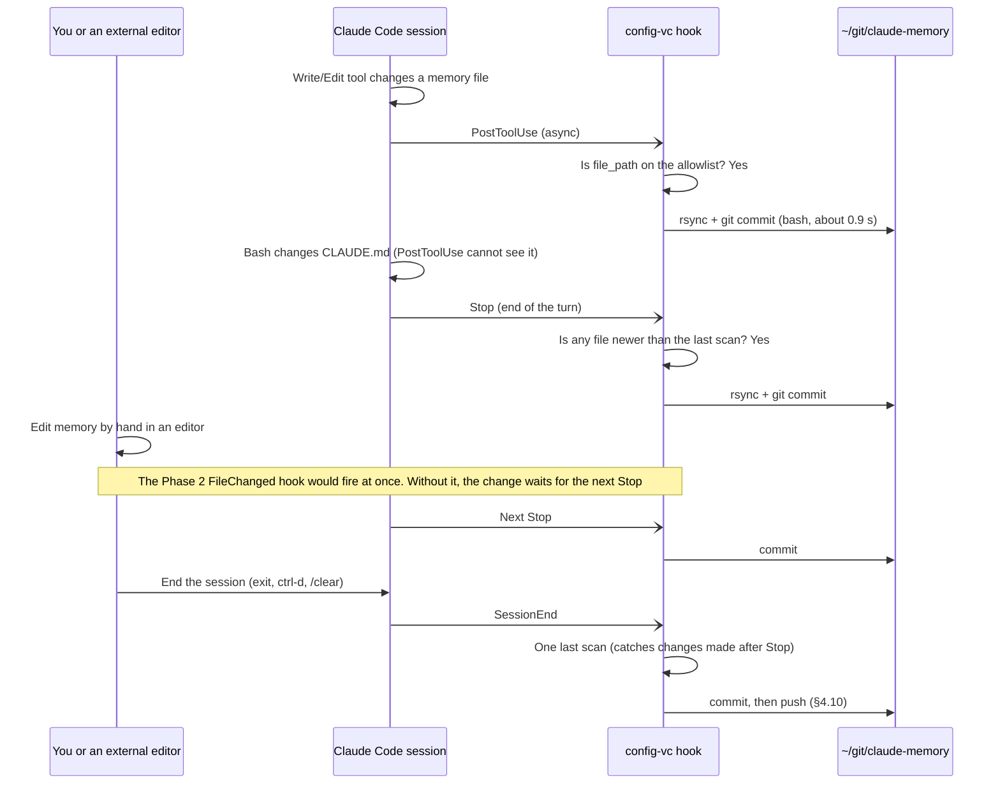
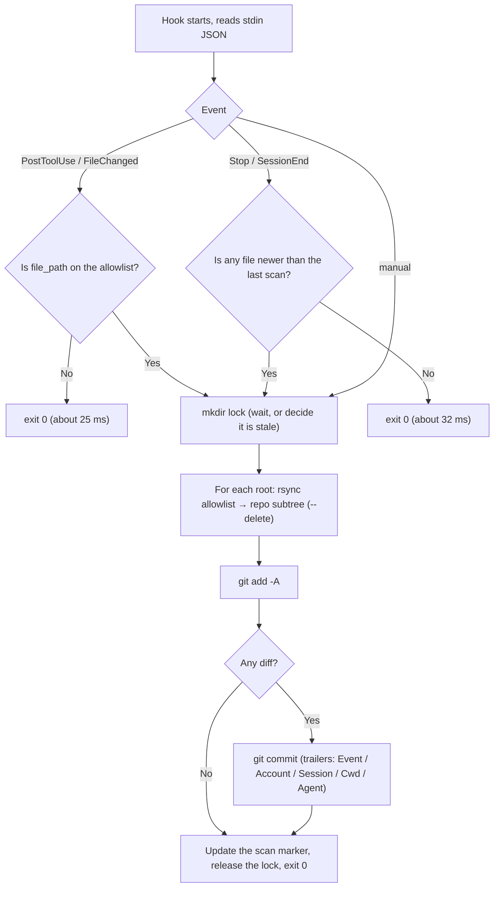
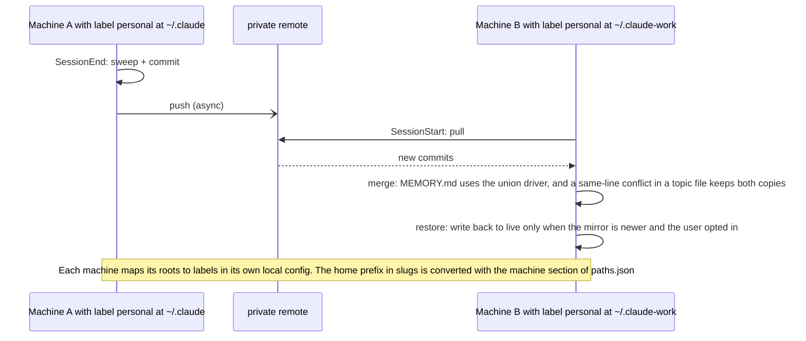
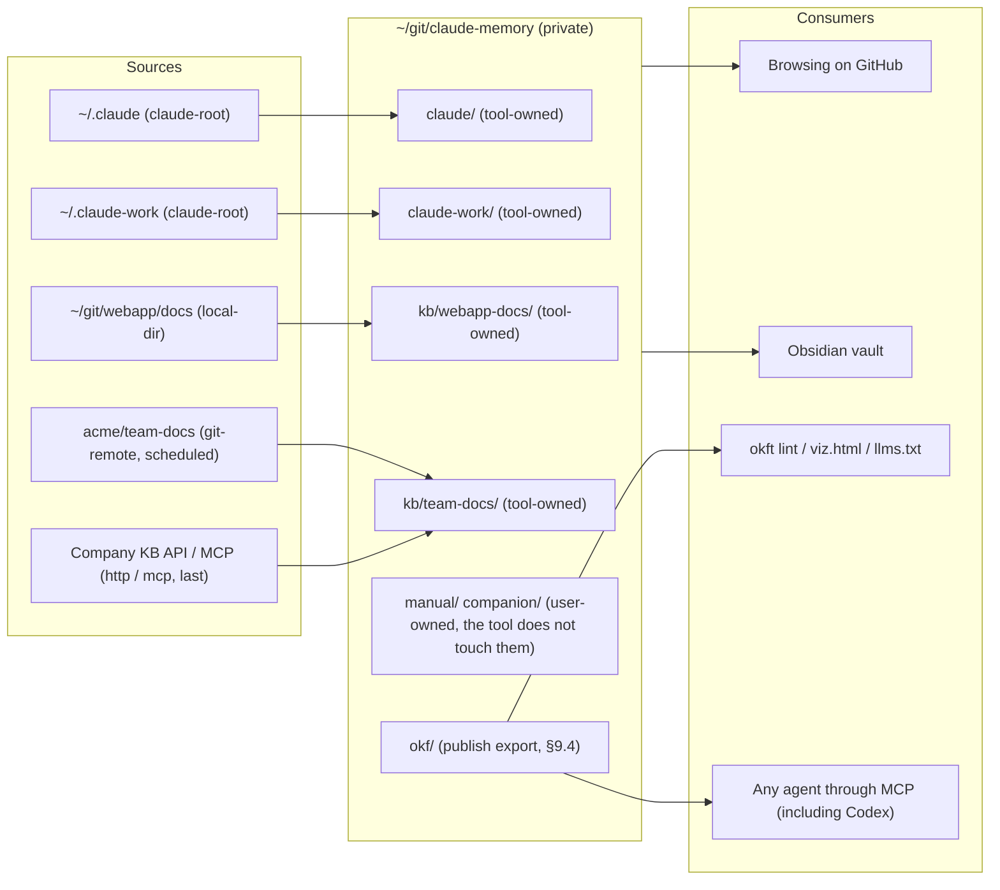
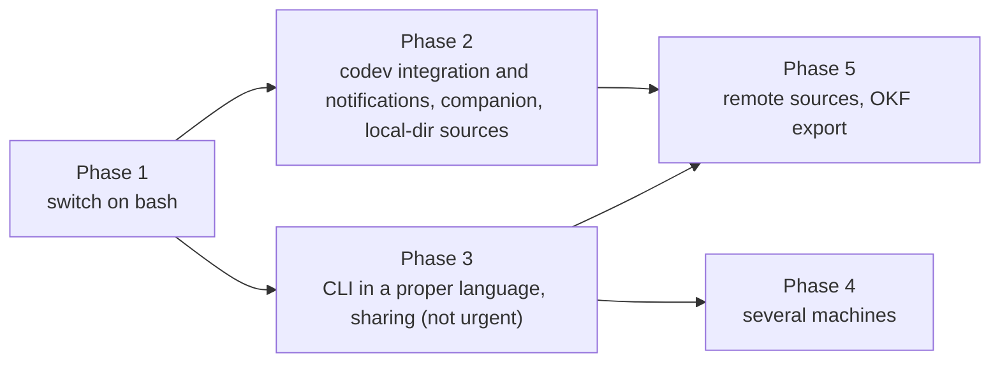

# Version Control for Claude Code Memory and Settings: Design Document

> **About this document.** This is the design record written in September 2026 while memsaga was built. Sections that carry a date are kept as history, so they use old names (memvc and config-vc for the tool; ccmem and claude-memory for the data repo) and plans that later changed. The current behaviour is described in [README.md](../README.md), [docs/architecture.md](architecture.md) and [docs/two-way-sync.md](two-way-sync.md).

Version 0.1, 2026-09-13. Authors: author and Claude Code (model Fable 5.1). Status: the design is final enough to build Phase 1. It waits for author to decide the open questions (§12) before it is installed.

This document assumes the reader does not have the context of the discussion that produced it. Each term is explained the first time it appears. All measurements come from author's own machine; Appendix A has the raw numbers.

---

## 0. One-page summary

**The problem.** Claude Code writes "global instructions" to `~/.claude/CLAUDE.md`. It writes the facts it learns in each working directory to `~/.claude/projects/<slug>/memory/*.md` (this is called auto-memory). These files have no history. If two sessions change the same CLAUDE.md on the same day, nothing can tell you what the previous version looked like. A few days ago Claude was asked to clean up memory (delete, move and merge files); after that, the deleted content was simply gone. The need is **version control**: history, diff, rollback, attribution (which session changed what), browsing, and later several machines. git is one way to build it, and today it is the most balanced way (§3.3).

**The approach.** A "mirror repo" driven by hooks.

- Claude Code's official hooks call a script at three points: `PostToolUse` (right after a Write or Edit tool call wrote a file), `Stop` (the end of each turn) and `SessionEnd`.
- The script copies the files on an allowlist (CLAUDE.md, each project's memory, opt-in skills, and so on) with rsync (a standard file-copy tool) into `~/git/claude-memory`, a private git repo. If anything changed, it commits. The commit message records the event, the account, the session and the current working directory (cwd).
- The live files are never inside the repo's work tree. So no `git checkout` or `git clean` can touch the settings that are in use.
- Both Claude accounts are collected, each in its own subtree. They are `~/.claude` and `~/.claude-work`, and they are managed by codev (the author's open-source macOS app, github.com/grimmerk/codev: a VS Code project switcher and Claude Code session manager).

**Done so far.** A 142-line bash prototype, `hook/config-vc.sh`. 7 tests (including 8 sessions firing at the same moment) passed 5 runs in a row. A dry run on real data copied 234 files in 0.9 seconds. The hook costs 59 ms of wall-clock time per turn on average, and it runs async, so it does not block you. It is not yet registered in settings.json.

**Implementation status (2026-09-18).** Phase 1 is done in **Rust** and is live on the main account. The tool is `~/git/memvc` (memvc was the tool's first name; it is now memsaga, §13.2). It is a Cargo workspace with the `memvc-core` library and the `memvc` CLI. The binary is installed at `~/.cargo/bin/memvc` and is 2.8 MB. All 24 tests pass: 15 end-to-end (e2e) behaviour tests that run the real binary against real git, and 9 unit tests. The data repo is `~/git/ccmem` (its first name; it is now `memories`). `init` first backfills from transcripts: 1,222 writes become 502 commits with their original dates (697 versions could be rebuilt and 525 could not). Then it imports the current state. The result is 503 commits in total and a 22 MB `.git`, built in 1 minute 18 seconds. Measured hook costs: `PostToolUse` on an unrelated file 5.2 ms, `Stop` with no change 24 ms, the reporter 4.4 ms. The config file is `~/.config/memvc/config.toml`. The hooks are registered in `~/.claude/settings.json` (not yet in the work account; it runs for one week first). The `memvc-history` skill is in `~/.claude/skills/`. Not done yet: a GitHub remote and push (§4.10), codev integration, `log.md`. Details are in §13.

**Recommended path (original).** Phase 1: switch on the bash prototype (doable this week). Phase 2: light codev integration (a switch, an installer, an "open history" button). Phase 3: if the tool is shared with others, port it to a single Go or Rust binary, and the bash version becomes the test specification. Phase 4: several machines. Phase 5: grow into a central knowledge base. Details are in §10.

---

## 1. Goals and scope

### 1.1 What to version

| Priority | Content | Location | Default |
|---|---|---|---|
| Required | Global instructions, CLAUDE.md | `<root>/CLAUDE.md` | Collected |
| Required | Each project's auto-memory | `<root>/projects/<slug>/memory/*.md` | Collected |
| Recommended | skills | `<root>/skills/**` | Collected (commands are the older mechanism and are not collected) |
| Opt-in | settings.json, settings.local.json, statusline, hooks/ | `<root>/*` | Not collected |
| Never | transcripts, `~/.claude.json` (holds OAuth login tokens), file-history, plugins, cache | | Not collected; nothing outside the allowlist can get in |

`<root>` is one Claude configuration directory. author has two: `~/.claude` (account main) and `~/.claude-work` (account work, selected with `CLAUDE_CONFIG_DIR`).

### 1.2 Requirements

1. **Zero manual steps.** Changing a file creates history. Nothing extra is needed in the conversation.
2. **Never block the user.** The hook must be async, exit quickly, and always exit 0.
3. **Never touch live files.** The tool only reads configuration directories and only writes the repo. Restoring is an explicit user action.
4. **Browsable.** You can read the history on GitHub or with a local `git log`.
5. **Private.** CLAUDE.md contains names of the employer's internal infrastructure, and memory mentions customers and incidents. The repo is private from day one.
6. **Two accounts**, compatible with codev's Sharing feature (the second account's CLAUDE.md, skills and commands are symlinks back to `~/.claude`).

### 1.3 Out of scope (this version)

Sync across machines (§8 only reserves the design), Codex support (Codex is OpenAI's coding agent; §9.3 only keeps the option open), and semantic search (§3.3 explains why not).

---

## 2. Current state

### 2.1 Where things live

```
~/.claude/                                   ← account main (the anchor)
├── CLAUDE.md                                ← global instructions, the only real copy
└── projects/
    ├── -Users-me-git/                  ← cwd = ~/git
    │   ├── <session-id>.jsonl               ← transcripts (not mirrored)
    │   └── memory/                          ← 21 files
    │       ├── MEMORY.md                    ← index; its first 200 lines load at session start
    │       └── <topic>.md                   ← one fact per file
    ├── -Users-me-git-webapp/memory/    ← 89
    ├── -Users-me-git-webapp-ui/memory/ ← 1 (Claude Code already deleted the transcripts; only memory is left)
    ├── -Users-me-git-webapp-some-branch-packages-some-package/memory/  ← 1
    └── … (13 memory directories with content in total)

~/.claude-work/                              ← account work, a separate tree
├── CLAUDE.md -> /Users/me/.claude/CLAUDE.md     ← symlink made by codev Sharing
├── skills   -> /Users/me/.claude/skills
├── commands -> /Users/me/.claude/commands
└── projects/
    ├── -Users-me-git/memory/           ← 6 (different files from main's ~/git memory)
    ├── -Users-me-git-webapp/memory/    ← 33
    └── … (6 in total)
```

Three facts:
- **The slug is the cwd's absolute path with every non-alphanumeric character replaced by `-`.** A reverse lookup through `history.jsonl` (which records the `project` of every prompt) maps 18 of the 19 memory directories back to a real path, with 0 slug collisions.
- `~/git` and `~/git/webapp` are **two unrelated** memory directories. They have no parent-child link.
- `projects/` itself is flat, one level deep. The hierarchy survives only inside the slug string.

### 2.2 Who writes these files (243 real transcripts)

| How it was written | Count | Share | Which hook sees it |
|---|---|---|---|
| Write / Edit tools | 1,048 | 70% | `PostToolUse`, at once |
| Bash (`python3 - <<'PY'` string replacement, `printf >>`, and so on) | 441 | 30% | Only the `Stop` scan |

61 sessions wrote with the tools, and 49 sessions wrote with Bash. **Conclusion: the `Stop` scan is not a backup. It is a required layer.**

### 2.3 codev's role

codev (author's open-source macOS app: a VS Code project switcher plus Claude Code session management) already manages the two accounts. Its registry is `~/.config/codev/accounts.json`. `claude work` is a shell function that actually runs `env CLAUDE_CONFIG_DIR=$HOME/.claude-work claude`. Sharing uses absolute-path symlinks. On every launch, codev uses read-merge-write to put its own status hook into the settings.json of **both** accounts (it keeps other entries, but the write is not atomic). It does not read or write CLAUDE.md, memory or file-history. It has no chokidar (a Node.js file-watching library); it only runs `fs.watch` on its own status directory.

---

## 3. Survey of alternatives

### 3.1 Open source (two rounds of search: GitHub in all languages, plus the web)

Projects that can, in principle, do "CLAUDE.md + memory + git + hook":

| Repo | Language / stars / last push | Covers | Trigger | Gap |
|---|---|---|---|---|
| toroleapinc/claude-brain | Shell / 88 / 2026-06 | CLAUDE.md, memory, skills, settings | SessionStart/End hook + git | Merges memory through `claude -p`; no updates since June |
| cmacha2/cenv | Rust / 0 / 08-31 | CLAUDE.md, settings, allowlisted memory | Stop/SessionEnd hook | One config dir only; its gitleaks gate (a secret scanner) is worth learning from |
| nanzhi84/harness-sync | TypeScript / 1 / 06-20 | CLAUDE.md, settings, skills, memory snapshots with slug remapping; also manages Codex | launchd (the macOS service manager) + SessionEnd hook | Snapshots, not a commit per change |
| weisbert/claude-memory-overhaul | Shell / 1 / 08-27 | Turns the memory directory itself into a git repo | Auto-commit on Stop + SessionEnd | An in-place repo (the risk in §4.1) |
| Beennnn/memvault | Shell / 0 / 07-09 | memory + rules into a cloud drive | PostToolUse/Stop/SessionStart hook | No git |
| renefichtmueller/claude-sync | TypeScript / 27 / 06-24 | All of `~/.claude`, including credentials and transcripts | The README says there is a hook, but no code calls it | Manual only in practice |
| schemann/claude-project-sync | TypeScript / 1 / 07-18 | Moves memory between config dirs on one machine | Manual | The only one that supports `CLAUDE_CONFIG_DIR`, but not across machines |

There are also a dozen or more personal scripts with 0 to 1 stars (Appendix B). What they have in common: one author, active for a few weeks to a few months. None of them does all of "commit at once on every edit + scan every turn to catch misses + two config dirs + a browsable layout". Before trusting any of them on every edit, I would have to read all of its code. That is about as much work as writing 142 lines myself. **Decision: build our own.**

### 3.2 Route B: `autoMemoryDirectory`

Claude Code has an `autoMemoryDirectory` setting (v2.1.74+, at any settings level). It moves memory to a chosen directory. If each project's own `.claude/settings.local.json` points it at `~/git/claude-memory/<project>/`, Claude writes straight into the git repo. The hook then only needs `git commit`: no copying and no slugs.

| | Mirror (this design) | Route B |
|---|---|---|
| Setup | Once, global | Once per cwd (each worktree and each subdirectory counts as one) |
| The existing 19 directories | Untouched | Must be moved |
| Live files inside a git work tree | No | Yes; `git checkout .` can touch the memory in use |
| Delay | Until the next hook | Zero |
| Two accounts | One subtree each | One setting each |

Measured on 2026-09-17 (a scratch project, `claude -p`, with a control group):

| Setup | Result |
|---|---|
| A real memory directory (control) | Write is approved automatically; the file lands |
| The memory directory is a symlink to a target outside `~/.claude` | Write is blocked: "requested permissions to edit … which is a sensitive file" |
| The memory directory is a symlink to a target inside `~/.claude` | Also blocked |
| The project's `.claude/settings.local.json` sets `autoMemoryDirectory` to a path inside the repo | Write is approved automatically and goes straight to that directory; the default slug directory keeps only transcripts |

So the shortcut "symlink the live memory directory into the repo" is blocked by Claude Code's own sensitive-file protection, and `autoMemoryDirectory` is the way to move memory that Claude Code supports. Two new facts about route B. (1) It is a per-project setting, so at `Stop` the tool could write `.claude/settings.local.json` for the git root of the current cwd and move the existing memory there. (2) One cwd's settings.local.json applies to both accounts, so **main and work would share one memory directory in the same project**. Today they are separate; for example, webapp has 89 files versus 33. This must be decided before adopting route B. Pointing CLAUDE.md and skills into the repo with symlinks is already proven to work by the work account (the docs only warn that Cowork sessions skip a `~/.claude/CLAUDE.md` that is a symlink).

The upstream issue anthropics/claude-code#25947 (a project-local memory directory) is still open. **Decision: Phase 1 mirrors first (safe, already done). When Phase 2 evaluates two-way sync, route B is one candidate; see §4.12.**

### 3.3 Agent memory database vs git

I looked at how mem0, Letta, Zep/Graphiti, LangMem, Cognee, Honcho, Supermemory, ChatGPT and claude.ai handle versions:

| | Markdown in git | Event-sourced database (mem0) | Bitemporal graph (Zep) | Vector store that overwrites |
|---|---|---|---|---|
| History granularity | Per commit, per line | Old/new value per operation | A valid-time interval per fact | None |
| Humans can browse / diff | log / diff / blame | A table, no diff | Can query a point in time, no diff | None |
| Rollback | revert / checkout | Manual rewrite | None | None |
| Merging across machines | push / pull, three-way merge | None | Through a server | Through a server |
| Editable outside the tool | Yes | No | No | No |
| Semantic search | Needs a separate index | Yes | Yes | Yes |
| "What did I know on day X" | Commit time only | Operation time | Valid time + transaction time | None |
| Dependencies / lock-in | git | SQLite + vector store + large language model (LLM) | Graph database + LLM | Vector store |

git's three real weak points: search is literal; a time query answers "when did the file change", not "when was the fact true"; and when several writers change the same line at once, git just hands the conflict to a human. The database camp's weak points: it is opaque, it cannot be edited by hand, and it locks you in. Supporting evidence: in 2026-02 Letta moved Letta Code's memory to markdown managed by git, and file-first tools (ai-memory, basic-memory, obsidian-mind) all use "markdown in git as the source of record, with an index that can be rebuilt". **Decision: git is the system of record. If semantic search is wanted, build a separate index that can be rebuilt.**

---

## 4. Architecture

### 4.1 Data flow

```
                 hook events                                 ┌───────────────────────────┐
┌──────────────┐ PostToolUse(Write|Edit) / Stop / SessionEnd │ config-vc (executor)      │
│ Claude Code  │ ───────────────────────────────────────────▶│ 1 is the path in scope?   │
│ account main │   stdin: hook JSON                          │ 2 mtime fast path         │
│ account work │   env: CLAUDE_CONFIG_DIR (work only)        │ 3 mkdir lock              │
└──────────────┘                                             │ 4 rsync allowlist → repo  │
   ▲ read                                                    │ 5 git add / commit        │
   │                                                         └─────────────┬─────────────┘
┌──┴────────────────────────┐        read only                             │ write only
│ ~/.claude, ~/.claude-work │ ◀────────────────────────────────────────────┘
│ (live config directories) │                                       ┌───────────────────────┐
└───────────────────────────┘                                       │ ~/git/claude-memory   │
                                                                    │ private git repo      │
                                                                    │ claude/ claude-work/  │
                                                                    └───────────────────────┘
```

Why a mirror, and not `git init` inside `~/.claude`: (1) If you exclude `projects/`, you lose memory. If you include `projects/`, you need a `.gitignore` allowlist to keep transcripts out, and one wrong line commits conversation content. (2) Once the live directory has a `.git`, any session that runs `git checkout .` or `git clean` there changes the settings in use. (3) Two account directories cannot be one in-place repo. Another candidate is the dotfiles trick "a bare repo with its work tree pointing at `~/.claude`". It solves (2) but not (3).

### 4.2 Three trigger layers

| Layer | Hook | What it catches | Delay | Status |
|---|---|---|---|---|
| 1 | `PostToolUse`, matcher `Write\|Edit` (or `PostToolBatch`) | Claude changing CLAUDE.md, memory or skills with a tool | Detected at once; by default the commit happens at that turn's Stop (see "Commit granularity" below) | The prototype commits at once; the granularity change is still to do |
| 2 | `Stop` + `SessionEnd` | Changes made with Bash (30%), deletions, anything missed | End of the turn | Done |
| 3 | `FileChanged` + `watchPaths` | Your own edits in an editor; edits by other programs | At once | Phase 2 experiment |

When each layer takes over during one turn:



**What Stop and SessionEnd mean, and how we use them.** `Stop` fires each time Claude finishes answering a prompt, which is the end of each turn. `SessionEnd` fires once, when the whole session ends (you exit, press ctrl-d, run `/clear`, or close the window). For the script both mean the same thing: scan. The difference is timing. `Stop` is the normal layer 2 and scans once per turn. `SessionEnd` is the last safety net. It catches changes made after this turn's Stop and before the session ends (for example, you change memory with Bash yourself after Claude has answered, and then leave). It is also the natural time to push and to send one summary notification, because nobody is waiting any more.

**Commit granularity: by default "one commit per turn", not "one commit per edit".** In the prototype, layer 1 scans and commits on every matching Write/Edit. When Claude changes the same file many times in one turn, this makes a fragmented history. Example: one message sends 15 Edit calls in parallel (Claude Code runs several tool calls from the same reply as one parallel batch). 15 hooks start at once, the lock puts them in a queue, and the result is several commits, each holding part of the change. The fix is to separate "detect" from "commit":

| Event | What it does | Cost |
|---|---|---|
| `PostToolUse` (Write/Edit in scope) | Only `touch` a dirty marker; no scan | About 5 ms |
| `PostToolBatch` (fires once when a batch of parallel tool calls ends; its input carries the whole batch as `tool_calls[]`) | Same as above; can replace PostToolUse to start fewer processes | Once per batch |
| `Stop` | If dirty, or if an mtime (a file's last-modified time) is newer than the last scan: scan + **one** commit whose message lists every file changed in that turn | Pays 0.9 s only when something changed |
| `SessionEnd` | Same as Stop, then push | |

This way, however many edits and files a turn has, it is one commit, and the session and cwd in the trailer belong to that same turn. The cost is that "at once" becomes "at the end of the turn", which is usually tens of seconds to a few minutes. Anyone who wants one commit per edit can set `CCVC_GRANULARITY=edit`. The mod version (a Claude Mods plugin, §9.5) has this granularity by nature (`turn.complete`).

Layer 3 evaluation (measured 2026-09-16, a scratch project + `claude -p`): Claude Code uses a real filesystem watcher, so it catches writes from anyone. The hook receives `file_path` and `event` (change / add / unlink). The matcher only knows file names inside the cwd; absolute paths must come from a `SessionStart` hook that returns `watchPaths`. Results: `watchPaths` **accepts directories** (changing `b.md` and adding `c.md` under the directory both fire). **Events are debounced**: 5 quick appends in a row send only 1 event, while writes 1 second apart each send one. It also fires in `-p` mode. So it is usable: SessionStart just needs to return the absolute paths of the 19 memory directories and the two CLAUDE.md files.

What "does not trigger itself" means: if a FileChanged hook changes a watched file itself, it fires itself again and makes a loop (the example in the official docs that normalises Windows line endings, CRLF, guards against exactly this). Our script only reads the memory directories and only writes `~/git/claude-memory`, which is not on the watch list, so there is no loop. One Write makes layer 1 and layer 3 each run once. The second run exits within 32 ms, because the file's mtime is older than the last scan.

"You edit it yourself" has two cases, and they go in different directions. (1) You edit the live file under `~/.claude/projects/…/memory/` directly. Layer 2 picks it up on the next turn, and layer 3 could pick it up at once. (2) You edit the mirrored copy inside `~/git/claude-memory`. This is **not** synced back to the live file. The mirror is one-way, and writing back happens only through an explicit restore (§4.6, §8). In the mirror, the subtrees that the tool owns (`claude/`, `claude-work/`) are overwritten by rsync on the next scan to match the live files, so hand edits there are lost. Paths that the user owns (`manual/`, `companion/`) are committed into history by the next scan (§9.1).

The value of layer 3 is to commit editor edits "at once" instead of "at the end of the next turn". Layer 2 already guarantees correctness, so layer 3 is planned for Phase 2.

All hooks use `async: true` and `timeout: 30`. The script has no `set -e` and no `trap ERR` (the bash 3.2 that ships with macOS fires ERR by mistake inside `||`/`&&` chains; the prototype hit this). Every step tolerates failure, and the script always exits 0.

### 4.3 Script flow in detail



1. Read the stdin JSON and take `hook_event_name`.
2. `PostToolUse`: use `tool_input.file_path` to decide whether the path is on any root's allowlist. If not, exit (25 ms).
3. `Stop`/`SessionEnd`: decide whether "any file is newer than the last scan". At the start of every scan, the script `touch`es an empty marker file, `.git/config-vc.last-sweep`. Its mtime is "the time of the last scan". Next time, the script asks the filesystem whether anything changed after the marker: `[ file -nt marker ]` for a single file, and `find dir -newer marker -print -quit` for a directory (it stops at the first hit). This is only a few `stat` system calls and reads no file content, so it takes 32 ms. Deletions are caught too, because deleting a file updates the mtime of its parent directory. A symlinked directory needs a trailing slash so that `find` follows it (measured: without the slash it misses changes).
4. Take the lock. The lock exists for **mutual exclusion**. You run several Claude sessions at once, and their hooks may each start a script in the same second. If two of them rsync and `git commit` at the same time, they hit `index.lock` or overwrite each other's work. So the script first "claims a slot"; only the one that gets it does the work, and the others wait (up to 10 seconds) or give up. The claim is `mkdir .git/config-vc.lock`. `mkdir` is atomic at the filesystem level: when two processes try at once, only one succeeds. This is the standard replacement on macOS, which has no `flock` command. The lock counts as stale (left behind by a script that died) only when `stat` succeeds and the lock is older than 120 seconds. A failed `stat` means someone just released the lock, so the script simply retries. The prototype's first version treated a failed `stat` as stale and deleted a lock that someone had just created; this is fixed.
5. For each root: `rsync -a --delete` the files and directories on the allowlist into `<repo>/<root name>/`, excluding `*.codev-bak*`, `*.codev-tmp-*` and `.DS_Store`. Memory directories are rsynced one by one into `<repo>/<root name>/memory/<slug>/` (before 2026-09-18 this was `projects/<slug>/memory/`). Empty directories are skipped, and a slug whose source disappeared is removed from the repo. Symlinks stay symlinks.
6. `git add -A`. If there is no diff, update the marker and exit. If there is a diff, commit with `-c commit.gpgsign=false`, so that 1Password (the password manager that holds the signing key) does not pop up a signing prompt inside the hook.
7. The test with 8 sessions firing at once: strictly one after another, 1 commit holding all 8 files, 0 failures, no leftover lock.

A full scan takes 940 ms. That is the cost of "copy 234 files + git" itself and has nothing to do with the hook mechanism. Any implementation pays git's roughly 75 ms plus the copy time; what bash adds is the cost of forking subshells (§5.1). One optimisation is not done yet: a **targeted scan**. `PostToolUse` already knows which file changed, so it can rsync only that root's one memory directory instead of all 21. The estimate is that 940 ms drops to about 150 ms, and bash can do it. `Stop` keeps the full scan.

### 4.4 Repo layout

**Layout A (used in Phase 1):** copy the slugs as they are.

```
~/git/claude-memory/
├── README.md                    ← auto-generated index (§4.7)
├── paths.json                   ← slug ↔ real path map, generated from history.jsonl
├── claude/
│   ├── CLAUDE.md
│   ├── skills/…                 (opt-in)
│   └── memory/                  ← the live side is projects/<slug>/memory/; the repo drops the projects level (since 2026-09-18)
│       ├── -Users-me-git/…
│       ├── -Users-me-git-webapp/…
│       └── …
└── claude-work/
    ├── CLAUDE.md -> ../claude/CLAUDE.md      ← relative symlink, so the repo is self-contained (Phase 1.1)
    ├── skills   -> ../claude/skills
    └── memory/
        └── -Users-me-git-webapp/…
```

Restoring takes almost no thought. Only one kind of path needs mapping (`projects/<slug>/memory/` ↔ `memory/<slug>/`), and everything else maps one to one. The downside: the layout is as flat as the source, and the README index has to make up for it when browsing.

**Layout B (a later option):** rebuild the real path tree, such as `home/git/webapp/memory/…`. Paths outside home go under `root/…`, and slugs that cannot be mapped back go under `_unresolved/<slug>/`. Moving from A to B is one `git mv` commit, and `git log --follow` keeps each file's history. `paths.json` can be regenerated from `history.jsonl` at any time. author prefers A first, because B has to handle the general case of roots anywhere under `/`. **Decision: A. B stays as a later option.**

Subtree names use the basename of the root directory (`claude`, `claude-work`), not codev's account label. Labels can be renamed, and a rename would move the whole tree. For mapping labels across machines, see §8.

### 4.5 Two accounts and symlinks

In a work-account session, Claude writes `~/.claude-work/CLAUDE.md`, which is a symlink. The hook receives the path `~/.claude-work/CLAUDE.md`, which matches the allowlist of the root `~/.claude-work`. The fast path (the hook's quick exit when no scan is needed; see Appendix D) uses `-nt`, which follows symlinks (measured: it DETECTS the change). After the scan, the content change lands in `claude/CLAUDE.md`, while `claude-work/CLAUDE.md` stays a symlink. The commit trailer is `Account: work`: the hook inherits `CLAUDE_CONFIG_DIR`, and comparing it with accounts.json gives the label. If author later presses "Unlink & restore" in codev to replace the symlink with a real file, the mirror records that change as an ordinary commit.

```
  work-account session                                 main-account session
  Write ~/.claude-work/CLAUDE.md                       Write ~/.claude/CLAUDE.md
          │                                              │
          ▼                                              ▼
  ~/.claude-work/CLAUDE.md ──────symlink────────────▶  ~/.claude/CLAUDE.md (the only real copy)
          │ hook: root=~/.claude-work matches            │ hook: root=~/.claude matches
          │ -nt follows the symlink, sees new mtime      │
          ▼                                              ▼
  repo/claude-work/CLAUDE.md -> ../claude/CLAUDE.md    repo/claude/CLAUDE.md (the content change lands here)
  commit trailer  Account: work                        commit trailer  Account: main
```

### 4.6 Memory clean-up (delete, move, merge)

`rsync --delete` carries deletions into the repo. In git, a move is a delete plus an add; `git log --follow` or `-M` shows it as a rename when more than half of the content is similar. A merge shows as one file growing while other files disappear. To find what was deleted last week:

```
git -C ~/git/claude-memory log --diff-filter=D --since='7 days ago' --name-only
git -C ~/git/claude-memory show <sha>^:claude/memory/<slug>/<file>.md   # revisions before 2026-09-18 use claude/projects/<slug>/memory/
```

Prototype test 5 is exactly this: "Claude deletes a memory file with Bash, and after the Stop scan a deletion is committed". Both layouts support it. When a whole project's memory is emptied, its node is removed.

### 4.7 Commit messages and the index

There are three modes, set with `CCVC_MSG=auto|prompt|llm`:

- `auto` (the default, zero cost): the subject is `<event>: <account>:<area>, …`, the body is `git diff --name-status`, and the trailers are `Event / Account / Session / Cwd / Agent`.
- `prompt` (zero cost; the message contains conversation content): the subject is the first 60 characters of the turn's last user prompt, taken from the `transcript_path` that the hook receives.
- `llm` (opt-in): `claude -p` uses Haiku (the smallest Claude model) to summarise the diff. Measured: 12.4 seconds per call and about one to two thousand tokens. Turning off the Model Context Protocol (MCP) servers only brings it down to 8.5 seconds; most of the time is CLI start-up. `claude -p` has no fast flag. `/fast` speeds up Opus output in interactive mode and is unrelated here, and Haiku is already the fastest model. Calling the API directly takes about 1 to 2 seconds but needs an API key. Either way, the LLM must never block the commit. Commit first with the `auto` message, and attach the summary later with `git notes`. git notes are git's built-in "annotations": `git notes add -m 'summary' <sha>` attaches text to an existing commit without changing its SHA (the commit hash). `git log` shows the note too. Notes are stored in `refs/notes/commits` and need a separate `git push origin refs/notes/*`. The drawback: the GitHub website has not shown notes since 2014, so if the summary must be visible on GitHub, writing it into `log.md` is more practical. Recursion guard: `claude -p` starts a session and fires the Stop hook. `--bare` skips hooks but does not accept the OAuth login, so the environment variable `CCVC_INNER=1` makes the child session's hook exit at once.

The `README.md` index is regenerated on every commit. It has one row per project (real path, number of memory files, last commit), and the file names link to the slug directories. The GitHub front page becomes the table of contents, so browsing works without layout B. Another local way to browse is to open the data repo as an Obsidian vault (Obsidian is a Markdown note-taking app; §9.3). Wikilinks, backlinks, the graph view and the properties view then all come for free.

### 4.8 Configuration file

`~/.config/claude-config-vc/config.sh` (it becomes TOML, a config file format, in Phase 3):

```
CCVC_REPO=~/git/claude-memory
CCVC_ROOTS=                       # empty = read codev accounts.json, then fall back to ~/.claude
CCVC_FILES="CLAUDE.md"            # top-level files of each root
CCVC_DIRS="skills"                # top-level directories of each root
CCVC_MEMORY=1                     # projects/*/memory
CCVC_MSG=auto
```

Root discovery order: explicit setting > codev registry > the default `~/.claude`. The codev registry is an **optional discovery source**; if the file is missing, the tool falls back. The tool does not need codev to exist. This shape (root + file list + directory list + memory glob + excludes) is the basis for the generalisation in §9.

### 4.9 Notifications and visibility: the tool only emits events; each UI shows them in its own way

The need: when a sync happens, there should be a place to see it, either as a brief flash or as a list to check later. The principle: **the tool writes one machine-readable event log, and every way of showing it is a consumer of that log.** Then the terminal, macOS notifications, codev and notch-style apps can all plug in, and the tool depends on none of them.

```
                         ┌───────────────────────────────┐
  sweep / commit ───────▶│ events.jsonl (one line/sweep) │
                         │ ts, event, account, session,  │
                         │ cwd, files, sha, duration     │
                         └──────┬───────┬───────┬────────┘
                                │       │       │
        ┌───────────────────────┘       │       └────────────────────┐
        ▼                               ▼                            ▼
  ① flash in the terminal          ② macOS notification            ③ codev (Phase 2)
  reporter hook (sync, ~5 ms)      osascript, opt-in               sync badge on each row of the Sessions list
  one systemMessage line           one per commit is too noisy     "recent syncs" list in the menu bar
                                                                   Electron Notification, can open the diff
  ④ notch-style apps (vibe-island and others): one more consumer, only if the app offers an input interface
```

| Layer | Where it is built | Mechanism | Cost and noise | Status |
|---|---|---|---|---|
| Event log + `status` / `log` commands | The tool | Append one JSON line per sweep; `status` shows the last success time and the latest N entries | Zero | Phase 1; this is the "list to check later" |
| ① Flash in the terminal | The tool | "Flash" means the Claude Code terminal prints one grey line at the end of the turn, like its own "Saved 2 memories". It is done by a separate **sync** reporter hook (a reporter is "a hook that reports") on `Stop`. It reads the events since the last report and returns `{"systemMessage": "…: 2 files → abc123"}` | About 5 ms, synchronous; appears only on turns with a commit | author is neutral to mildly positive about in-terminal notices; they are not the main point. **On by default but quiet** (one line, only when there is a commit); one setting turns it off |
| ② macOS notification | The tool | `osascript -e 'display notification'` after a commit or at SessionEnd, or terminal-notifier | No dependency. The sender shows as Script Editor and cannot be clicked. An estimated one turn in ten has a commit, so one notice per commit would be noisy | The fallback without codev; suggest one summary at SessionEnd only |
| ③ codev | codev | `fs.watch` on events.jsonl (the same pattern it uses for codev-status). Three display points: a "recent syncs" list in a menu-bar submenu; macOS notifications sent through Electron's `Notification` API (codev is an Electron app), which carry codev's app identity and can open the GitHub commit, Obsidian, or codev's own history window; and a "Sessions list badge". The badge works like this: each row in the Sessions mode of codev's Quick Switcher (its project and session picker) already has a status light, and events carry the session id, so the same row can show a small count such as "this session synced 3 times". Optional | Zero cost for the tool | Phase 2, **the main display** (author wants macOS notifications and the menu bar, not the terminal) |
| ④ Notch-style apps (apps that show agent status around the MacBook camera notch) | That app | vibe-island's bridge only accepts `--source <agent> [--event <name>]` to forward Claude's hook JSON; it has no documented entry point for custom events | | Connect only if it opens an API |

Why ① needs its own sync hook: the `systemMessage` returned by an async hook is handed to Claude on the next turn and is **not shown to the user** (hooks reference, "How async hooks execute"). Only a synchronous hook's `systemMessage` appears in the terminal. So the scan stays async (0.9 seconds, never blocking), and reporting uses a synchronous hook that only reads the event file (5 ms). As an opt-in, the same mechanism could also give Claude "memory just committed abc123" as `additionalContext`, to work with the `config-history` skill planned for Phase 1. It is off by default, because for the model it is noise.

Where the event log lives: `.git/config-vc.events.jsonl` in the data repo (not version-controlled, but it travels with the repo). `status` reads it. codev only needs the data repo's path to find it.

---

### 4.10 Push: when, how to authenticate, what to do on failure

A commit is local. Pushing to a private GitHub remote is a separate action, and the design keeps the two apart, because pushing needs the network and authentication and must not slow down the hook.

- **When.** `SessionEnd` is the moment you leave Claude Code or run `/clear`, not every turn, and author thinks that is too rare. So the plan changed. At `Stop`, if the local repo is ahead of the remote **and** the last successful push was more than 10 minutes ago, push once, async. This is throttled, so the network is not hit every turn. `SessionEnd` pushes once more, and the `manual` command can push by hand. When role-b from §4.11 or codev exists, it pushes on a schedule. There is no push in `PostToolUse`.
- **Authentication is the key point**, and commit and push are two different things. I checked author's setup: `gpg.format = ssh`, and both `SSH_AUTH_SOCK` and the `IdentityAgent` in `~/.ssh/config` point to 1Password's agent. So **both signing and SSH (Secure Shell) connections go through 1Password**. Commit: the hook passes `-c commit.gpgsign=false`, and without signing it never touches the agent. Every commit in the tests succeeded, so the proof of concept (PoC) cannot fail for this reason. Push: over SSH it touches the agent. If the agent asks for confirmation, the hook has no terminal (TTY) to answer it and hangs until it times out. Over HTTPS, `gh` is logged in and its token has the `repo` scope, but `credential.helper` is not set yet. So `gh auth setup-git` must run once; after that, HTTPS push is non-interactive. Before going live, verify once with `GIT_TERMINAL_PROMPT=0 git push </dev/null`. During the PoC, a failed push only means the remote is behind; commits are not affected.
- **On failure.** A failed push only writes to the log and to the event log (§4.9), and the next SessionEnd tries again. Never force-push. A remote that is behind the local repo is not an error; pull and merge for multi-machine sync belong to §8.
- **Privacy.** The remote must be a private repo. The `status` command shows "local is ahead of the remote by N commits", so you can see whether pushes succeed.

### 4.11 A light hook plus a resident worker: a spool directory and launchd

author's idea: the hook is only a very light role-a′ (it starts a process, but that process takes a few milliseconds) and hands the work to a resident role-b. On macOS the cheapest way is not to keep your own process running forever. It is a **spool directory + launchd**:

```
hook (any language, 2 to 5 ms)                                                 role-b (a job that launchd starts)
  write one JSON event file into spool/ (tmp first, then rename: atomic)  ──▶  launchd QueueDirectories / WatchPaths starts the job when spool has a file
  exit 0 at once                                                               read the whole batch, remove duplicates, merge several edits of one session
                                                                               scan + commit (the lock is inside its own process; no mkdir lock needed)
                                                                               throttled push, write events.jsonl, send notifications
                                                                               exit when done; uses no CPU when idle
```

Benefits: the hook's fixed cost falls to the floor of process start-up. Events from several sessions merge naturally inside role-b. Attribution is not lost, because each event file carries the session id and the cwd. Throttled push, notifications and watching any folder (`WatchPaths`) all live in one place, role-b. codev could also act as role-b (it is already resident and already uses `fs.watch`). The two can coexist, and the launchd job is the default when codev is absent. Costs: one more launchd plist to install, and the hook needs a fallback that scans by itself when it cannot write to the spool. This is the architecture direction for Phases 2 to 3, and it uses the same file format as the event log in §4.9.

### 4.12 Two-way: edits made in the repo (by you, or by an AI that fixes wording or layout), and how they get back to the live files

author places two-way sync between nice-to-have and must: the repo is there to be browsed, and when you see something you will want to change it. There are three routes, and two of them were measured (§3.2):

| Route | How | Measured | Pros | Costs |
|---|---|---|---|---|
| C: symlink the live memory directory into the repo | `projects/<slug>/memory -> repo/…` | **Blocked by Claude Code** (sensitive file) | | Not possible |
| B: move memory with `autoMemoryDirectory` + symlink CLAUDE.md/skills | Memory lives directly in the repo; the hook only runs `git commit` | Works; approved automatically | Zero copying, zero delay, two-way by nature; the scan shrinks to git's 75 ms; edits in Obsidian or on GitHub take effect at once | A per-project setting (the tool can write it); both accounts share memory in the same project; live files are inside a git work tree, so `git checkout`/`clean` can touch them; on a new machine, memory is empty until the repo is cloned |
| D: keep the mirror, add "write-back" | For each file, use the commit of the last sync as the base and do a three-way merge: `git merge-file mirror-version base live-version` | Not built; the mechanism is standard git | No architecture change; the two accounts stay separate; live files stay out of the work tree | Needs merge and conflict policies: on a conflict, keep the live file, save the other side as `.conflict.md`, and notify; write-back happens at Stop or SessionStart |

**Recommendation:** Phase 1 keeps the one-way mirror. Phase 2 chooses B or D. If "two accounts share memory in the same project" is acceptable, B is the simplest and fastest, and the whole tool shrinks to "commit + push + notify". Otherwise, D. Both let hand edits in `companion/` and `manual/` go straight into history. Whichever route is chosen, "restore to a past version" stays an explicit user action.

### 4.13 First import (pre-scan), choosing the scope, backfilling history

**The current state goes in completely, not only new changes.** The mirror is a "state", not a "change log". Every scan rsyncs **all** files on the allowlist, so the first scan is a full import (the first commit of the dry run had 234 files), and files that never change stay in the repo afterwards. So "a project's memory was last updated last week, and I want to browse it this week" always works. Still, the import should be an explicit step, with choices:

- `init`: scan first without committing, and list each account, each project (the slug plus the real path found by reverse lookup), the file count, the last modified time and the size, so you can see what will be collected.
- Choosing: by default, collect everything. The config file's `exclude` takes globs to leave things out (for example, the slug of an experimental project, or `*/memory/scratch-*.md`). `--only` does the reverse and collects only what is listed. Exclude rules stay in force for all later scans, not just the first.
- Granularity of the first commit: by default **one commit per account** ("import claude: 13 projects, 174 files"). `--split project` makes one commit per project, so `git log` can be read project by project. The commit date is the time of the import; to give the timeline meaning, use the backfill below.

**Backfilling history (backfill, an option in Phase 2).** At import time, the earlier versions of memory files can still be found. Transcripts record every Write (with the full content) and every Edit (with the old and new strings), with timestamps. `file-history/` holds snapshots of files that Claude edited. This machine's transcripts go from 2026-07-06 to now, about 10 weeks, and about 1,000 tool writes to memory and CLAUDE.md among them can be replayed. The 441 writes made with Bash are a gap, filled by the next full Write or by a file-history snapshot. Method: replay these operations in time order. Each point in time becomes a commit with `GIT_AUTHOR_DATE` set (or one commit per day), with the session and cwd in the trailers as usual. The result is a repo that has the last 10 weeks of history on the day it is created, so `git log --since='2 weeks ago'` is useful at once. Limits: Claude Code deletes old transcripts according to `cleanupPeriodDays`, whose official default is **30 days**. You have not set it, and this machine still keeps files from July 6, which means the clean-up only runs under some conditions; but do not count on that. `file-history` keeps only the last 100 checkpoints and is deleted together with its session. The memory directories themselves are never cleaned. The backfill can only go as deep as this allows, so **it is scheduled into Phase 1's `init`**: `init` first replays the transcripts to build historical commits, then adds the import commit of the current state on top, and the repo has the past weeks of history from day one. Where the replay result does not match today's files, today's files win, and the difference is recorded in the commit message.

If Phase 1 has no time for the backfill, it can be added later without rebuilding the repo. `git replace --graft <import commit> <last backfill commit>` attaches the backfilled history before the import commit, and `git filter-repo` makes it permanent. This rewrites the SHA of every commit after the import, but all content is kept, including commits from hand edits to the mirror or from two-way write-back in the meantime. A private personal repo has no collaborators, so one force-push is fine (the employer's rule against force-push does not apply here). The only real loss is transcripts that were already deleted, and that is the one reason to do the backfill early. This is exactly the idea behind the `backfill` of okf-skills (a Claude Code plugin for the Open Knowledge Format, §9.4). It is also one reason for building our own (§3.2): no existing tool does this.

## 5. Cost

### 5.1 Each case (real transcripts: 9,651 turns, 63,389 tool calls, 10,571 Write/Edit calls)

| # | Case | Is the hook called? | Share | bash today | bash optimised (estimate) | Go/Rust (estimate) |
|---|---|---|---|---|---|---|
| 1 | Read, Bash, Grep and other tools that are not Write/Edit | No | 83% of tool calls | 0 | 0 | 0 |
| 2 | Write/Edit to CLAUDE.md / memory | Yes, a full scan at once | 1.7% of tool calls (10% of Write/Edit) | 940 ms wall, about 0.5 s CPU | About 450 ms | About 100 ms |
| 3 | Bash changes CLAUDE.md / memory | A full scan at that turn's Stop | 441 / 9,651 turns ≈ 4.6% of turns | 940 ms (at the end of the turn) | About 450 ms | About 100 ms |
| 4 | Write/Edit to other files | Yes; checks the path, then exits | 15% of tool calls (90% of Write/Edit) | 25 ms | About 10 ms | About 3 ms |
| 5 | Stop on every turn, with no change | Yes; compares mtimes, then exits | Almost every turn | 32 ms | About 12 ms | About 5 ms |
| 6 | SessionEnd | Same as 5 or 3 | Once per session | Same as above | | |

On average a turn has 1.1 Write/Edit calls. So bash today costs about 59 ms of wall-clock time and 0.03 to 0.05 seconds of CPU per turn, all async. Across the 9,651 turns of history, that adds up to about 10 minutes of CPU.

"Other files" in the table means any file outside the allowlist, mostly project source code; the hook sees that the path is out of scope and exits. CLAUDE.md and memory share a row because their costs are of the same order. Measured: CLAUDE.md is 115 KB and memory files are 1.4 to 89 KB, and an rsync of a single file takes 13 to 22 ms in every case. `git add` + commit takes 60 ms after a CLAUDE.md change and 47 ms after a change to a small memory file, a difference of 13 ms. File size is not a factor; the 940 ms is fixed overhead. **Commit frequency** (with one commit per turn, over 11,351 real turns): turns that change memory or CLAUDE.md are **10.9%** (1,233 turns: 746 with tools only, 399 with Bash only, 88 with both). Those turns average 1.5 edits, with a maximum of 14. So the 450 to 940 ms is paid about once every 9 turns, and it is async. The 940 ms of a full scan breaks down as: 21 rsync process starts, about 284 ms; git add, 20 ms; git diff, 15 ms; git commit, 40 ms; the rest is bash subshells (each `$(…)` forks, about 3 ms each, and a scan has dozens of them). A compiled tool uses a native stat walk instead of rsync (1.3 ms in Python, lower when compiled), so a full scan in Go or Rust is mostly git's 75 ms.

### 5.2 Fixed cost of each runtime (direct process start, median of 50 runs)

| Runtime | Start + read stdin | Notes |
|---|---|---|
| bash, empty script | 2.2 ms | |
| bash + jq (a JSON command-line tool) | 5.3 ms | The floor of the current hook |
| python3 3.12 | 15 ms | |
| node 24 | 18 ms | An earlier reading of 270 ms went through the nvm (Node Version Manager) shell function and was wrong |
| C | 2.0 ms | 33 KB |
| Go | 2.3 ms | 3 MB |
| Rust | 2.7 ms | 440 KB |

Repo size: after two full commits, `.git` is 2.2 MB. Each CLAUDE.md change adds a compressed blob of about 30 KB, and `git gc` stores deltas.

---

## 6. Language choice

### 6.1 Comparison

| | bash (now) | Python | TypeScript | Go | Rust |
|---|---|---|---|---|---|
| What the user must install first | Nothing (macOS ships bash 3.2) | python3 | node | **Nothing** | **Nothing** |
| Single binary | No | No | No | Yes, 3 MB | Yes, 0.5 MB |
| Hook fixed cost | 5 ms floor, 25 ms today | 15 ms | 18 ms and up | 2 ms | 3 ms |
| Cross-platform | Poor: `stat -f`, no `flock`, the trap behaviour of bash 3.2 | Good | Good | Good; cross-compiling is built in with `GOOS/GOARCH` | Good; cross-compiling needs installed targets or cargo-zigbuild |
| Publishing for others | Copy the file | pipx | npm | goreleaser makes GitHub Releases + a Homebrew tap in one step | cargo-dist can do the same; there is also cargo-binstall |
| How others install | Download with curl | `pipx install` | `npm i -g` | `brew install <tap>/<tool>` or download the binary; `go install` needs the Go toolchain | `brew install` or download the binary; `cargo install` compiles for several minutes |
| Development speed / readability | Short, but full of traps | High | High | High | Medium; a learning curve |
| Ecosystem for this kind of CLI | | | | gh, kubectl, terraform, hugo | ripgrep, fd, bat, uv, ruff |
| Familiarity here | | | codev is TypeScript (TS) | the author's employer has Go services | cargo already installed personally |

**The answer on ease of installation:** for users, Go and Rust are the same. Each is one binary, installed from a Homebrew tap or downloaded directly. The difference is on the developer side. Go's cross-compiling plus goreleaser is the easiest path from build to release. Rust needs extra targets, but cargo-dist can do it too. The feeling that "more and more CLIs are written in Rust" is true (uv, ruff, bat, fd), while Go is still the main language for devops CLIs (gh, kubectl). This tool walks files, applies rsync logic and calls git. That is process orchestration, not computation, so Rust's lack of a garbage collector (GC) and its zero-cost abstractions do not help here.

### 6.2 Addendum of 2026-09-17: should we go straight to Go?

author's premise changed. He will not read any implementation in depth; shell and Rust are equally opaque to him, and Go is the language he reads best. Also, Claude writes the code, so writing speed is not a variable. Under this premise:

- **The value of running the shell version for a week first.** What that week tests are "environment" questions: hook wiring, two accounts, interaction with codev, 1Password, commit frequency and noise. These do not depend on the language; running a Go version for a week gives the same data. The shell version's only real advantage is "already written and already tested". But it lacks everything §4 added later: the dirty marker for one commit per turn, the `git status` fast path, the event log, the `status` command, push throttling, and generating `index.md`/`log.md`. Adding them is roughly another 150 lines of bash, and we have already fallen into the traps of bash 3.2 twice.
- **The cost of going straight to Go.** A new codebase, estimated at 800 to 1,200 lines plus tests, which one session can finish. The risk is a young binary that runs on every Write/Edit. But the hook is async, always exits 0, and only writes the repo, never live files. So the worst case is "no commit", not "bad data", and `status` shows it.
- **Rust.** author wants to practise it, but he reads Go better, and Phase 2's spool daemon, generalised sources and notifications all need fast iteration. Recommendation: write the tool in Go. To practise Rust, write the hook-side shim in Rust later (read stdin, write a spool file: a few dozen lines). It is too small to slow down the main work.
- **Can the tests be reused?** Yes, and that is their main value. Today's `test/test.sh` is a black-box test. It uses fake config directories, feeds hook JSON into stdin, and checks the commits and files in the repo; it never looks at the implementation. As long as the new implementation keeps the same contract (stdin JSON, configuration through environment variables, exit 0, the repo layout, the commit trailers), the same harness runs against a different executable path. That turns the shell version into the specification. The Go version adds its own unit tests (slug mapping, the fast-path decision, the merge policy).

**The 2026-09-17 recommendation was Go. On 2026-09-18 author chose Rust instead; his reasons hold, so it is Rust.** Of his three reasons, the heaviest is architectural. codev is an Electron app (Electron is a desktop app framework built on Node.js). A Rust core can be called by codev inside its own process through napi-rs (Rust bindings for Node-API). Node-API keeps a stable application binary interface (ABI), so Electron does not need a rebuild. Then the CLI, the hook, codev's history window and `init`/backfill all share one implementation. Doing the same in Go needs cgo or a child process, which is much worse. The other two reasons: he wants to practise Rust; and whether the code is Go or Rust, he will only skim it, so the gap in readability does not decide anything for him.

The shape of the Rust version:

- One workspace with three crates: `memvc-core` (a library: config, root discovery, slug mapping, the fast path, scanning, commits, the event log, backfill, and later the merge policy), `memvc` (the CLI, built with `clap`; subcommands `hook init sweep status log install push backfill`), and `memvc-node` (napi-rs, for codev in Phase 2; an empty shell for now).
- git is always run by starting the system `git` (`std::process::Command`), not through `git2`/libgit2. Its behaviour then matches your own git setup (credential helper, the `gpgsign` override, hooks), and there is one C dependency fewer.
- File walking with `walkdir` or `ignore`, JSON with `serde_json`, errors with `anyhow`, logging with `tracing`, and Phase 2's watcher with `notify`. No async runtime; nothing in this tool needs one.
- So that author can roughly read it: small modules, short functions, no APIs heavy with lifetimes, `String`/`PathBuf` instead of borrowing tricks, a comment at the top of each module that states its purpose, and errors that carry the path through `anyhow::Context`.

Test strategy (following author's global preferences: behaviour tests first, e2e > integration > unit, no unit tests that only restate a value, and each behaviour tested once at the highest sensible level):

- **e2e / behaviour:** `tests/*.rs` use `assert_cmd` to run the compiled binary and `tempfile` to create fake config directories; they feed hook JSON to stdin and check the repo state with real `git`. This is the Rust version of the seven cases in today's `test/test.sh`: first import, no commit when nothing changed, fast exit for out-of-scope paths, commit and trailers for in-scope writes, deletion propagation, no loss with 8 parallel hooks, and symlinks kept. New cases are added: one commit per turn, the `git status` fast path picking up `companion/`, the `exclude` of `init`, backfill replay, and push throttling (against a local bare repo).
- **Contract tests:** the original bash harness stays, changed to run the Rust binary, as a cross-check that "the two implementations behave the same". It can retire once the Rust version is stable.
- **unit** tests only for pure logic: converting between slugs and real paths, the mtime decision of the fast path, ordering operations and handling gaps in the backfill, and the merge policy.
- **Mutation-verify the invariants.** There are two "never" rules: the tool never writes live files (except for an explicit restore), and `rsync --delete` never reaches outside the prefixes the tool owns. Write one test for each, then remove the guard on purpose and confirm that the test turns red (a rule from the global CLAUDE.md).

**The original 2026-09-17 recommendation (kept for context):** write Phase 1 directly in Go, and keep the shell prototype as a reference implementation and a contract test. If author wanted to be conservative, the alternative was to add the dirty marker to the shell version, run it on the main account for a week while the new version is written, and switch after the week. Both register their hooks in the same way, so switching only means changing the command path in settings.json.

**The original recommendation (2026-09-13):** Phase 1 in bash (done and tested). For sharing (Phase 3), port to **Go** (fast to develop, cross-compiling built in, goreleaser for releases, and the employer has Go experience). If author wanted to practise Rust along the way, Rust was equally fine; the difference was only in the developer experience. The bash version becomes the specification and the test cases. TypeScript was not recommended at first (users may not have node), but the Claude Mods of §9.5 changed that. A mod must be TS, so if Mods reach general availability (GA), a shared TS core plus a single binary from `bun build --compile` would be one way to avoid two implementations. **The Phase 3 language decision should wait until Mods are GA.**

---

## 7. codev integration

### 7.1 Levels

| | No integration | Light integration (recommended) | Deep integration |
|---|---|---|---|
| What codev does | Knows nothing | One switch on the Accounts page; installs the hooks into each account's settings.json; writes the roots into the tool's config; one "open history" button | The engine moves into codev: watcher, commits, history and diff, restore UI, sync |
| What the tool does | Everything, including the installer | Executor + CLI | There is no separate tool |
| Commits depend on codev running | No | No | Yes, unless the hook calls codev's CLI, and Electron takes hundreds of ms to start |
| Can be shared with others | Yes | Yes; codev only adds value | No; tied to macOS and codev |
| Where accounts come from | Set by hand, or read from accounts.json | codev writes them into the tool's config | Built in |

**Recommendation: light integration.** The tool defines the data flow; codev adds installation and display on top.

### 7.2 Two directions

- "The tool integrates codev": the tool reads `~/.config/codev/accounts.json` to discover roots. This **optional discovery** exists from Phase 1. It comes after an explicit setting and before the default, and the tool falls back if the file is missing. Its only purpose is to save typing two paths.
- "codev integrates the tool": codev offers a switch on the Accounts page. When it is turned on, codev uses its existing `installHooks` read-merge-write to put the three hook entries into **each** account's settings.json, and it writes the roots into the tool's config file. The code for this side **lives in the codev repo**; the tool repo does not need to know about codev. Once codev writes the config, the tool's fallback of reading accounts.json may stay or go.

```
codev repo                                         claude-memory-sync repo
┌────────────────────────────────────┐             ┌──────────────────────────────┐
│ Accounts page                      │             │ hook / CLI executor          │
│  [x] Version-control memory        │ writes      │  read config → sweep         │
│  repo: ~/git/claude-memory         │────────────▶│  → git commit                │
│  [Open history]                    │ config +    │                              │
│                                    │ settings    │ does not import codev;       │
│ installer (existing installHooks)  │ hooks       │ may read accounts.json       │
└────────────────────────────────────┘             └──────────────────────────────┘
```

### 7.3 Compatibility risks (checked against codev's code)

- On every launch, codev does a read-merge-write of both accounts' settings.json, and it is not atomic. The tool never writes settings.json. The only race is the one-time registration, which just needs to avoid the moment codev starts.
- When codev flips a toggle, it reformats the file (2-space indent, no trailing newline). Whitespace-only diffs appear only if settings.json is opted into version control.
- `*.codev-bak-*` and `*.codev-tmp-*` files are never cleaned up. rsync excludes them, and a test confirms that HEAD contains 0 of them.
- The tool's Stop hook is async and runs in parallel with codev's status hook (which has `timeout: 5`), so it does not slow down the idle state.
- codev has no plan, issue or TODO for versioning config. This is an entirely new feature.

### 7.4 Where the code lives

- **The tool:** a separate repo, `~/git/claude-memory-sync` (it can be public). Contents: the hook script (later the CLI), tests, design docs.
- **The data:** `~/git/claude-memory` (private). The tool's state files (`paths.json`, the README index) live here.
- **The integration layer:** the codev repo.

---

## 8. Several machines and different account names (design reserved, Phase 4)

One person with two computers may have the account names reversed: on this machine `~/.claude` is personal, and on the other machine `~/.claude` is for work. The design:

1. Repo subtrees use **logical labels** (for example `personal/`, `work/`). Each machine's config decides which local root maps to which label, instead of using the directory basename. This is the only shape Phase 1 must fix in advance: `roots = [{path: ~/.claude, label: personal}, …]`. In Phase 1 the default label is the basename; it can be changed in the config later.
2. Slugs contain the home path (`-Users-me-…`). On a machine with a different username, restore applies a prefix map (`-Users-author` ↔ `-home-author`). `paths.json` stores each machine's paths in its own section, keyed by machine id. Layout B's `home/` abstraction handles this naturally, which is one of its strengths.
3. `MEMORY.md` gets `merge=union` in `.gitattributes` (measured: when each side adds one index line, both lines are present after the merge). When both sides change the same line of a topic file, the merge conflicts (measured). The policy is "keep both and never block the session": keep the local version, save the other as `<file>.conflict-<host>.md`, and write an entry in the log.
4. Flow: push at SessionEnd (async); pull + restore at SessionStart (write back only when the mirror is newer than the live file, and only with an explicit opt-in).



---

## 9. Extensions

### 9.1 A central knowledge base (KB) (Phase 5, nice to have)

Generalise the "source":

```
[[sources]]                          # Phase 1's Claude root is one kind of source too
type = "claude-root"   path = "~/.claude"        label = "personal"
[[sources]]
type = "local-dir"     path = "~/git/webapp/docs"  include = ["**/*.md"]  dest = "kb/webapp-docs"
[[sources]]
type = "git-remote"    url  = "git@github.com:acme/team-docs.git"  paths = ["docs/"]  dest = "kb/team-docs"  schedule = "hourly"
[[sources]]
type = "http" | "mcp"  …                          # to be decided later
```

- `local-dir`: the same sweep, just with more roots. There are three kinds of trigger; choose by need. Inside a session, use `FileChanged` + `watchPaths` (already measured: it works for files and for directories, with debounce). To watch at all times, use a resident watcher (launchd running `fswatch`/`watchexec`, or codev's `fs.watch`). The least effort is to let the mtime fast path of `Stop` scan these paths as well. Any specific file or folder can be listed.
- `git-remote`: no clone is needed. `git archive` or a sparse checkout fetches the listed paths, on a schedule.
- `http` / `mcp`: call an API, or an MCP tool with a specific prompt, and save the result as md. This is heavy, so it comes last.
- Grouping: `dest` decides the location in the data repo, so md files from repo-a and repo-b can land under the same `kb/<group>/`.
- The subtrees the tool owns (`claude/`, `kb/…`) are overwritten with `rsync --delete`. Other paths belong to the user, and the tool does not touch them. Hand-maintained memory goes under `manual/`, so it never conflicts with the automatic mirror.



- What bash can already do: `claude-root` and `local-dir` are the same rsync, and `git-remote` is `git archive`. These are the strengths of shell. `http` and `mcp` involve JSON, authentication and retries, so they are worth waiting for the proper language of Phase 3. Codex is then just a source with `type = "codex-root"` (root `~/.codex`, files `AGENTS.md config.toml`, memory glob `memories/` excluding the `.git` and sqlite inside it). The adapter of §9.3 only has to install hooks.json.

**Traditional Chinese companion documents (moved up to Phase 2).** The situation: an English md file is already committed in a company repo. You ask Claude for a Traditional Chinese version, but that version must not be committed to the company repo. The approach:

1. Path convention: `companion/<repo name>/<path inside the repo>.zh-tw.md` in the data repo. For example, the translation of `companion/webapp-service/docs/some-package.md` goes to `companion/webapp-service/docs/some-package.zh-tw.md`. This path is user-owned, so rsync does not touch it.
2. Telling Claude where to write: a `companion-docs` skill (itself version-controlled) describes the path convention, the rule "translations do not go into the company repo", and how to derive the companion path from the path of a company file. Claude writes there with Write.
3. Getting into history: the Write path is not on any root's allowlist, so layer 1 does not fire. The fast path of layer 2 (`Stop`) needs one more step, `git -C ~/git/claude-memory status --porcelain --untracked-files=all` (about 20 ms). If it finds anything, the usual `git add -A` plus commit follows. This step also covers `manual/` and any other user-owned path.
4. Reading: open the English original and the `.zh-tw.md` side by side on GitHub or in Obsidian. In Obsidian they can link to each other with `[[companion/…]]`.

**Do not put them in the memory directory.** The first 200 lines of `MEMORY.md` load into the context, and topic files get read too, so a full translation there is noise. To let Claude find it, put a one-line pointer in memory that points to the `companion/` path.

### 9.2 Obsidian: what works directly, and designs worth borrowing

**Works directly: open the data repo as an Obsidian vault.** Measured: of 232 memory files, 174 use `[[wikilink]]` (Claude Code's memory conventions already link files with `[[name]]`), and 213 have YAML frontmatter (`name`, `description`, `metadata.type`). All of these are native Obsidian formats. Wikilinks become clickable links and backlinks, the graph view comes for free, and frontmatter becomes properties. Bases (an Obsidian core feature) or Dataview (a community plugin) can build views such as "all memories with `type: feedback`", and full-text search is built in. Obsidian is already installed on author's machine. The vault's `.obsidian/` settings directory sits at the repo root; it is user-owned, and the tool does not touch it. One known limit: wikilinks resolve by file name, and every project has a `MEMORY.md`. When names clash, Obsidian picks the shortest path, so cross-project links to an index may point to the wrong file; topic file names are mostly unique. This is the cheapest way to meet requirement 4 of §1.2 ("browsable"), and it does not need layout B.

**Designs to borrow (the obsidian-git community plugin):** it has three auto-commit triggers: a fixed interval (`Auto commit-and-sync interval`), X minutes after you stop editing (`Auto commit-and-sync after stopping file edits`), and a variant that counts from the last commit. Our `Stop` hook is a natural boundary based on idle time, so the design direction is the same. Its Source Control view (stage, diff), History view (git log plus diff) and Line Authoring (blame inside the editor) are exactly the experience that Phase 2's "open history" should give. If the vault is the data repo, these UIs work directly, with nothing to build. The desktop version uses the system git; the mobile version uses isomorphic-git and supports neither rebase nor submodules.

**What it should not replace:** Obsidian Sync's version history is paid, expires by time (Standard keeps 1 month, Plus 12 months, attachments 2 weeks), has no merge semantics and is invisible to hooks. So it cannot replace git across machines. The File Recovery core plugin (by default a snapshot every 5 minutes, kept for 7 days, stored outside the vault, and it restores only `.md` and `.canvas`) is the same kind of thing as Claude Code's own file-history: a safety net, not history. It can stay as extra insurance for hand edits inside the vault. obsidian-git only runs while Obsidian is open and cannot see Claude's session attribution, so it cannot replace the hook for commits.

### 9.3 Codex (low weight; only keep the option open)

Differences found: Codex's global instructions are `~/.codex/AGENTS.md` (0 bytes on this machine today). Its memory is a **single global** `~/.codex/memories/` plus a SQLite database, switched on with `[features] memories = true`. Each entry records its cwd, and the directory has its own `.git` for Codex's consolidation pipeline (not enabled on this machine; the database has 0 rows). Hooks live in `hooks.json`, with nearly the same event names and stdin fields. `CODEX_HOME` corresponds to `CLAUDE_CONFIG_DIR`.

The cost to pay now is zero, because the config shape in §4.8 is already "root + files + directories + memory glob + excludes". When it is really built, it needs: one root `~/.codex`, files `AGENTS.md config.toml`, memory glob `memories/` excluding the `.git` and sqlite inside it, and one install adapter that writes `hooks.json`. Supporting Codex in the same tool adds only the adapter. A separate tool would copy the lock, commit, layout and restore logic: about 70% of the code, which does not depend on which agent it serves. **Precondition:** do not change the data model on the Claude side for Codex, for example by flattening per-project memory into one global memory.

---

### 9.4 Open Knowledge Format (OKF): use it as an "export format", not to change existing files

OKF is a specification from the Data Cloud team at **Google Cloud** (not Microsoft). v0.1 was announced on 2026-06-12 and v0.2 on 07-25, under the Apache-2.0 license. The spec repo is `GoogleCloudPlatform/open-knowledge-format` (422 stars). What it is: a directory of markdown with YAML frontmatter. The only required field is `type` (there is no central registry, and consumers must tolerate unknown values). The recommended fields are `title`, `description`, `resource` and `tags`. v0.2 added provenance (`sources[]`), trust (`generated` and `verified`, with three trust levels derived from the `human:<id>` prefix) and lifecycle (`status: draft|stable|deprecated`, `stale_after`). Reserved file names are `index.md` (for a grouping directory) and `log.md` (change history, newest first, with ISO 8601 date headings). Links are ordinary markdown links, preferably relative to the bundle root (`/path.md`). Consumers must tolerate unknown keys, broken links and a missing index. In its announcement, Google itself lists the existing patterns that OKF wants to unify: Karpathy's LLM wiki, Obsidian vaults, "the AGENTS.md / CLAUDE.md family", and the many repos with index.md/log.md. The ecosystem within three months: okf-skills (a Claude Code plugin, 384 stars: a `.okf/` directory, validate, visualize, backfill from git history), pi-llm-wiki (575 stars, an Obsidian-compatible OKF wiki), okf-rs (Rust), openknowledge (a Go CLI: check, search, publish to llms.txt and a static viewer), okft (a Python linter + MCP server), and BundleDex (a catalogue of more than 440 bundles).

**(a) The tool layer: valuable, as a derived export.** This tool's mirror must be faithful (for restore) and must not change live files, so OKF is not applied to the sources. Instead, a `publish` step writes its output to an `okf/` subdirectory or to another branch. It normalises frontmatter (`type` from `metadata.type`, `title` from `name`, `generated.by` from the Agent and model in the commit trailer, `generated.at` from `modified`), rewrites `[[wikilink]]` as markdown links, and generates `index.md` and `log.md` for each bundle (the latter straight from `git log`). What we get: a ready-made viz.html graph, `okft lint` checks for broken links and staleness, llms.txt, and a way to serve this memory to **any** agent through MCP with knowledge-mcp or okft. This also changes the Codex answer of §9.3: there is no need to sync Claude's memory into Codex; Codex can read it through OKF + MCP. Phase 1 borrows only two conventions: the README index is renamed `index.md`, and the change history produces `log.md`. Both are nearly free.

**(b) skills, CLAUDE.md, memory: not adopted, and not needed.** SKILL.md frontmatter belongs to the Agent Skills open standard (started by Anthropic, already adopted by Codex, Cursor, Copilot and others). claude.ai uploads and the Skills API treat unknown top-level fields as hard errors; for local Claude Code this is not documented; and the only free slot is `metadata:`. OKF requires a top-level `type`, so the two standards compete for the same level, and SKILL.md stays as it is. CLAUDE.md does not support frontmatter; if you add it, the whole YAML block goes into the context. Memory files: the official docs put `type` at the top level (`user|feedback|project|reference`). On this machine, 14 of 232 files do that, and 147 use `metadata.type`, as written by this harness. The top-level version happens to meet OKF's minimum. But extra fields are not guaranteed to survive when the model rewrites a file, and no consumer would read them; meanwhile `[[wikilink]]` is the memory convention and native to Obsidian. The only idea worth borrowing is `stale_after` / `status: deprecated` for memory hygiene. It can be tried first as `metadata.stale_after` plus one instruction in CLAUDE.md, without changing the format.

**(c) Other markdown documents: adopt a minimal core for "knowledge meant for agents to read", but not yet for instruction files or for company repos.** The minimal core (`type`, `title`, `description`, `index.md`, `log.md`, bundle-relative links) costs almost nothing, renders directly on GitHub and is compatible with Obsidian. The lifecycle and trust fields of v0.2 are exactly the rules that author already follows in prose in team-docs: "as of <date>" becomes `stale_after`, "who verified it" becomes `verified: [{by: human:author, at}]`, and "made by an agent" becomes `generated.by`. Good fits: team-docs, a personal knowledge base, and content pulled from the company KB in Phase 5 (`generated.by: process:kb-fetch`, with `sources[].resource` set to the original URL). Three poor fits: (1) **instruction files** for agents (CLAUDE.md, AGENTS.md, SKILL.md, `.claude/rules/*.md`; rules are Claude Code's path-scoped instruction files, and their only frontmatter is `paths`), because each already belongs to another standard; (2) pull requests (PRs), issues and Slack drafts, because no consumer reads frontmatter there, so it is only noise; (3) documents in company repos, because OKF is a three-month-old v0.x that jumped from v0.1 to v0.2 in six weeks, with examples centred on BigQuery. Validate it in your own notebook first.

### 9.5 Claude Mods (function hooks): the "native version" of this design; build it after GA

**What it is.** On 2026-09-03, an Anthropic engineer proposed "function hooks" in anthropics/claude-code#91870. An update on 09-09 gave them the name **Claude Mods**. A mod is a plugin, with one difference: a hook is no longer a shell command but a function `($, e, next)` in a TypeScript module. It is middleware in the style of Express (a Node.js web framework): it **wraps** the engine's operation instead of watching from the side, and it gets both the input and the result. `$` is the engine interface (`$.fs`, `$.process.run`, `$.store`, `$.clock`, `$.ui`, `$.session`, `$.tool` and others, 15 nouns in all), and an admin can remove nouns to restrict every plugin. The source code of the three built-in mods (`sec-default`, `diff`, `telemetry`) is public under `mods/` in the repo, and the type definitions `mods/types/claude-code.d.ts` are about 400 KB. Status: **not GA**. The issue is still open (179 comments, last updated 09-15). The changelog up to 2.1.272 has no entries about mods. Using it needs `CLAUDE_CODE_ENABLE_FUNCTION_HOOKS=1`, and it is officially labelled "early access; the API may change between versions without notice". The local 2.1.272 has no `claude plugin test` subcommand, so the test toolchain is not in the public release yet either.

**How it maps to this design.** The built-in `diff` mod (the `/diff` side panel) has exactly our trigger topology. It hooks `tool.call` for `Edit`, `Write` and `NotebookEdit` (our layer 1), and `tool.call` for `Bash` and `PowerShell` plus `turn.complete` (our layer 2, Stop). It also polls HEAD with `$.clock.every`. In effect, Anthropic's own team validated the shape of §4.2.

| Part of this design | Shell hook version (Phase 1) | Mod version |
|---|---|---|
| Layer 1 trigger | `PostToolUse` matcher `Write\|Edit`, 25 ms per process start | `on('tool.call', {tool:'Write'\|'Edit'\|'NotebookEdit'})`, in-process, dispatch p99 (99th percentile) 50 µs, `e.file_path` readable directly |
| Layer 2 trigger | `Stop` hook, 32 ms | `on('turn.complete')`, in-process |
| Scan and commit | bash + rsync + git | `$.fs.*` walk, `$.process.run(['git', …])` (no shell, 30 s limit by default) |
| Last-scan marker, event log | `.git/config-vc.*` files | `$.store.get/set` (the plugin's own persistent JSON) |
| Attribution | Parse stdin JSON, `CLAUDE_CONFIG_DIR` | `$.session.id()`, `$.session.cwd()`, `$.session.model()` |
| Notifications of §4.9 | A separate synchronous reporter hook prints `systemMessage` | `$.ui.toast` / `$.ui.status` / `$.ui.notice`, in both the terminal and Claude Desktop |
| "List to check later" | `status` CLI | `command.register` for a `/memory-log` that opens a Pane like `/diff`, listing recent syncs and diffs |
| Install | Edit two settings.json files | Install a plugin; `enabledPlugins` is also per config dir; codev can install it |
| Tests | `test/test.sh` | `claude plugin test`; tests get the engine's `$` and `on`, and can mock `store`, `clock` and `process.run` |

**What GA means here:** the runtime has been in the binary since about 2.1.260. Setting `CLAUDE_CODE_ENABLE_FUNCTION_HOOKS=1` loads mods and makes them testable. "Not GA" means the interface may change between versions without notice, the changelog has no entries, and the test toolchain (`claude plugin test`) is not in the command list of the public release.

**Where it is better than the other approaches:** intercepting file edits is first-class (`tool.call` gets `e.file_path` and the result). The fixed cost of each Write/Edit falls from 25 ms to microseconds. `$.store` removes the need to manage marker files, and `$.session` removes the need to parse stdin. It also offers the in-terminal `$.ui.toast` and Panes, but the notifications and history UI that author wants are not in the terminal (§4.9), so that part is of little value for this project.

**Where it is worse, or cannot do the job:** it lives only inside a Claude Code session; without a session, nothing happens. So cron, manual scans, multi-machine restore and the KB sources of Phase 5 are impossible, and Codex has no equivalent mechanism. It must be TypeScript. For files changed with Bash, it also sees only the command string: `e.command` of `tool.call` is the whole `python3 - <<'PY' …` text, and which files change is inside the script, so you cannot know without running it. So a mod, like a shell hook, still needs an mtime scan afterwards; the built-in `diff` mod also rescans after every Bash call. Org managed settings can remove `$.process` and `$.fs`, so the work account might be restricted. Hook failures are skipped silently by default. Hooks for the same event run one after another, so eight 300 ms hooks take 2.4 seconds. The API is not frozen and the test tools are not public. `$` is a capability boundary, not a sandbox. **What it cannot replace:** a mod exists only inside a Claude Code session, so `manual` scans, cron, multi-machine restore, the KB sources of Phase 5 and Codex (no equivalent mechanism) still need a standalone engine. For files changed with Bash, a mod also sees only the command string, so layer 2 is still required. An org's managed settings can remove `$.process` or `$.fs` through `sec-default`. **If the work account is governed by the company's managed settings, the mod version may be restricted while the shell hook version is not.** That is one more reason to keep the shell version.

**Effect on the language decision (§6):** a mod must be TypeScript (transpiled in-process by Bun, a JavaScript runtime). If Mods reach GA, the best form on the Claude side is a mod, but a standalone engine is still needed. To avoid two implementations, one option is a shared TS core, with the CLI built by `bun build --compile` into a single binary (about 50 MB: ten times larger than Go, but acceptable). So the Phase 3 language decision should **wait until Mods are GA**, and meanwhile the bash version stays the specification.

**Phase plan:** add a Phase 2b, "mod version experiment". Its precondition is that function hooks reach GA, or at least that the API is frozen. The work: rewrite the engine logic of §4 once with `$`, hook `tool.call` and `turn.complete`, replace the reporter hook with `$.ui.toast`, register `/memory-log`, and add tests with `claude plugin test`. The shell hook version stays permanently, as a fallback and as the engine for environments without Claude.

## 10. Phases



Each arrow means "the first phase must be done before the second". Phases that no arrow joins are independent, and you can stop after any one of them.

| Phase | Content | Definition of done |
|---|---|---|
| **1 Switch on (Rust, §6.2)** | Create the data repo (private); `init` pre-scan, `exclude`/`--only`, backfill first and then import (§4.13); register the hooks in both accounts; default scope CLAUDE.md + memory + skills; layout A; generators for `paths.json` and the `index.md` index; relative symlinks; the config file; the dirty marker for one commit per turn; event log + `status` command + in-terminal reporter; the `config-history` skill; the shell harness changed to run the Go binary as a contract test | It runs for a full week; a drill that restores one memory file from history succeeds; both accounts have commits that carry `Account:`; `status` lists recent syncs |
| **2 codev integration, notifications, companion, generalised sources** | author's order: notifications and generalisation are more urgent than the language. Content: the Accounts-page switch and installer (codev repo); a "recent syncs" list in the menu bar and macOS notifications (Electron Notification, which can open GitHub, Obsidian or codev's history window, §4.9); an "open history" button; the skill for Traditional Chinese companion documents in `companion/` and the `git status` fast path (§9.1); `local-dir` and `git-remote` sources (bash can do these, §9.1); layer 3, `FileChanged` (measured, it works); push at SessionEnd (§4.10); an opt-in gate that scans for secrets | A new account is enabled from codev in one click; macOS notifications are clickable; at least one `local-dir` source and one companion document are in history; push succeeds without a TTY |
| **2b Mod version experiment** | Precondition: function hooks are GA, or the API is frozen (§9.5). Rewrite the engine with `$`, hook `tool.call` and `turn.complete`, `$.ui.toast` notifications, a `/memory-log` Pane, `claude plugin test` | Under `CLAUDE_CODE_ENABLE_FUNCTION_HOOKS=1` it produces the same commits as the shell version; there is a conclusion on whether the work account's managed settings restrict it |
| **3 CLI port and sharing (not urgent)** | A single binary in Go or Rust (author wants to try Rust, undecided; if Mods reach GA, a shared TS core is also an option, §9.5); subcommands `hook sweep install restore paths log status push`; TOML config in the `[[sources]]` shape; `http`/`mcp` sources are built here; the bash version becomes the test specification; goreleaser or cargo-dist + a Homebrew tap; an English README | Someone else, on a clean Mac or Linux machine, has it running within 10 minutes of `brew install` |
| **4 Several machines** | push/pull, per-machine config, logical labels, slug prefix mapping, union merge, conflict policy, a restore command, optional layout B | Two machines see each other's memory history with no data loss |
| **5 Knowledge base** | `local-dir` and `git-remote` sources, grouping, companion documents; `http`/`mcp` last; the OKF `publish` export (§9.4), so that any agent can read this memory through MCP | At least one company KB source lands in the repo every hour and can be browsed on GitHub; `okft lint` passes on the exported bundle |

Each phase can stop on its own. Even if nothing after Phase 1 is done, its value is already delivered.

---

## 11. Risks and known limits

- **Privacy:** memory mentions customers and incidents, and CLAUDE.md contains internal infrastructure names. The repo is private. Commit messages in `llm`/`prompt` mode contain content too. A gitleaks gate can be added.
- **Hook failure mode:** the script always exits 0, and failures only go to the log `.git/config-vc.log`. There must be a `status` command that shows the last successful time. Otherwise a hook that silently stopped working looks exactly like nothing happening.
- **Concurrent settings.json writes:** avoid codev's start-up when registering.
- **bash 3.2:** `trap ERR`, no `flock`, and `stat -f` are macOS-specific and do not work on Linux as they are. Phase 3 solves this.
- **Scope of `rsync --delete`:** only within the prefixes the tool owns; covered by tests.
- **PostToolUse can only match on the tool name:** so every Write/Edit to any file starts a process once (25 ms; 3 ms in Go or Rust).
- **`claude -p` recursion:** `llm` mode must set `CCVC_INNER=1`.
- **Transcript clean-up:** Claude Code deletes old transcripts. The reverse lookup for `paths.json` uses `history.jsonl`, which is not deleted. Still, 1 of 19 directories cannot be mapped back and goes to `_unresolved/`.
- **Changes in codev's Sharing state** (Unlink / Unlink & restore): the mirror records them as they are; no special handling is needed.

---

## 12. Decision log and open questions (updated 2026-09-16)

Decided (author, 2026-09-16):
- Default scope: CLAUDE.md, memory, **skills**. `commands` is the older mechanism and is not collected. settings.json stays opt-in.
- Commit message: `auto`. If `llm` is turned on later, attach the summary afterwards with `git notes` instead of delaying the commit, so commits never wait for the LLM's 8 to 12 seconds (§4.7).
- Notifications: the in-terminal reporter is on by default but quiet (author is neutral to mildly positive). The focus is codev's macOS notifications and menu bar. The history UI is GitHub, Obsidian or a codev window.
- Two-way: placed between nice-to-have and must. Phase 2 chooses route B (`autoMemoryDirectory`) or route D (three-way write-back), §4.12. Symlinking the live memory directory was measured to be blocked by Claude Code.
- Push rhythm: a throttled push at Stop (when ahead of the remote and more than 10 minutes after the last push) plus SessionEnd, §4.10. Run `gh auth setup-git` once first.
- Priorities: notifications and source generalisation (including companion documents) come before the language. The language is Phase 3 and not urgent; Go or Rust is undecided and can wait until Mods are clearer.
- Push: connecting a private remote is fine. The mechanism follows §4.10 (async at SessionEnd, HTTPS + the gh credential helper, verified without a TTY).

Open:
1. Names of the data repo and the tool (author decides). The tool never hard-codes paths, and a rename is an `mv` plus one line in the config file, so pick a name and start using it. Checked on GitHub on 2026-09-17, counting only repos with exactly the same name:

   | Candidate | Length | Name clashes | Fits as | Notes |
   |---|---|---|---|---|
   | `claude-memory` | 13 | None | Data | The current working name; clear but long |
   | `cc-memory` | 9 | Three small repos (at most 10 stars) | Data | cc = Claude Code; a clash does not matter for a private repo |
   | `ccmem` | 5 | Three, with 0 to 2 stars | Data | The shortest; path `~/git/ccmem` |
   | `mem` | 3 | Too generic | Data | Enough for a private, local repo, but `~/git/mem` is too vague |
   | `memvc` | 5 | **None** | Tool | memory version control; not tied to Claude, so it fits the generalisation of §9 |
   | `claude-memgit` | 13 | None | Tool | Clear, but tied to Claude |
   | `cc-memory-sync`, `ccmem-sync` | 14, 10 | None | Tool | "sync" undersells the main purpose, which is version control |
   | `claude-mem` | 10 | thedotmack/claude-mem, 94k stars | Not usable | People would confuse the two |

   Suggested pair: data `~/git/ccmem` (private, short) and tool `memvc` (public, no clash, generic).
2. When to register the hooks, that is, when to start Phase 1. Suggestion: register only the main account first and run it for a week, then add the work account.
3. The `config-history` skill will be built. Still open: whether the global CLAUDE.md should get a three-line pointer to it (see the Phase 1 notes: the skill's description is already enough for Claude to find it when needed, and the pointer is only insurance, at the cost of three more lines in CLAUDE.md).
4. Whether to build a minimal mod now with `CLAUDE_CODE_ENABLE_FUNCTION_HOOKS=1` to test the waters (it would only hook `tool.call` to record events, with no git). The main purpose is to see whether the work account is restricted by managed settings.

### 12.2 Companion documents (added 2026-09-19)

- A companion is not memory. Memory holds short facts that Claude learned; it is keyed by repo, and its index loads at session start. A companion is a derived version of a whole document (a translation, annotations, a Chinese draft written before the source exists). It is keyed by **the path of the source file**, and it matters only when that file is read. Putting companions into memory would overflow the index (webapp's memory index is already 95% full), and it would also tie them to the wrong level.
- The trigger is "file F was read", not "the path where the session runs". Check whether `companion/<repo>/<path>.<lang>.md` exists: one string mapping plus one stat, with no scan. Reading documents across repos is covered naturally; there is no need to "look up repo-b's companion on purpose while working in repo-a".
- When the source does not exist yet (a Chinese draft written first for a company repo, where it cannot be committed): the path uses the source's future location, with `status: draft` and an empty `sources` (PR grimmerk/memsaga-private#8).
- Install only the skill for now, with no Read hook. The skill is triggered by the user's words ("Chinese version", "translation") at zero cost. A Read hook would be one stat plus `additionalContext`, but it adds one process start to every Read (about 5 ms, and a session has one or two hundred Reads). Add it only after Claude is actually seen missing a companion, and measure the number of Reads before adding it. The review date is recorded in the maintenance to-do list under `~/.claude` (2026-10-19).
- `index.md` lists the files under `companion/` (PR grimmerk/memsaga-private#6), so both people and Claude can browse the existing companions.

---

## 13. Implementation record (2026-09-18, Phase 1)

### 13.1 Meta files

| File | Where | Who creates it | Version-controlled? | Purpose |
|---|---|---|---|---|
| `index.md` | Root of `~/git/ccmem/` | memvc, regenerated on every commit | Yes | The GitHub front page is the table of contents: one section per account, one row per project (real path, file count, last modified, slug) |
| `paths.json` | Same | memvc, by reverse lookup in each root's `history.jsonl` | Yes | slug ↔ real cwd map, for restore and for several machines |
| `.gitattributes` | Same | Created once by `init` | Yes | `**/MEMORY.md merge=union`, so merging the index across machines does not conflict |
| `MEMORY.md` | Each `projects/<slug>/memory/` | Claude Code itself | Yes (mirrored) | Claude's memory index; its first 200 lines load at session start; not a memvc file |
| `history.jsonl` | Top of each root | Claude Code itself | No | The cwd of every prompt; memvc only reads it to map slugs back |
| `.git/memvc/events.jsonl` | Inside the `.git` of ccmem | memvc | No (inside `.git`) | One JSON line per sweep, commit and push; read by `status` and by the reporter |
| `.git/memvc/last-sweep`, `dirty`, `lock`, `last-push`, `report-offset`, `memvc.log` | Same | memvc | No | Fast-path marker, this turn's dirty marker, flock, push throttling, how far the reporter has read, debug log |
| `log.md` | Not built | Generated from `git log` by the OKF export in Phase 5 | Yes, once built | An OKF reserved file name; a change history for humans |
| `settings.json.memvc-bak` | `~/.claude/` | `memvc install`, before its first change | No | A backup taken before the hooks are registered |

There is no `history.md`. The `README.md` index mentioned earlier is now `index.md`.

### 13.2 Where the implementation differs from the design

- The first import is **one** commit (`import:`), not one commit per account. With backfill, the history is already spread out over time, so splitting by account adds little.
- Backfill uses two passes: forward (apply the Edits that follow each Write) and backward (undo Edits starting from the live file, trusted only when the result of that operation is still visible in the file). As a result, the global CLAUDE.md has 8 backfilled commits (the earliest on 09-03), and the MEMORY.md of webapp has 6. The `~/git` MEMORY.md still has only the import commit. Most of its later changes were Bash `python3 -` string replacements, so the content of the last Edit in the transcripts is no longer in the file, and the chain breaks at the first step.
- `exclude_paths` is a new setting. Its default is `skills/synced` (official skills that Claude Code syncs down from claude.ai, 4 MB; they are not the user's files).
- Symlinks that point outside the tree (`skills/agent-browser -> ../../.agents/...`) are rewritten as absolute paths, so they are not broken inside the repo.
- The fast path of Stop no longer starts `git status`. It does a stat walk of the user-owned top-level directories instead, which takes it from 40 ms down to 24 ms.
- settings.json uses read-merge-write with `preserve_order`, so the key order does not change. During the first install the order got sorted; it was restored from the backup.
- Rename (2026-09-18, PR grimmerk/memsaga-private#4): the tool memvc → **memsaga** (CLI, crates, GitHub repo, `~/.config/memsaga/`, `.git/memsaga/`, environment variables `MEMSAGA_*`, skill `memsaga-history`), and the data repo ccmem → **memories** (GitHub `grimmerk/memories`, locally `~/git/memories`). author's reasons: on GitHub, `grimmerk/memories` is clear at a glance; and a saga is "a long history of one memory", which pairs with the mem- prefix. Other sections of this document keep the old names, because they record the time they were written.
- The memory path on the repo side changed from `<label>/projects/<slug>/memory/` to `<label>/memory/<slug>/` (2026-09-18, PR grimmerk/memsaga-private#3). The repo never holds transcripts, and the `projects/` level only copied the live structure. Without it, the kind comes first (`memory/`, `skills/`, `hooks/`), and mirroring another kind of thing later is just one more top-level directory. The migration is one commit (renames plus a regenerated `index.md`). `git log --follow` crosses it for files whose content did not change much at the same time. After an upgrade, the first Stop moves the old `projects/` away automatically (`needs_sweep` scans when it sees it), and `restore --at` automatically looks up the old path for old revisions. Matching the official directory structure only matters to people who browse the repo by hand, and that was judged not worth the extra level.

## 14. Usage (a quick reference for myself, 2026-09-18)

- Normally you do nothing. At the end of a turn with changes, you see `memsaga: N files committed (sha)`.
- `memsaga status`: the last scan, the dirty marker, the push status, recent events.
- `memsaga diff`: see what the next commit would contain (it refreshes the mirror but does not commit); `--stat` shows only a summary.
- `memsaga restore claude/memory/<slug>/x.md --at <rev>`: prints the diff first and asks y/N before it writes back to the live file; `-y` skips the question. You can also give the absolute path of the live file. Deleted files can be recovered the same way.
- `memsaga log`, `git -C ~/git/memories log -p --follow -- <path>`: view history; the `memsaga-history` skill has more ways to query it.
- `memsaga install --skills`: writes the `memsaga-history` and `companion-docs` skills built into the binary into each account's `skills/` (`--skill <name>` installs only one; `--no-hooks` leaves settings.json alone).
- `memsaga push`: push now. Normally a push happens at most once every 10 minutes at Stop, and once at SessionEnd.
- The config is in `~/.config/memsaga/config.toml`, and `memsaga config` prints the values in effect. Engineering details are in `docs/architecture.md` (English).

## Appendix A: Measurements

- Transcript statistics: 243 transcripts (including subagents) were scanned for how files were written, and 133 main transcripts were used for the load per turn. 9,651 user turns, 63,389 tool calls, 10,571 Write/Edit calls (17%), and 1.10 Write/Edit calls per turn (median per session: 0.59).
- Write sources: Edit memory 770, Write memory 207, Edit CLAUDE.md 71; Bash writing memory 387, CLAUDE.md 54.
- Dry run (both real roots, default scope): 234 files, 13,002 lines, first run 1.36 s; full scope 268 files, 1.18 s; `.git` 2.2 MB.
- Hook: PostToolUse on an unrelated file 25 ms (p90, the 90th percentile: 28); Stop with no change 32 ms (p90: 37); full scan 940 ms; one rsync 13.5 ms; git add 20, diff 15, commit 40 ms; Python stat walk 1.3 ms.
- Runtimes: bash 2.2, bash+jq 5.3, python3 15.3, node 17.7, C 2.0, Go 2.3, Rust 2.7 ms.
- Concurrency: 8 parallel Stop hooks, rerun 5 times: 0 errors, 0 lock overlaps, 8/8 files in HEAD, 1 commit.
- `claude -p` with Haiku summarising a 40-line diff: 12.4 s.
- Slug reverse lookup: main has 97 historical cwds, and 13/13 memory directories map back; work 5/6; 0 collisions.
- Merge: with `merge=union`, MEMORY.md merges without conflict after each side adds one line; when both sides change the same line of a topic file, conflict markers appear.
- Secret scan: no literal tokens or keys inside the allowlist.

## Appendix B: Open-source list (second-round additions; all have 0 to 1 stars unless noted)

MrBurcha/ClaudeTotalRecall (TS), ak3ne/copycat, hierrr/agent-sync (Python, relies on `autoMemoryDirectory`), ccomkhj/wikibrain-starter, iasolb/claude-workbench, modem7/claude-config-sync, finnigan-j/fj-skills claude-backup, stepanic/dotclaude-sync, dgigafox/lucid, kowloon-network/kowloon-claude-memory, gossipcat-ai/memsync (TS), kbitz/mind-meld (Python, also manages Codex), lidongpeng36/agent-sync (Rust, also manages Codex), Saturate/clync (Rust), CVector-Energy/claude-code-memory (GitHub Action, 10 stars). Config only, no memory: FelixIsaac/claude-code-sync (Go, 8), tombelieber/claude-backup (8), DazzleML/dazzle-claude-config, zwyin/claude-md-manager. Their own storage (a different category): thedotmack/claude-mem, vshulcz/deja-vu, mnemon-dev/mnemon and others. Upstream: anthropics/claude-code#1463 (closed), #25947 (open).

## Appendix C: References

- Claude Code hooks reference: https://code.claude.com/docs/en/hooks.md (`FileChanged`, `watchPaths`, `updatedInput`, async, exit code semantics)
- Claude Code memory: https://code.claude.com/docs/en/memory.md (`autoMemoryDirectory`, machine-local)
- codev: `src/accounts.ts`, `src/cli/share-manager.ts`, `src/session-status-hooks.ts`, `docs/multi-account-support-design.md` §5, grimmerk/codev#122 to grimmerk/codev#130
- Codex CLI: `~/.codex/AGENTS.md`, `config.toml`, `hooks.json`, `[features] memories`, `CODEX_HOME`
- Letta Context Repositories (2026-02); DiffMem; ai-memory; basic-memory; obsidian-mind

## Appendix D: Glossary

- **auto-memory**: per-cwd markdown memory that Claude Code writes automatically during a session.
- **slug**: the directory name made from the cwd's absolute path by replacing every non-alphanumeric character with `-`.
- **root**: one Claude configuration directory (`~/.claude`, or the directory that `CLAUDE_CONFIG_DIR` points to).
- **mirror repo**: the git repo that holds copies of the live files; the live files themselves are not in git.
- **hook**: a user command that Claude Code runs at specific points of its lifecycle; it receives JSON on stdin.
- **fast path**: the hook's quick exit when no scan is needed (the path is out of scope, or no mtime is newer than the last scan).
